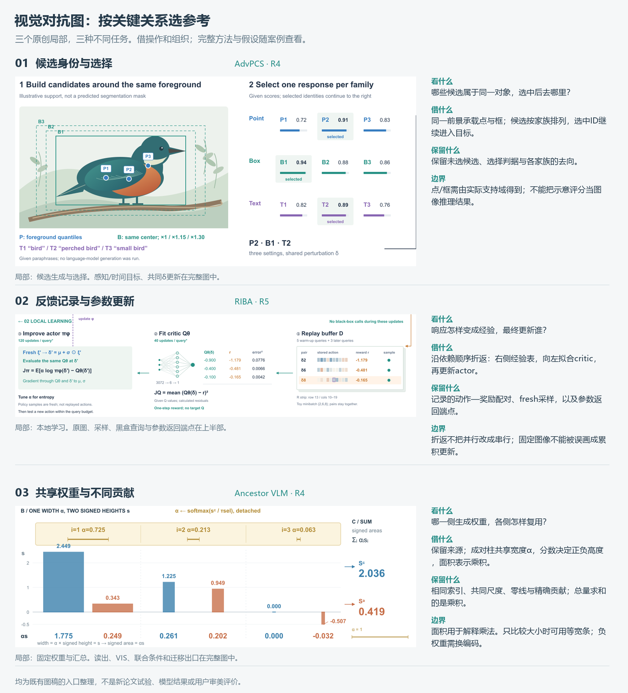

# 视觉对抗：按关键关系选参考

这是一组已有案例的选择入口，不是新机制分类或新的效果验证。先看论文中需要解释的关系，再读对应完整案例；不要只凭“对抗”“视觉”或“共享”匹配参考。

## 候选身份与选择

**问题：** 哪些候选属于同一对象，选中后去哪里？ **可借：** 同一前景承载点与框；候选按家族排列，选中ID继续进入目标。

**条件和边界：** 保留未选候选、选择判据与各家族的去向。 点/框需由实际支持域得到；不能把示意评分当图像推理结果。

> 先确定候选是否共享一个对象或支持域。共享时用同一主体承载候选位置，再按家族对齐判据与选中ID；让ID继续进入真实下游操作。未选候选仍可见。候选几何若与主体无关，不用叠加插画；评分未知时保持符号。

**范围：** 局部：候选生成与选择。感知/时间目标、共同δ更新在完整图中。 [完整案例：AdvPCS · R4](cases/advpcs.md)。

## 反馈记录与参数更新

**问题：** 响应怎样变成经验，最终更新谁？ **可借：** 沿依赖顺序折返：右侧经验表，向左拟合critic，再更新actor。

**条件和边界：** 记录的动作—奖励配对、fresh采样，以及参数返回端点。 折返不把并行改成串行；固定图像不能被误画成累积更新。

> 先标出外部响应与本地可微学习的边界，再沿真实依赖排列记录、拟合、采样与参数更新。长回线来自节点位置时，比较折返布局与同名端口；更新箭头终止于实际参数。保留记录配对，区分重放动作与新策略样本，不把固定输入误画成状态累积。

**范围：** 局部：本地学习。原图、采样、黑盒查询与参数返回端点在上半部。 [完整案例：RIBA · R5](cases/riba.md)。

**相近但不同的反馈：** [SRIM](cases/srim.md)记录每个尺度的偏差历史，并据此随机抽样；一个观测分别更新历史槽和共享扰动。借用其首次赋值、单槽写入和下一步读取的表达，不套用RIBA的actor/critic或把抽样改成排名必选。

## 共享权重与不同贡献

**问题：** 哪一侧生成权重，各侧怎样复用？ **可借：** 保留来源；成对柱共享宽度α，分数决定正负高度，面积表示乘积。

**条件和边界：** 相同索引、共同尺度、零线与精确贡献；总量求和的是乘积。 面积用于解释乘法。只比较大小时可用等宽条；负权重需换编码。

> 先确认权重由哪一侧生成、是否跨侧固定复用，以及乘在哪个量上。用同索引组织不同操作数和结果；非负权重乘有符号分数可用同尺度宽度×高度解释，面积和精确数字并存。只比较最终值时优先等宽条或数表，不能为对称而重算权重。

**范围：** 局部：固定权重与汇总。读出、VIS、联合条件和迁移出口在完整图中。 [完整案例：Ancestor VLM · R4](cases/ancestor-vla.md)。

## 组合与跳出

候选选择和共享加权可能同时存在，但选择集合、权重生成、作用对象分别对应真实运算。RIBA的固定输入、AdvPCS的共享扰动和Ancestor VLM的固定权重属于不同共享关系，不能互换图示。没有匹配机制时，回到[机制提炼](figure-planning.md)，不要求从这三项选一项。

三张裁图取自当前PNG，未重画内容。只保留局部所需范围；截取位置和缩放不改变数据。这里只整理可借动作，没有新论文生成试验或用户阅读测试。

## 实际试用：RILA

[RILA新图](cases/rila.md)仅借反馈边界提示，未套用actor/critic或固定权重。按实际输入将在线灯光向量递推、物理捕获、两帧估计和事件时间分开。这说明入口可以帮助明确借用边界，也暴露三张参考不能覆盖所有主机制；单次试画与自我修订不证明审美改善。
