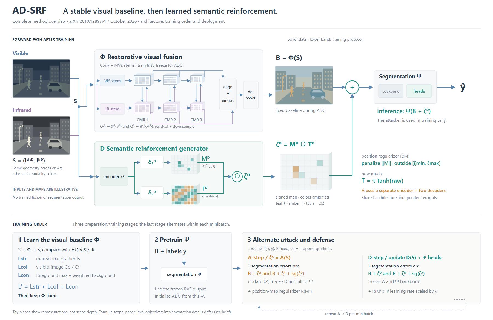

# AD-SRF：完整架构与训练协议分开组织

[论文v1](https://arxiv.org/html/2610.12897v1)，2026-10-09；实际查看Fig.2/PDFp3，阅读§II-B–C、Algorithm 1和§III-A。核对[作者固定提交5fa242d](https://github.com/HaoZhang1018/AD-SRF/tree/5fa242ded03d6e19c783076fa5c7ef2b8723f1e3)的生成器、交替训练与测试代码。未核实期刊录用。

## 从局部案例回到全局覆盖

此前SIGN与Detect and Suppress展开局部关系，不能据此证明skill会画完整方法。此例保留RVF、CMR三级交互、金字塔聚合、视觉训练约束、分割预训练、A/D双分支生成、交替更新和最终推理出口。每个组件的内部详略不同，但训练中存在的组件没有因不在推理路径中就被删掉。

两个有效候选是“推理主干+下方训练协议”和“按训练阶段重复完整网络”。共同内容相同，前者减少重复输入/网络，后者更便于按时间逐段阅读。本图选择前者：上方固定位于部署时仍保留的网络，底部按Φ/D/Ψ名称说明它们如何学得。攻击器A在训练带中明确为独立生成函数，不放进推理主干。

## 三维留给表示，更新状态留给二维

三对浅特征面表示CMR层级，两模态双向检索；每级输出都进入对齐拼接，不只取最后一级。生成器位置图、强度图和逐元素乘积用浅层网格表示。连续位置值与有符号强度区别可见，厚度不表示真实场景深度。

更新对象不通过物体旋转或高度表示。训练带明确：先训练Φ，再用B和y预训练Ψ，最后交替A步、D步。A步冻结D与全部Ψ；D步冻结A与Ψ backbone，只适配Ψ的heads/decoder。B在ADG保持不变，推理为Ψ(B+ζD)。对方图以sg标停止梯度；两步各保留单方与双方叠加的两个损失输入。

## 依据决定图意

正文两个概念阶段不等于仅有两个训练步骤；§III-A和README明确还有分割预训练。代码中A/D分别实例化，所以共享的是架构形式，不是两者权重。位置图为连续[0,1]，不画成硬mask；L1区间通过惩罚约束，不将所有训练输出画成已经严格满足。

代码还含联合扰动项0.5系数及额外正则；图按论文级目标和Algorithm 1概括，不把两套表达混称精确实现。街景与模态配色是原创示意，未运行融合或分割；只计算给定6×8 M与τtanh(raw)的乘积，τ=.02为示例。

## 实际修订与剩余取舍

R1看图后输入说明碰到支路，R2拆行；补清soft[0,1]、攻防损失标签y和A的参数更新，避免只有目标方向却不知依据。两稿均实际看图，无模型、攻击、导出或格式检查。

全图完整性使高度达到1170，训练带仍偏文字，需要按名称对应上方架构。它是完整总览的可用选择，不是所有论文都应采用的固定上下两栏。尚无用户审美反馈。可迁移的是区分“数据怎样流”和“参数何时更新”，让完整性先于局部绘图便利，而非把复杂框架简化成最容易画的算子。

## 训练状态表：同一参数跨阶段对齐

R3/R4保留R2整个上方架构、给定数值与训练目标。下方比较两个成立的组织：R2每阶段独立卡片，便于顺序阅读；R4阶段作列、参数组作行，便于横向查同一参数在何时更新。视觉训练仍保留三个损失来源，A/D各自的两个输入组合与位置正则仍可见。文字压缩并使用FG/BG缩写，图注保留展开；不是同字体字号下的排版实验，也没有减少画布高度。

表中用有色点及update表示更新、锁及fixed表示参数固定、横线表示该阶段未使用。预训练Ψ合并backbone和heads两格，标network-level，因为§III-A没有逐子模块说明其预训练状态，不能擅自补成明确的逐行优化协议。后续A/D两步则有论文算法与代码证据支持分行表达。

R3实际看图后，底部解释将“Φ冻结”与“Ψ截断”混成一句；R4改为冻结的Ψ仍向活动生成器传递梯度，而对手图由sg截断。参数更新表不能替代完整反向图，锁不应画在数据连线上。两稿实际查看，R4固定行可横向追踪；尚未测阅读速度或获得审美反馈。

新增代价是五行状态表和图例，表格小字在缩图中仍需放大。普通一次训练不必使用这种组织；当主要问题是交替更新的对应关系时再选用。
