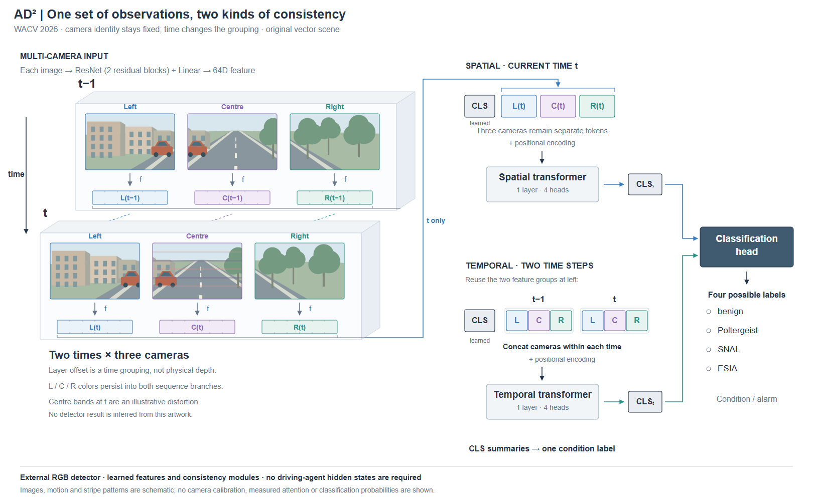

# 案例十：同一观测集合组织成两种序列

**来源：** [AD² v1](https://arxiv.org/html/2602.10160v1)，WACV 2026，§3.2.2–3.2.3，Fig.4 / PDF p5。

**要保留的区别：** 三摄像头的六张图像覆盖两个时刻。空间支路把当前时刻的三个相机特征分别作为序列元素；时间支路先在每个时刻拼接三个相机特征，再比较两个时刻。两者不是同一个六元素序列改个标题。

这次让两个错位浅层板承载同一观测集合，替换前面较强的三列分区惯性。每板包含三个正视场景图和各自的 64D 特征，保留 L/C/R 身份颜色；时间只由 t−1/t 和层板位移表示。场景为原创矢量道路的重叠取景，前后车辆位置改变，当前 centre 有放大条纹示意。场景没有实际多相机标定，层板也不是三维地图。

右侧三块独立彩色 token 表示空间序列；两个外框各包含 L/C/R 片段，表示时间序列的逐时刻拼接。CLS 是学习的额外 token，两条 transformer 的 CLS 输出分别进入分类头。正文未给出完整投影层、融合算子，不因模块对称就补上同维假设、加法或均值。分类仅列出四种可能标签，不为示意畸变指定识别结果。

首稿两个问题会改变机制理解：当前相机特征的长线接向了 CLS；时间分支的回线跨过 transformer 输出和说明文字。修订将当前三个特征用括号收成分组，再指向真正的相机 token。时间支路通过相同的镜头与时间标识明确复用两组特征，移除交叉的长回线，并标明 CLS 为 learned。代价是读时间支路时需按身份标签对应左侧，不能把减少线条当作无条件更优。

迁移到视频、传感器融合或时间序列时，先说明每个序列元素包含哪些索引，哪些索引保留为序列轴，哪些已在元素内部拼接；再决定浅层板与 token 外框。摄影图像可以保持正视可读，局部空间厚度只负责分组。

**固定内容的紧凑修订：** R2 仍有较大空白与长空间输入线。R3/R4 保持全部六张场景各 178×112、相同的特征与分类机制，只交换两条支路的上下位置，让当前帧靠近空间序列，分类头置于两个输出之间，并收起重复说明。画布高度由 1000 降为 720；这不是实际投稿尺寸指标。R4 把每个时刻的三个独立彩色小块改为一个连续三色拼接条，避免外框虽标两个时刻、内部却像六个独立 token 的歧义。紧凑图及对比取舍见 [视觉指南](../design-guide.md#多视角与时间层板和序列外框承担不同关系)。
