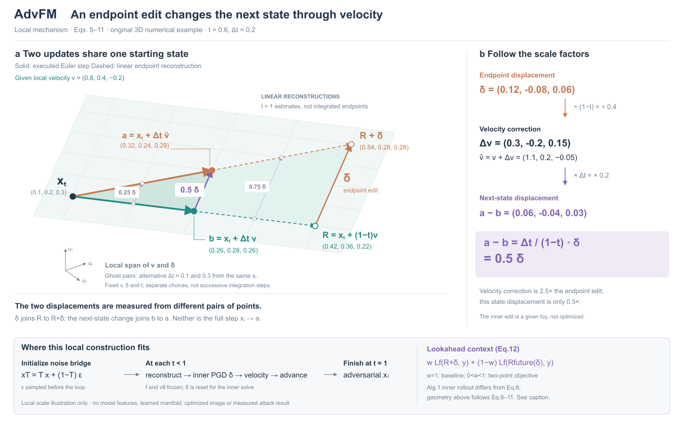

# AdvFM：先确定每支箭头的两端

[CVPR 2026论文](https://openaccess.thecvf.com/content/CVPR2026/papers/Liu_AdvFM_Lookahead_Flow-Matching_Velocity-Field_Attacks_for_Imperceptible_and_Transferable_Adversarial_CVPR_2026_paper.pdf)。读§3、Algorithm1、§5.1，实际看PDF p4算法、p7/Fig1；没有查作者实现或运行模型。Fig1为图像结果比较，本稿由公式构造空间关系。

## 从算子选择几何

比较双路时间展开与共享起点的向量扇形，选后者。重建端点编辑δ、速度修正δ/(1−t)、下一状态相对未攻击状态的差Δtδ/(1−t)有不同参照对象。空间主图让两条射线共用起点，真正的本步推进为实线，继续到线性重建端点的部分为虚线；两对端点的跨接线分别表示两个差分。平面是向量跨度，不是假想数据流形。

给定三维x=(.1,.2,.3)、v=(.8,.4,−.2)、δ=(.12,−.08,.06)，t=.6，Δt=.2。实际代数给出Δv=2.5δ，状态差=.5δ。这里不沿用“amplification”的文字直接把下一状态箭头放大。R2新增独立Δt=.1/.3的淡色参考，固定同一x、t、v、δ，分别得到.25δ/.75δ；不是积分后重新求场的连续轨迹。低维例不代表模型特征降维。

## 看图与边界

R1没有显式给v，读者需倒推；R2补v与vhat数值，加入步长对照帮助理解差分的缩放。共同相机使关键跨接方向可分，读数仍正视。没有用额外立方体或曲线填充空白。主图的形状服务一个局部算子，完整方法只作为底部上下文，不能声称完整lookahead复现。

Eq8与Algorithm1行8的内循环速度表达不同，行15又回到包含基准v的式子。图随Eq5–11，lookahead只展示两点目标并记录分歧。初始化按算法在循环前采噪；t=1作为终点，不进行分母为零的更新。

这版仍偏几何教学图，缺少模型级的丰富对象；不能用它证明任意论文都已达到用户期望的视觉效果。可借用的是共同参照系、不同状态对的差分和执行/估计分工。
