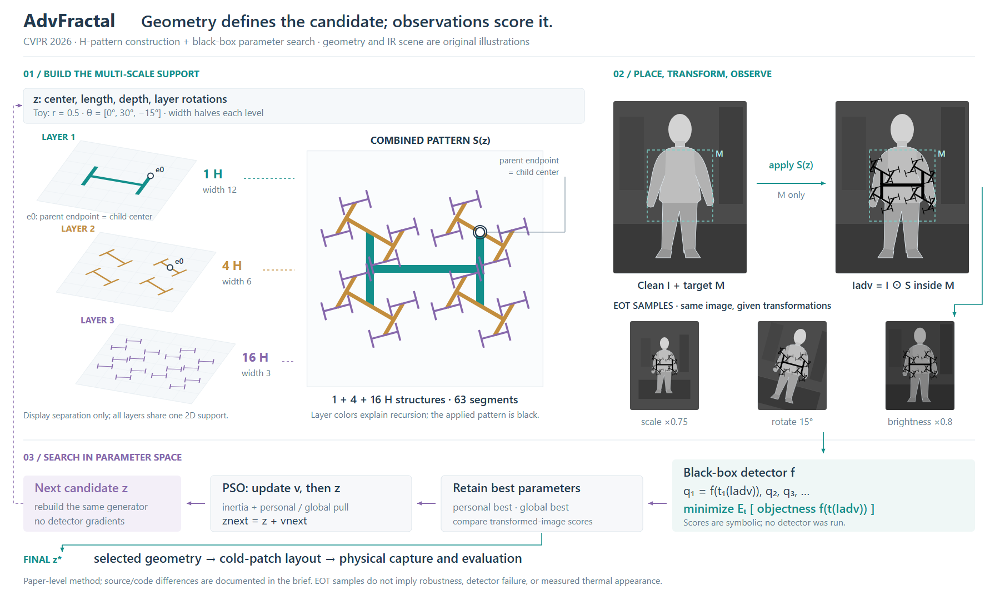
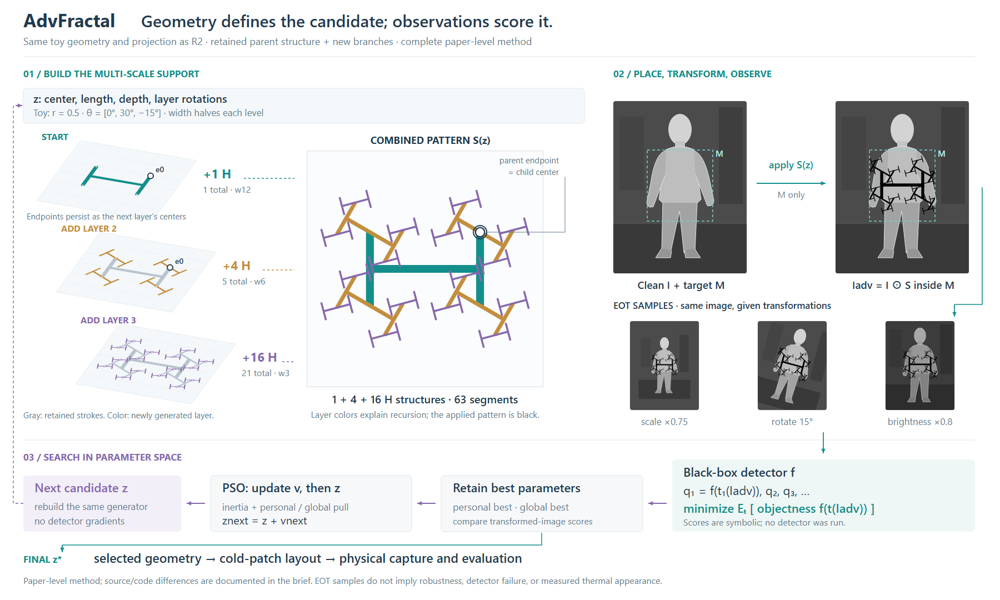
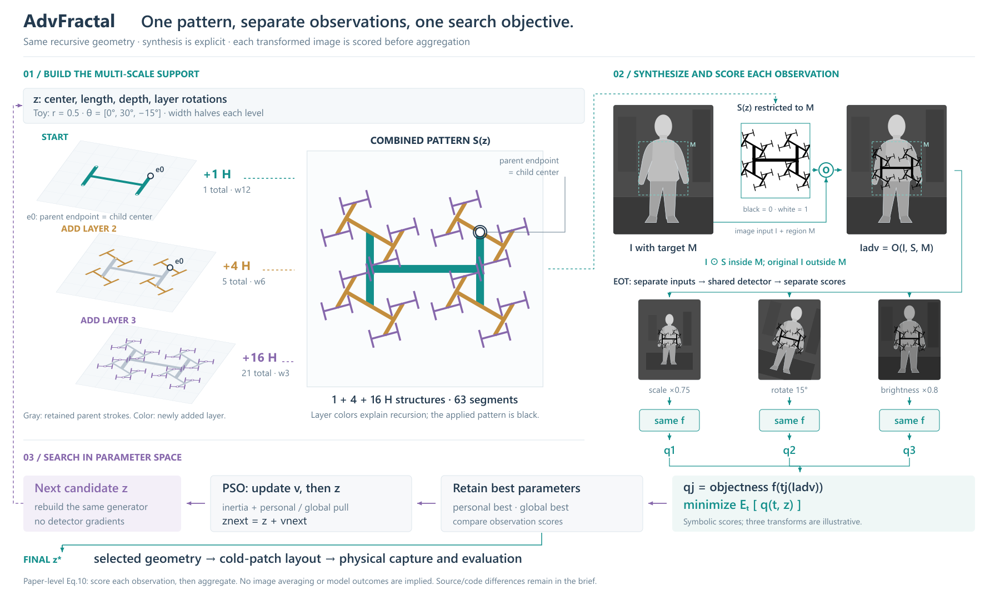

# AdvFractal：让递归对象承担主视觉

[论文](https://openaccess.thecvf.com/content/CVPR2026/html/Hu_Fractal_Camouflage_A_Bio-Inspired_Approach_for_Multi-Scale_Adversarial_Attacks_in_CVPR_2026_paper.html)，CVPR 2026；读§3.1–3.4、Eq.1–13、Algorithm 1，实际查看Fig.2/PDFp3。[所读代码固定提交](https://github.com/wangxinwangxin123/AdvFractal/blob/33a3ca603e2b155c7a16e7d3c95ce1f0f693b413/Advfractal_attack.py)。

## 新提示怎样落到画法

画前用主张、证据、主体、组织、图内/图注和范围写短brief。主张是“几何参数生成多尺度图案，观察后的检测评分选择参数”；因此主视觉给递归层与正视合成，人物只承担位置语境，PSO放到评分返回的路径中。另一成立方案是粒子群居中、几何作旁证，本例因缺少真实候选评价且更关注构造而未选。

普通流程没有消失：区域融合、EOT、黑盒评分、个体/全局best、速度/位置更新及物理出口都可追踪。与NORP不同，本图不以衣物立体模型为主体；层片的深度只分开构造贡献，不表示贴片真实堆叠。

## 同一几何跨视图

原创三层H例含1/4/16个H，长度比.5、线宽12/6/3、累计角度0°/30°/−15°。同一段集合分别画层贡献、彩色合成与黑色图案，父端点e0在下一层成为子中心。人物与热强度是原创示意；M内才应用黑线，模型评分保持符号。变换缩略图展示给定缩放/旋转/亮度，无攻击成功结果。

论文与公开代码不完全一致：代码angle decode只有两个角度、第三层缺省0；未见M裁切/EOT，置信度对所有返回框求均值。长度比例在正文、表注和代码也不同。本图按论文总览，几何参数明确为示意，不声称复现作者实现。

## 看图后修什么

R1主视觉已是分形，但手写对应引线没有落在真实父/子点，缩略图压扁了人物，最终出口线未接回z*。R2改为计算后的同名e0标记、保持源场景比例、接通best到最终参数；黑线使用0值以符合示意乘法。两稿均实际查看。

本例落实了新brief，但没有与旧提示做受控生成对照，不能归因其质量优于旧提示。剩余是几何到图像依靠S(z)名称对应，EOT区域占面积且缩略图较小；用户审美尚未反馈。只把这次设计和修订证据写回，不增加所有论文必须递归展开的新规则。

## 累积构造：保留父结构，突出新增层（R3）

本轮的阅读任务是“下一层从哪里产生”。两种成立组织分别是R2的独立层贡献和R3的累积状态；前者隔离每层，后者保留父结构。选择R3作补充，而非宣称替换旧图。

所有角度、长度、线宽、63段、仿射投影、面片位置、完整合成、IR场景、EOT和搜索/出口保持。只在左侧各面保留此前所有笔画为灰色，当前层保留原身份色；第一面圈出根端点，后两面圈出新层中心。新增H数为1/4/16，累计为1/5/21，不能混作优化迭代次数或材料层数。没有重新放置子分支以改善排布。

R3实际看图：第二层的四个子中心落在保留的父H端点上，第三层也可沿灰色父结构找到新增紫色分支；代价是细层线条更密。旧版用于隔离层贡献，累积版用于追生成来源。当前对照没有改变投影，不证明3D比2D更有用，也没有读者实验或用户审美结论。无需为制造差异继续修改数据或增加新对象。

## R4/R5：融合输入与逐观察评分

将SmuDPatch的“局部入口/操作/出口”提示迁移到本例。旧图已完整，新图只展开影响判读的连接：从原63段以原.44比例进入M的图案实际裁出窗口，I与S作为O的两个输入；每张变换图各自经过同一个f得到符号qj，之后再形成期望评分。PSO更新、best和物理出口均保留。相比中央共用检测器框，按观察分列更便于看到调用次数，代价是重复f框与更小图像。

重新读本地固定正文Eq8–13：Eq9写图像期望，Eq10是检测后objectness的期望。本稿明确随Eq10，不把平均图像送入模型。三个变换仍是原给定示例，不暗示完整分布、采样数或等权重。

R4/R5实际查看。R4把I、S、结果排成一行并串箭头，容易被读作I生成S；R5让I和S分别进入O。累积层、彩色合成、全63段和投影不变。主要图像240×310缩到180×232.5，EOT124×160缩到112×144.67；腾出实际操作与评分支路。无新模型输出或优化，完整方法可追踪的改进不等于视觉效果已被认可。

这次迁移支持在画图时检查“中间对象的真实输入与输出”，而不支持强制所有模型调用都展开。只展开会影响机制理解的连接；旧稿用于更大的观察图，新稿用于追踪评分。
