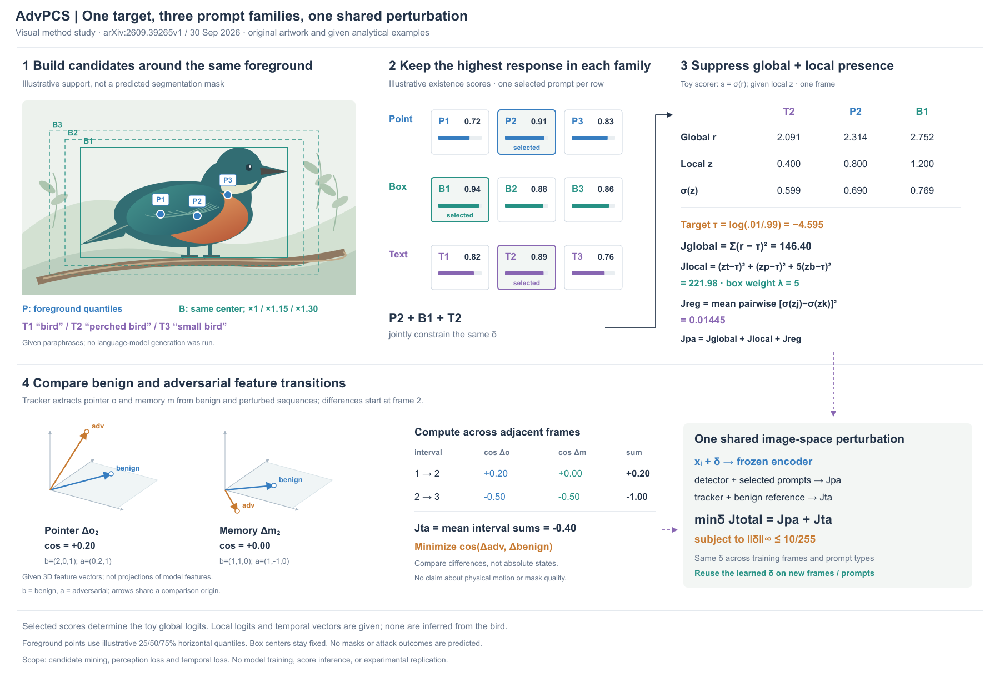
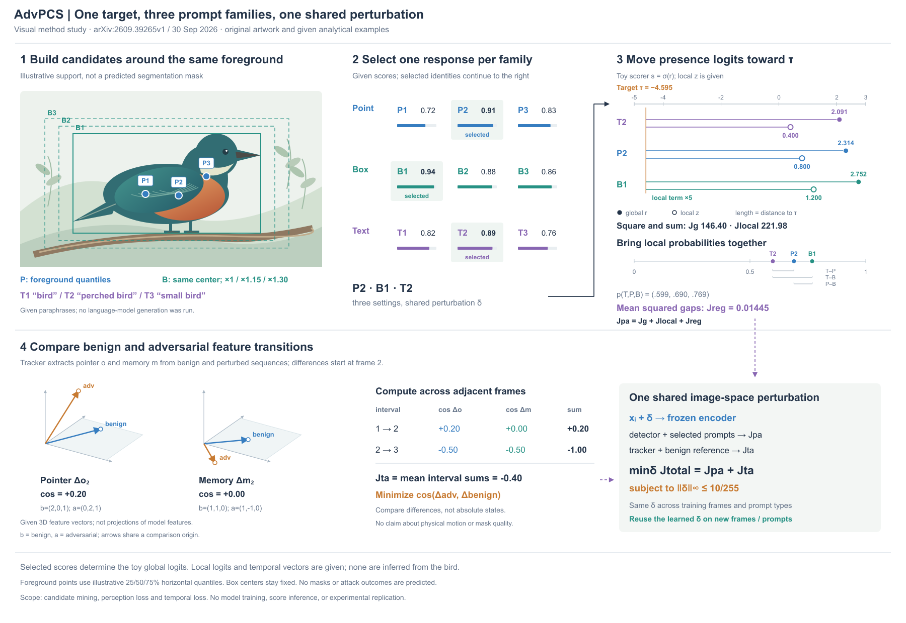

# AdvPCS：同一前景上的三类提示

[Universal Cross-Prompt Adversarial Attacks on Promptable Concept Segmentation](https://arxiv.org/html/2609.39265v1)，2026-09-30预印本。读§3、Eq2–9、§4.1，实际看PDF p6/Fig3。图3按memory、prompt mining、detector三行组织，右侧展示真实分割结果；轨迹图为状态随时间的概念示意。新稿从候选几何和确切运算出发，不复制实验结果。

## 构图决定

比较三个提示家族各画一张对象图，与同一主体叠加点/框、文本放外侧，再按候选行对齐评分。选择后者，保持前景身份，避免三张复制图挤占主体。鸟的喙、眼、颈环、翼羽、尾、腿与枝条提供辨识度；背景降低对比。点与框的空间位置直接来自这一前景，不只画几个与对象无关的提示图标。

主视觉为具体对象及其候选几何。右侧按选中ID读全局/局部数值；底部以独立三维小例解释相邻特征差的方向，两项回到共享δ优化。三维用于算子允许的低维方向例，不把特征指针误画为鸟的物理位置。没有鸟运动帧、预测掩码或优化后场景。

## 从论文到图面

每类挑最高响应候选，三类条件的损失共同约束一个UAP；并非把提示本身相加。感知项含全局logit目标、带box权重的局部logit目标和sigmoid概率间一致性。时间项比较adv与benign的相邻pointer/memory差，而不是只比较adv相邻绝对特征，也不是直接推远两个绝对状态。

正文对min-max内外阶段的描述有歧义，图采用明确的候选响应选择和δ最小化关系。公开代码链接https://github.com/alphanull-cqu/AdvPCS访问返回404，未验证实现中的score聚合、精确quantile或优化器；不擅自补Adam等细节。论文τ=log(.01/.99)、λ=5、ε=10/255用于算例和形式约束。

## 原创几何与算术

鸟前景由同组椭圆、多边形和矩形定义；栖枝、阴影与背景不属于support。采样该支持域，取横向25/50/75%分位的x，再在相应列取前景y中位数。这是明示的绘图选择，不声称作者采用该精确算法。默认框取前景极值，再保持中心把宽高分别乘1.15、1.30。文本T1/T2/T3为给定候选，没有调用LLM。

候选评分P=(.72,.91,.83)，B=(.94,.88,.86)，T=(.82,.89,.76)，选择P2、B1、T2。R2采用明确的toy scalar scorer s=σ(r)，因此全局r按T/P/B顺序为logit(.89/.91/.94)。局部z=(.4,.8,1.2)另行给定，得Jglobal≈146.40、Jlocal≈221.98、Jreg≈.01445。这些不是鸟图推理结果；toy scorer不是已验证的作者score实现。

时间小例用三帧给定向量：oB=[(0,0,0),(2,0,1),(3,1,1)]，oA=[(0,0,0),(0,2,1),(-1,2,2)]；mB=[(0,0,0),(1,1,0),(2,1,1)]，mA=[(0,0,0),(1,-1,0),(1,-2,-1)]。两interval的pointer cosine为.2/−.5，memory为0/−.5，均值Jta=−.4。空间只画第一interval，正视表计入两interval。感知N=1和时间N=3是独立解释小例，不计算一个共同Jtotal数值。

## 看图后的修改

R1点编号在翼羽上对比不足；R2加白底小标签，文本候选补T1–T3。R1全局logit与选中score是独立给定值；R2改为上述显式toy映射，让ID与算术可追踪，故不是纯布局对照。补Jpa三项相加、几何向量数值，移除过长的物理运动否定式标题。两版均实际查看。

仍有问题：主图是柔和轮廓插画，层次主要来自着色与遮挡；透明体素没有适用对象，不为满足形式而添加。下方几何和右侧数值占比较大，全局模型路径只以紧凑总览承接。该试验拓展了主体类型，但不能证明审美质量已经满足用户要求。后续若修改，应重点比较对象与运算的面积分配，而非继续加通用文字规则。

未运行模型、攻击、训练或导出/格式检查。

## 共用刻度：把感知目标变成可见距离

R2感知区主要是logit表和公式。比较保留表格并缩短表达，与在共用标尺上画出对象到目标的距离，R3/R4选择后者。读取现有JSON，不重新生成数据；鸟形、点/框、分数、全部logit、概率、特征和1800×1240画布保持。下半部时间分析保持。

logit标尺为−5到3，τ=−4.595画为共同竖线，实心r与空心z用同一水平标尺。每行上下错开只为区分两组值，没有纵轴数值意义。线长是未平方距离；平方求和及box local×5另行写明，不能把线长当最终损失。下部概率另用0–1轴，标三组pairwise gap和Jreg；概率间一致性不把τ作为目标，也不等同于降低概率本身。

候选区去掉重复外框，保留选中背景和ID；没有删除候选。R3回看发现三组gap缺配对标签、Jpa汇总不明显，R4补T–P/T–B/P–B及三项和。两版实际查看。右侧现在可从距离看出比较对象，但密集端点仍需要读数，概率差较短且精确值仍依赖数字。未展示优化后的值，也不声称这些目标已经收敛。

可借用的是“把公式中的距离与对应对象画在一起”，前提是同一度量、尺度和目标可定义。logit、概率、平方项和加权总量各有不同语义，不能为图面统一混到一条轴上。本例是同数据换表示，没有新模型实验或用户审美反馈。
