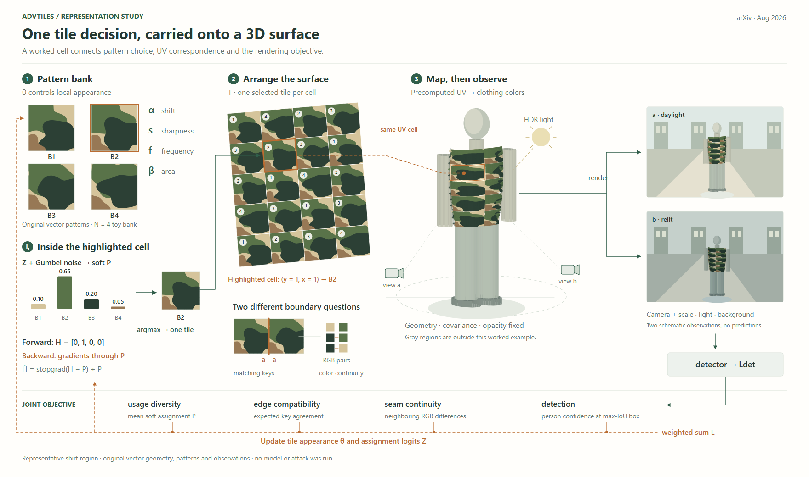
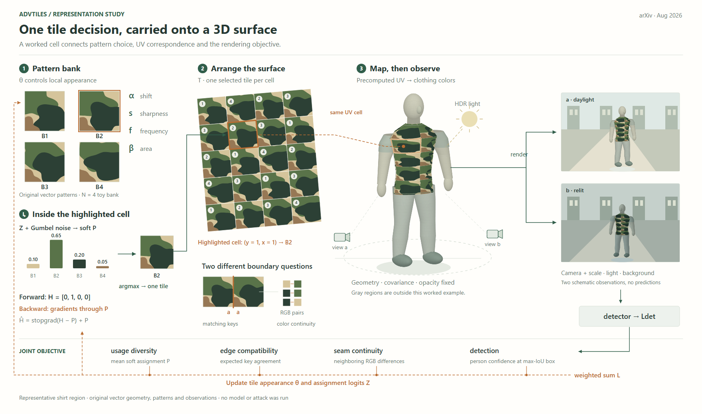

# AdvTiles：把同一纹理从二维选择带到三维表面

[论文v1](https://arxiv.org/html/2608.06801v1)，2026-08-07预印本；实际查看PDF第3页Fig.2、第4页Fig.3，阅读Methodology与Eq.1–11。未确认会议归属。

## 构图决定

比较“选择张量主导”与“衣物曲面主导”，选择后者。四块原创纹理与一个4×5铺面连接到人体上衣曲面，突出(y=1,x=1)的B2。局部区域解释选择和接缝，观测图像从人体向右展开；大容器退为短标题。

这是一张代表性区域机制图，不是全身制造或完整实验流程。裤装UV、76块素材库、IC-Light背景生成压缩到图注，不能将局部稿称为完整方法复现。

## 图形必须守住的对应

- 素材库、铺面、曲面复用同一块的局部图案与UV坐标。投影改变外形，不能重新生成装饰纹理冒充对应。
- 该格示意P=(.10,.65,.20,.05)，H只选B2。前向是硬选择，反向通过P；软选择不是半透明混合衣物，也不是一部分格子尚未填满。
- 相接标签相同是兼容关系；接缝颜色仍可能不同。局部B2/B3例子把两者并排显示，不能合并成一个“平滑”模块。
- 物理身体、UV平面、选择概率不是三个等价空间。场景深度用于物理形体，铺面的斜置只用于展示，概率保持正视。

## 实际修订

R1的渲染箭头从空处出发；四项损失只列标题，没有连接到总目标。R2把渲染入口接到人体边缘，四项共同汇合；突出素材库B2，并让第二个场景显示不同尺寸与颜色调制。已实际查看R1/R2。

两场景复用解析曲面及纹理，调光使用固定RGB系数，并非真实HDR或3DGS结果。没有运行模型、优化或攻击，也没有虚构检测框与性能。完整caption随试画提供。

## 收益与局限

收益：曲面是可追踪内容的实际载体，二维选择与三维物体之间有确定联系，避免用立体方块代替机制。相同纹理同时承担身份与外观，减少额外图例。

R2的局限：人体仍过于圆柱化，纹理块之间差异偏小，整体仍有从左到右的阶段倾向。不同颜色虽标明功能，梯度与对应都用暖色虚线，依赖端点和文字区分。新稿提供了表示迁移的证据，不能据此宣称审美已经满足用户要求。

可借用的提示：选一个局部位置，明确它在参数/平面/表面各自如何表示，让同一内容穿过映射。再决定展开哪些计算；不要仅把纹理贴到任意三维模型上。

## 固定内容后的形体修订：R3

R3保持四块纹理、4×5铺面、突出格、概率、损失和布局，只替换承载对象。肩部由窄领口向外展开，腰线内收；灰色袖口、四肢、手和分开的脚构成简化人体。主体和两幅观测复用这套形体，不另画随机纹理。此变化是设计改稿，不是几何训练或优化前后。

实际看第一稿发现灰色面的光照法向朝内，曲面底色仍由四角直边覆盖。修正为朝外的法向，并让底色沿实际投影边界填充；再查看成稿。曲面上的图案仍复用原始局部坐标，形体使用原创解析曲面，没有人体扫描或3DGS。

形体修订让肩、腰、腿部区别可见，没有新增图中文字、模块或画布面积。剩余代价：肩部转折仍偏折面，袖子未展开，纹理横向重复明显，暖色对应线与梯度线仍需依赖端点区分。没有用户审美反馈。

可借用的提示：对象已经承载具体机制但看起来过于原始时，固定数据和构图，先修改其有辨识度的轮廓与部件比例；沿同一坐标重新映射内容，再处理少量明暗。避免把造型修订画成方法改变了对象几何。
