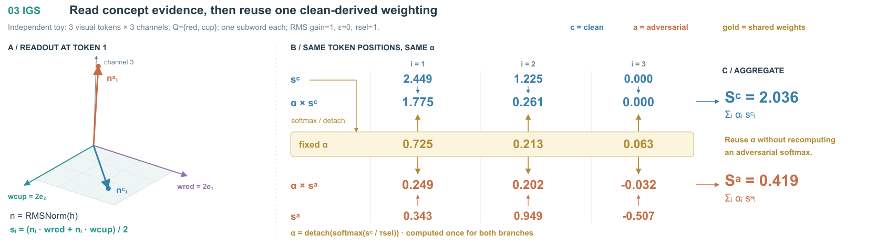
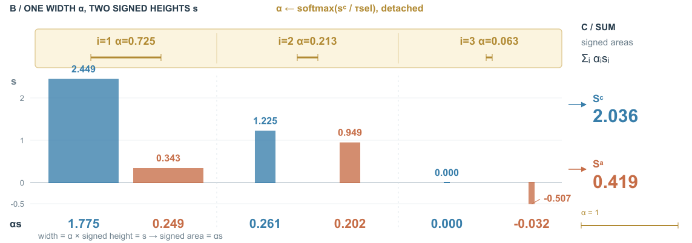

# Ancestor VLM：共享权重如何成为主视觉

## 依据与范围

[Black-Box Adversarial Patch Attacks on VLAs via Ancestor VLM Exploitation](https://arxiv.org/html/2610.09708v1)，arXiv:2610.09708v1，2026-10-07。读取§3–4、Eq.1–7、附录B与Algorithm 2；实际查看PDF p3/Fig.1。未读取作者实现、未运行网络。

原Fig.1通过公共资源、贴片、相机画面、目标与失败画面组织威胁模型，场景主体清楚，但内部目标函数未展开。借用的是“可访问部分与部署目标分开”的关系；这里重画原创双杯桌面，不借用其机器人照片或失败结果。全文证据中，VIS取projector后状态，IGS取中间image states经最终RMSNorm与语言头读出；指令用于选probe。固定干净权重和条件联合更新是本稿选择展开的两个关系。

这是一张联合方法总览配IGS局部展开。保留VIS和迁移出口；省略离线caption候选、过滤与排序细节。数值例不模拟从桌面图像得到特征，不表示攻击能让机器人失败。

## 构图选择

- 方案A：VIS、IGS、joint各占一等宽栏，各自展开。适合对比三个目标的组成，但会让IGS内部的跨分支共享被两个独立小图割开。
- 方案B：顶层紧凑总览，中间以一次生成的α横带组织两侧计算，底部保留目标与条件。采用B，面积给读出、逐位置贡献和汇总。

普通过程用短路径；二维表负责数值和身份，三维桌面负责场景辨识，三维向量负责一处读出关系。没有额外透明体素，因为这里没有需要体积承载的证据。保留背景空间与特征空间的独立性。

## 原创算例

给定干净三行h为(1,1,0)、(1,0,1)、(0,0,1)，受扰三行h为(.1,.1,1)、(.4,.2,1)、(-.1,-.2,1)。RMS gain=1、epsilon=0；两个probe各一个子词，人工语言头向量是(2,0,0)与(0,2,0)，温度tau_sel=1。先RMS归一化，再平均两个点积。所有量存于同名toy JSON；不将这三个位置等同于桌面三个区域。

所得s_clean≈[2.449,1.225,0]，s_adv≈[.343,.949,-.507]。alpha≈[.725,.213,.063]，精确权重相加为1，显示值有四舍五入。每列保留同一个i，α向上下两侧作用；Sc≈2.036、Sa≈.419。两个IGS项保留符号，未捏造校准分布或损失结果。三维图展示token 1归一化后的两条向量，非优化轨迹；屏幕角度不作实际度量。

## 看图后的修订

R1实际回看：IGS引线穿过说明；n_clean标记距端点较远；门控画为两阶段串行框后接更新，可能误读为gate=false就不更新。R2移开引线、靠近向量端点标注、补clean/adv颜色说明，并给共享权重增加从s_clean来的softmax/detach路径。底部改为阶段条件与β取值对应，再接Ljoint和更新；β=0仍有VIS。

实际查看R2。最主要关系现在可逐列追踪：一条α带连接两组乘法，数字与求和保持正视。剩余问题：图面仍偏公式密集，VIS没有具体数值展开；两个状态中的adv向量接近第三轴，未改变数据来制造分离；top-to-local依靠IGS同名端口，需要一次查找。图示的更新回路是概括，未逐项画EOT内部所有重复。没有用户审美反馈，不声称此版已经满足审美要求。

## 可迁移的提示与边界

> 权重由一侧计算、对多侧复用时，让它成为独立的共享对象，交代从哪一侧生成，再对齐各受体的索引与真实乘法。每侧保留不同操作数与结果；不要为构图对称而各算一份权重。完整控制条件决定是否更新哪一项时，以条件值进入目标式来表达，避免一条串行箭头错误地关停整个更新。

此例只支持这两类关系的表达。不同方法若确实每侧重算权重，应另画来源；不能套用共享横带。数值/模型机制准确不等于最终美观，也不能证明可泛化到任意论文。

## R3/R4：用面积展开同一组乘法

比较R2的中央共享权重数表，与同token成对的等宽矩形。前者直接读每一步数字与分配箭头，后者用非负权重决定宽度、正负分数决定相对零线的高度，面积解释乘法。选后者试画；R2保留为精确算术对照。不是重新研究论文或生成新数据。

脚本直接读取R2 SVG与原toy JSON，仅替换中央区域，场景、三维向量、所有数值、上下文、目标和画布不变。每个token的clean/adv两根柱都用160×alpha宽度、70×abs(s)高度，符号由零线两侧表达。各柱带符号面积/11200=alpha*s；总分求和的是乘积而非柱高。所有对象共用尺度，未独立缩放小权重来填满空间。

R3实际看图：负原始分数与底行乘积距离较近；权重生成来源被移进图注，省略过度。R4将负分数靠柱端侧面标注，图面恢复alpha来源、detach与带权求和表达。两个版本均实际查看。R4与R2的内容和数据相同，变化是表示及文字分工，不能称纯位置移动。

效果与代价：共同零线让第三个token的负贡献可见，同宽成对柱让“复用同一权重”形成形状关系；小权重对应真实窄柱。读者仍须按数字比较精确乘积，面积并不比同尺度长度更适合精确估计。上方金色宽度条与下方柱有一次对应查找，alpha来源由公式而非完整箭头展开。原三维读出和底部公式保持，因此不是整张图减少公式的证明，也没有用户审美反馈。

可迁移：确实要解释“非负权重×有符号数值”时，可试宽度×高度，给统一零线和两个尺度，保留小量的精确读数；正负两侧的面积不能混作概率。若任务只是比较最终值，普通等宽条形或数表可能更直接。权重含负值时不能直接套用非负宽度编码。减少图面公式时也要保留决定方法身份的来源和运算。
