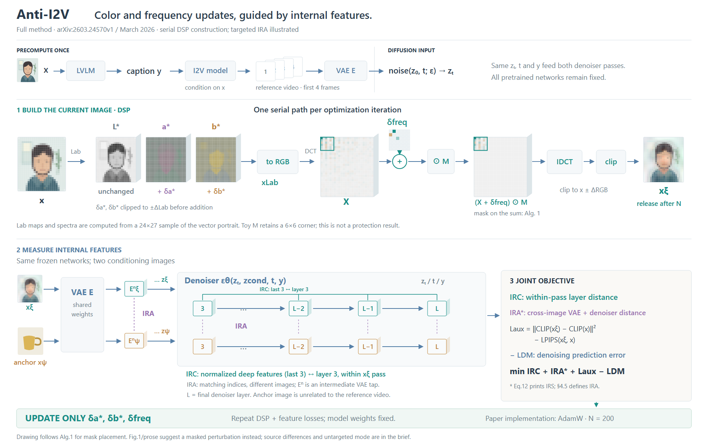
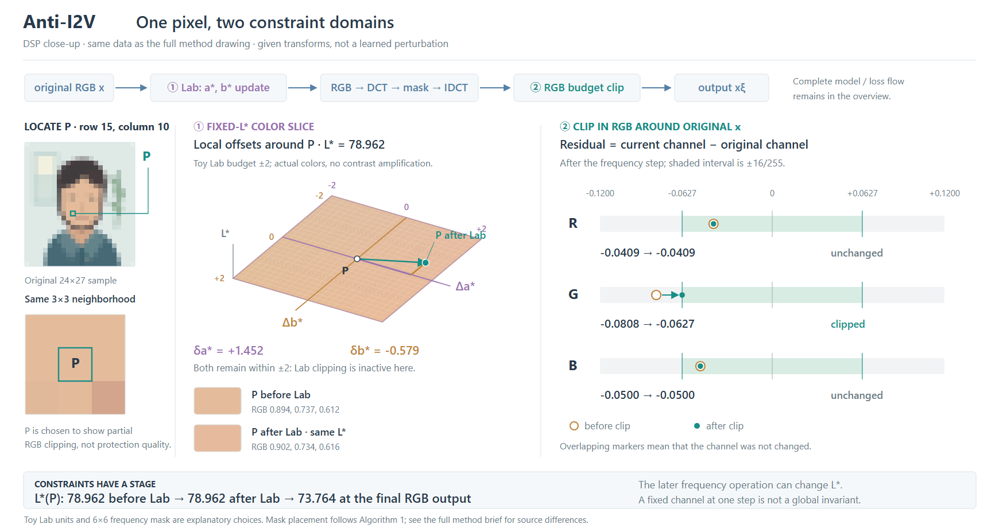

# Anti-I2V：跨域处理串行，特征比较分轴

[论文v1](https://arxiv.org/html/2603.24570v1)，2026-03-25；实际看Fig.1/PDFp4、Algorithm 1/PDFp5，读方法与附录实现细节。图以v1为依据，未核实作者代码。

## 完整流程决定主次

保留reference-video准备、Lab→RGB→DCT→IDCT的串行构造、RGB裁剪、VAE/denoiser两种输入、IRC/IRA、辅助项与denoising项、三个扰动更新及发布出口。预计算的reference video与targeted IRA的unrelated anchor明确分开。

两种候选是“横向DSP+condition×layer比较区”和“扰动变量居中、转换与loss围绕”；本图选前者，便于跟踪顺序及比较轴，但图面较高。三维薄片只区别通道/表示，真实变换来自同一原创24×27图像数组；层图保留索引，不用随机热图冒充模型结果。

## 作用范围比模块名称重要

Lab阶段只更新a*/b*，随后还要回RGB再DCT，因此不能画两条独立分支，也不能宣称最终L*必然不变。算法框的M作用于X+δfreq整体；Fig.1/prose更像只遮罩扰动。本图注明按Algorithm 1，不静默修改成更常见的写法。Eq.12的IRS与§4.5的IRA命名不一致，同样脚注说明；辅助损失符号照原式，不按常见习惯反转。

IRC是同一次protected pass内第3层与最后三层的比较；IRA是两次不同conditioning在对应索引的比较，且含VAE与denoiser。因此用行表示conditioning、列表示layer，绿色行内总线与紫色跨行比较各接到真实对象。冻结网络不意味着这些特征都停止梯度；没有依据就不加detach。

## 观察与修订

R1的装饰性δ小格无法代表计算数组，R2改成实际R通道低频窗口；IRC括号原先靠近anchor行，改接到protected行。R3修正通道名碰副标题，并将扩散输入与预计算区域分开。三稿均实际查看，未运行模型、攻击、导出或格式检查。

图面仍较高，色度差异细、特征区仍是符号结构，尚无用户审美反馈。可迁移的是先确定跨域操作顺序、阶段约束和比较对象，再用通道片/频谱/索引承载它们；不能把两个空间或两个loss一律排成对称并行模块。

## 同一像素的约束放大：R5

完整方法R3保留，R5是DSP局部补图。候选为“同一像素的色度坐标＋通道残差”和“全部像素的扰动分布＋超预算区域”；前者适合解释约束怎样生效，后者适合看覆盖范围。本次选前者，不把单点当作总体表现。

复用原24×27数组和全部变换，在恰有一或两个RGB通道被裁剪的像素中选择Lab位移最大的P=(15,10)，坐标从零开始。固定L*的斜置平面显示δa*=+1.452、δb*=−0.579；面片与前后色块保持实际sRGB颜色，仅放大坐标展示，不增强颜色对比。±2是原创示意的常规Lab单位，不冒称作者归一化预算。

右侧三通道共用相对原像素的残差刻度：G由−0.0808裁至−16/255，R/B前后标记重合。最后计算L*为78.962→78.962→73.764，区别Lab阶段固定与最终输出。R4看图后移开轴标签与标题，R5统一δb文字与轴颜色；两稿实际查看。

取舍：坐标能解释肉眼不显著的颜色变化，但单点不能说明整体扰动分布；局部图不代替模型、损失和优化路径。HTML同时保留完整总览。没有修改原数据，没有训练、攻击效果或保护成功的证据。

