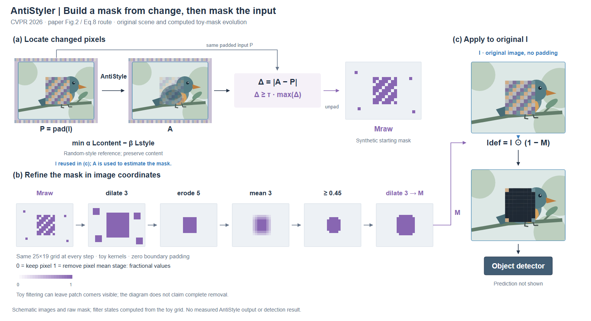

# AntiStyler：掩码估计与掩码应用分开表达

[CVPR 2026 论文](https://openaccess.thecvf.com/content/CVPR2026/html/Yankelev_AntiStyler_Defending_Object_Detection_Models_Against_Adversarial_Patch_Attacks_Using_CVPR_2026_paper.html)，阅读 §4.1–4.4、Eq.5–8，实际查看 Fig.2 / PDF p3。

## 先确定作用对象

论文路线：输入 I 随机填边得到 P，AntiStyle 得到 A；按 |A−P| 的变化阈值生成掩码并去除填边。掩码经过膨胀、腐蚀、平滑、阈值及膨胀后，最终作用于原输入 I，再交给检测器。

这与 [MAC](mac.md) 的逐视图扰动缩放不同：本例控制量是具有空间位置的像素掩码。对应原则仍适用，但需要固定网格，显示每一步区域如何变化。

## 构图决定

比较了等宽模块流水线与“上方估计、下方掩码演化、右侧应用”的分工，选择后者。让过滤过程获得连续横向空间；图像和掩码采用正视二维，同一格点在所有状态中保持位置。没有为立体感倾斜像素面。

初稿只有最终结果图，保留原输入的长绕线终点不明确。R2 在右列直接画原输入、掩码算式、遮挡结果和检测器，使算式的两个操作数有实际对象。代价是重复了一次原图；本例重复有助于区别 I 与 A。

## 示例如何构造

鸟图与 patch 纹理为原创矢量示意；25×19 raw mask 是合成网格，包含带孔区域及孤立点。随后确实计算 dilate3 → erode5 → mean3 → threshold0.45 → dilate3，边界补零。平滑阶段用统一 0–1 标尺，最终掩码按同坐标叠到原图。

这是运算演示，不是 AntiStyle 的模型输出或论文实验参数。过滤后仍可见 patch 边角，图面保留这一结果；没有补画检测框或宣称防御成功。

## 来源冲突会改变图意

[作者 notebook 固定版本](https://github.com/IdanYankelev/AntiStyler/blob/8573ffd31225ba38fd6da61c1db52efc35c0d085/AntiStyler_Demo.ipynb) 用分位数阈值；论文 Eq.8 用最大变化量的比例。代码在存在掩码时以裁去填边的 AntiStyled 图为最终被遮挡对象；论文 Fig.2 使用原输入。图明确采用论文 Fig.2/Eq.8 路线，差异写入 brief，不混成一张所谓实现图。

遇到类似差异，只核对会改变构图的操作和对象，标明采用的来源版本。无需把每次画图变成代码审计。

## 可迁移与局限

区域选择、图像恢复、分割后处理等方法可借用固定坐标的状态演化；中间状态要来自同一个实例。二值掩码与连续权重应使用可区分的图例。

本图较适合解释操作，仍偏教学流程图；局部纹理、视觉重心与正文插图密度尚待用户反馈。没有证据表明更多步骤或更多三维元素会自动改善审美。

## 同内容紧凑变体：从分区说明到连续路径

R3/R4 保留同一鸟图、初始掩码、过滤参数、来源路线与方法组成。原输入放左侧，一条上方复用线直接进入右侧最终算式；中间 P/A 同时进入差异计算，再进入下方连续六状态。原来上下两处重复的 raw mask 合成同一入口。没有靠删除过滤阶段缩减内容。

R3 实际观察到中间图像偏小且周围有空白。R4 把 padded/AntiStyled 图从180宽增到220宽，掩码从116宽增到132宽。相对 R2，主图仍从1560×850变为1560×640，输入/输出为280宽，P/A由200宽增到220宽，但 mask 从150宽降到132宽。这不是所有细节都放大的改进；掩码边缘的辨识是剩余取舍。

较紧凑版本适合已经有正文图注的场合，R2 保留更充分的图内说明。比较时固定显示宽度，分别看原输入复用与局部掩码可读性；不只比较画布面积。图注保留示意边界，未把来源差异隐藏掉。该观察支持局部面积重分配，不支持“越紧凑越好”的通用规则。
