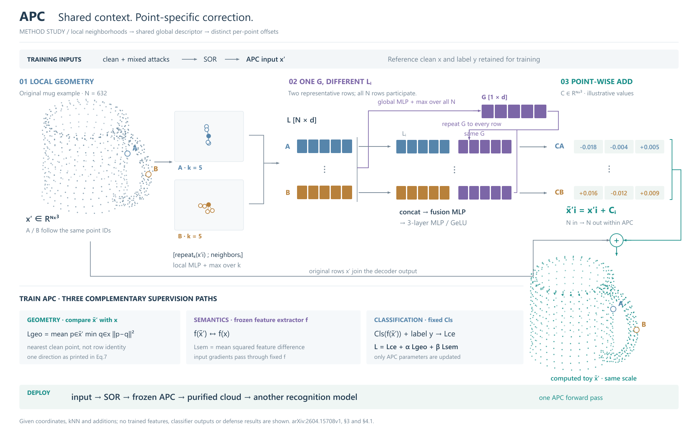
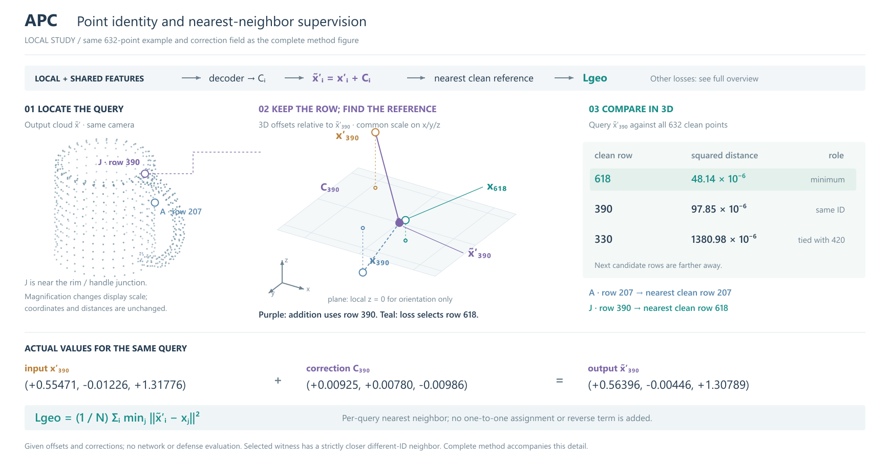

# APC：共享条件不等于共享输出

[APC v1](https://arxiv.org/html/2604.15708v1)，2026-04-17。读取§3.1–3.3、Eq1–9、§4.1，实际查看Fig1/PDFp3。作者链接仓库本轮返回404，采用论文层机制。

## 使用新参考入口的决定

主体选择“看分配”，辅以训练/部署阶段。3D输入本身不是选几何约束模板的充分理由；本例没有Topo-ADV的切平面投影或范数球。FeatureFool可借共享值的一次表示与分配连接，但本例共享的是全局G，不是最终C。两条代表行保留不同局部L_i，同一G重复后，经fusion/decoder产生不同C_i。

另一有效组织是横向输入—APC—输出、下方三个损失，适合总览；本例将行对应设为主体，杯形点云给出真实对象身份和实际kNN邻域，普通训练与部署收成支撑带。代价是部分算子仍以文字概括，特征颜色是身份标记而非测量值。

## 画到操作层

中心坐标沿k重复，与邻居坐标拼接后，经local MLP/max得到N×d的L。global MLP/max使用全部L，不只图中A/B两行；得到1×d的G后沿N重复，再与不同L_i拼接、融合，3层MLP/GeLU输出N×3的C。加法节点有两条真正输入：原x′和C。APC本身保持N，不推断SOR/Drop之后仍等于干净云点数。

训练保留干净样本与混合攻击、SOR、三个目标；f和Cls冻结但输入梯度可通过，只有APC更新。几何目标严格按打印Eq7是净化→干净的单向平方最近邻距离，不添加反向项，也不把点对齐加法与干净参考的最近邻配对混淆。部署冻结APC，接可替换识别模型，一次前向。

## 实际对象与修订

原创杯壁、内外杯沿、管状把手共632点，稳定索引A=207、B=541。输入偏移与修正场为人工确定性函数；k=5包含中心的近邻和逐点加法实际计算，未运行神经网络。L/G/E是符号，C两行的数值只是示意。输入与输出共用相机和尺度。

实际看R1/R2：R1全局聚合线没有连上G，原输入旁路未接明确加法点，输出较小；R2连通G，补加法汇合节点，恢复输入/输出同尺度，把G标签移开连线。训练回线原先穿过语义说明，改用训练区的明确参数状态，避免重复普通流程。

保留局限：杯形点云仍需跨区对应，近邻展示只展开两点；标准算子用短标签而未展开内部权重；没有模型输出或防御效果证据。参考入口帮助明确了借用对象，但这不是新旧提示的受控效果对照。

## 可迁移提示

共享时先命名共享发生在哪一级。共享输入、全局条件、模型参数和最终修正不是同一种关系。只把真正相同的量复制；融合了逐对象信息以后，就按各行输出继续画。用两个实际不同的代表行体现这一点，而不是给复制后的行随意换色。

## R4：同一数据中的点身份与监督配对

R2几何目标仍主要是公式；R3/R4将其单独展开，与完整R2同时提供。读取原有632点数组及C，不改变任何点、输入扰动或修正。对所有输出点计算到全部干净点的平方距离，选择严格异号最近邻的query390：reference618的距离平方约48.14×10⁻⁶，同号390约97.85×10⁻⁶；207仍对应207。不是为了表现差异而改变数据。

左侧同一杯形定位390；中部将所有相关坐标减去输出390、统一放大，显示输入390、修正C390、输出390、干净390与干净618。紫色箭头是保持行身份的加法，青色连线是另行选择的监督配对。平面仅表示局部z=0坐标参考，不是切平面约束。二维距离表明确使用三维欧氏距离，不能靠屏幕投影长短推断最近邻。

实际看R3/R4：移开输入标签和两处密集标签，用引线保留落点；顶部只将最近邻接到Lgeo，语义与分类损失指向完整总览，避免误串成同一计算。原数组中330/420有重复干净坐标，该较远候选的并列在表中注明；所选618严格胜出，不依赖并列时的索引顺序。

**可借用决定：** 同一编号可以表示运算中的对象身份，配对操作则有自己的选择规则。先在真实或既有示意中找能区分两者的实例；三维局部说明位置，正视数值说明选择依据。若缩略几何中的投影相邻，移动标签或加引线，不改数据坐标来拉开距离。

本变体是局部解释，不替代完整方法，也不是新模型实验。主图的投影不能保留所有三维距离，数值表和坐标定义因此仍是必要部分。
