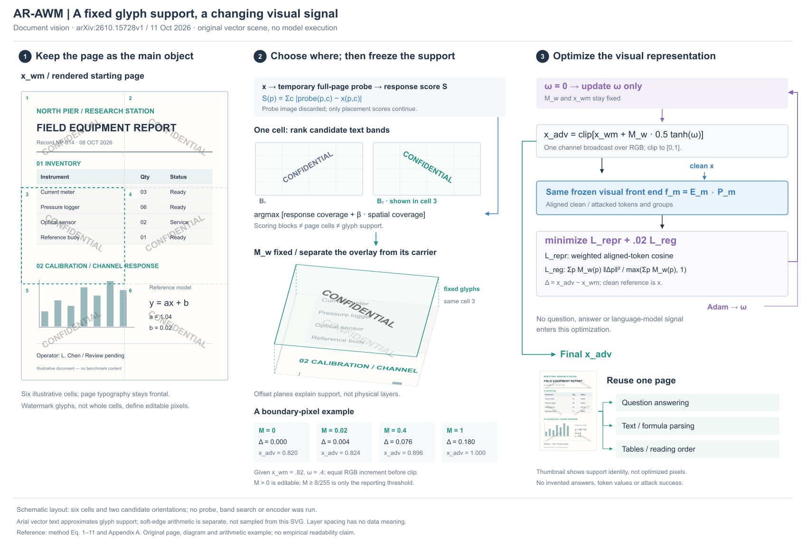
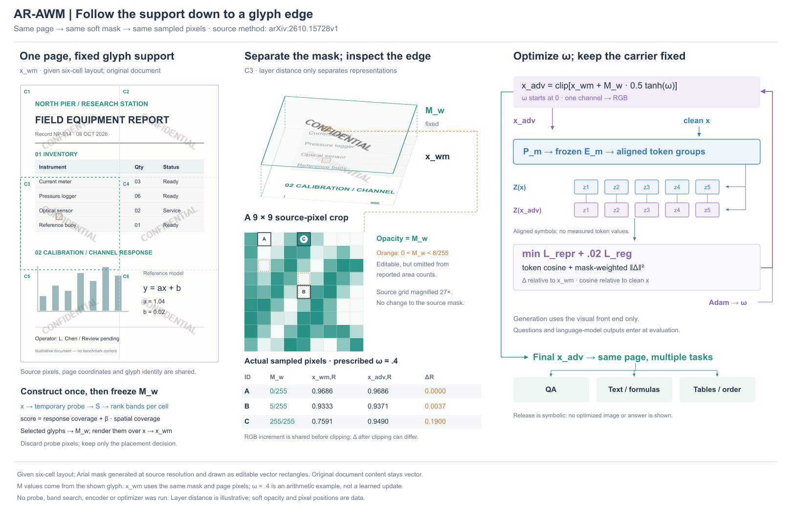

# AR-AWM：页面、区域和笔画分开读

[原论文](https://arxiv.org/html/2610.15728v1)，2026-10-11预印本。读方法Eq1–11、Alg1与附录A；实际看PDF p2/Fig1，p3–4正文。网页Fig1/2链接失败，PDF中实际查看的是Fig1，不声称看到了Fig2。

## 组织决策

比较小文档贯穿流水线与大页面保留正视、局部支持浅层分离。选后一种，让标题、表格、图表和公式使页面可辨识，局部只解释覆盖关系，右边完整优化与复用出口。原Fig1橙色大圆框内多张小页经过冻结编码器、token差异与任务结果，说明有完整全局流；新稿不复制作者失败答案或可读性勾选。

## 方法关系

临时全页probe是位置代理，S来自终点与原图差的RGB绝对值和，不是一次梯度显著图；轨迹丢弃，分数用于布局。页面cell、28像素评分block、候选band和真正文字笔画支持不是同一对象。候选按响应覆盖加β空间覆盖选，每cell一band；之后Mw固定。正文/附录定义soft alpha大于0均可编辑，8/255仅用于报告面积与重叠计数。

初始xwm由原图渲染水印。优化单通道omega，0.5tanh后乘固定Mw再广播RGB，与xwm相加clip[0,1]。干净token参考是x；正则的Δ参考是xwm。这两个参考点不能混同。Adam只更新omega，前端冻结；没有问题、答案或语言模型信号，最终同一页供不同问答/解析任务复用。Qwen一组、InternVL局部组与thumbnail加权，图中概括为aligned groups，具体权重不全展开。

## 本图实际做了什么

原创300×420设备报告，2列3行、交替±30度CONFIDENTIAL是给定布局，并非执行自动网格选择/响应排序。候选只展示两种方向，不代表完整家族。Arial SVG字形是矢量示意，不复刻DejaVu的Pillow光栅mask，未宣称面积7.98%。主视图和浅层C3使用同一SVG子树；空间透视是解释视图，不是原始观察放大。透明支撑面只为分离表示，不代表整面允许更新。

四个独立边界算例固定xwm=.82、omega=.4，Mw取0/.02/.4/1；实际计算clip后Δ约0/.003799/.075990/.18。M=.02>0却低于8/255，M=1处clip到1。例中RGB初始相同；一般RGB不同会在clip后产生不同各通道Δ。未计算probe、band搜索、token或模型输出。发布缩图复用同一支持身份，不是学到的像素。

## 看图修订与代价

实际看R1/R2：probe箭头压候选标题，移到右侧接排序；候选强调色改与C3方向一致，明确只是示例；层片抬高避说明，Adam标签连接更新回路。尝试从C3画长引线穿过其他页内容，去掉，保留同名身份。仍是三块区域，优化侧文字偏多；层片未直接展示软笔画像素，而靠独立算例解释。不把复杂度或病例数当审美进步。无导出/格式检查、模型运行或用户审美反馈。

## 可迁移经验

文字密集的图像先保持正视和真实页面层级，空间只拆开要解释的局部。cell/block/glyph分别是组织、计分和编辑范围，不能用一个矩形代替。区分构造中暂用的状态与最终沿用的对象；辅助探测不能误接为最终图像初值。不要为了连接完整而让长引线覆盖内容，同名局部可以换取页面可读性。

## R4：同一字形的总览、局部和数值

旧R2的给定Mw算例与SVG字形独立，难以解释那些数值属于哪里。本轮比较保持字形仅增加独立局部例，与让源字形本身成为可取样的软掩码；选后者。页面原内容与六分区不动，字形换为Pillow Arial Bold 13px、150×140画布、bicubic旋转的8bit mask，再将非零像素编码为原生SVG矩形。它不是论文的DejaVu/Pillow完整复现，也不等于旧SVG字体的逐像素结果。

同一mask在主页面、C3上下两层和9×9网格中复用。局部在C3选非零且小于8的alpha边缘，并要求附近有较多高alpha像素；为解释边界而选，不按模型响应。页面坐标x54/y195起始的9×9块放大到每格27显示单位，即原像素27倍、相对1.35倍页面显示为20倍。层片改变观察角度，不能叫原视角放大；正视像素网格保留索引和数值。透明度此处编码Mw，不能再整体淡化以表示不重要。

clean页面以300×420渲染取RGB，灰80/255、opacity .32与同一mask求xwm；给定omega=.4求xadv及clip后Δ。表里A/B/C是实际取样：M8分别0、5、255，红通道Δ约0、.003725、.189974。B低于报告阈值8/255但仍编辑。RGB完整数值存toy JSON；没有执行优化或制造模型特征值。五对token仅表示对应，不规定模型token数。最终页为符号出口，不再用未优化缩图暗示最终结果。

实际看R3/R4：左标题与中标题相挤，R4缩短；局部引线原来终止在空处，移到网格角；补编码器到两个token组以及发布到任务的连接。没有用美观评分代替观察。右侧仍有公式，但长正则归一化表达移入原brief/图注。构造流收在页下，两个候选缩图省略，保留probe→score→选位→mask→初始页和probe丢弃关系。画布1700×1150改1620×1060，页面1.45倍改1.35倍；不能说所有内容更紧凑且无代价。

可以借用的是同一源对象同时驱动总览、局部和算术，降低“漂亮局部与机制脱节”的风险。代价是把源表示改为像素，只有涉及soft支持或像素操作时才值得；普通文档图无须这种复杂度。未做导出/格式检查，clean页渲染用于算例取样，整图渲染用于设计批评；没有模型实验或用户审美认可。
