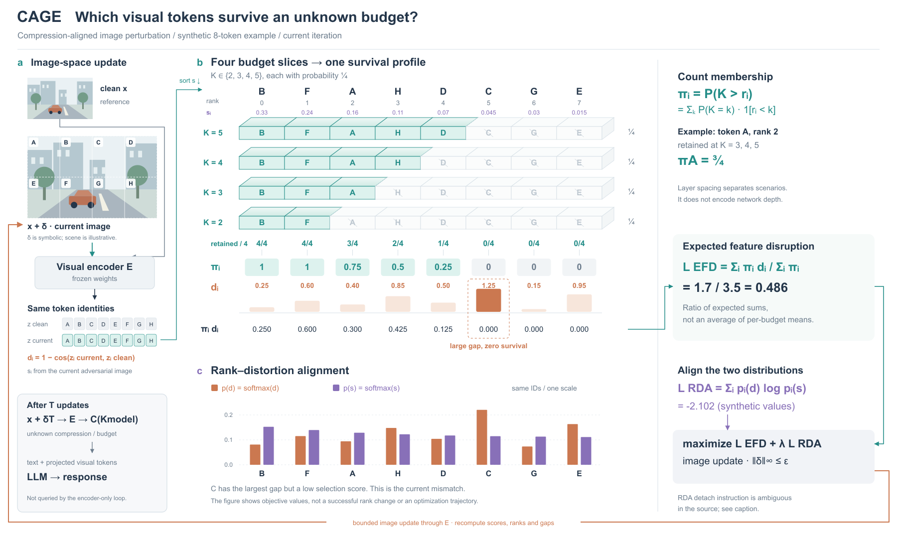
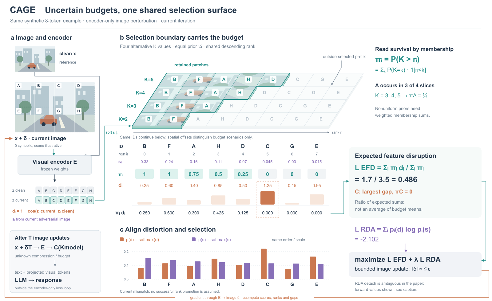

# CAGE：选择情景与概率归约

[论文 v1](https://arxiv.org/html/2601.21531v1)，2026-01-29预印本。读方法与附录算法，实际看PDF p4/Fig.3。未核实作者代码或会议接收。

## 为什么以排序为主体

比较图像中心的双目标环与共享排序的预算截面，选后者。核心是“预算不确定时，一个token多大概率留下”，重复网络或图像不帮助读这一步。原图的EFD只有概率色带与差异色带相乘，新图先把概率的来源展开。上下两区共用ID与排序，尽量用位置代替长连接。

给定8个token、四个等概率预算{2,3,4,5}，每个情景保留一个不同长度的前缀。浅立体只是分隔情景；所有数字和柱形正视。按列数入选次数得到π=[1,1,.75,.5,.25,0,0,0]，再与d相乘。C的给定差异最大而保留概率为0，下方RDA的两个分布继续保留这个身份。无温度softmax的分布差异不夸张，图也不为视觉冲击人为扩大它。

## 可借用与不可照搬

适合有限预算、候选规则或多种选择情景的概率归约。非均匀先验需按质量加权，不能仍把入选次数除情景数。EFD按原式算Σπd/Σπ，不偷换成各预算均值的平均。具体场景、分值和差异均为原创示意，不声称编码器测量或优化结果。

图像更新回路、冻结编码器、部署压缩/LLM出口齐全；EFD与RDA分别汇入总目标。正文的RDA detach描述与固定target的说法冲突，算法未消除歧义。本例展示前向值并记录限制，没有画出“C已被提升”的结果。

## 实际看图与修订

R1有下方分布但未显示s的输入值；两个目标到总目标的关系只靠文本；图像更新回线穿过限制说明。R2补排序分值、两条独立汇入路径，把回线移至图外缘。两稿均实际查看。剩余不足：总体仍较宽，浅立体更像分层表，未验证用户是否偏好这种视觉语言。只将“情景展开→按ID归约”的可借用做法加入案例，不把它变成所有论文的强制模板。

## R3/R4：让共同底面与截断轮廓承担范围

另一种有效组织是以预算为深度索引、rank为横轴的共同选择面。四个独立条带合并为一张格面，入选前缀形成阶梯边界。反复出现的片段直接裁自同一原创场景，A…H对应不变；半透明只让描边和字标可读，不编码概率或扰动。原分值、先验、π、d、两个分布与目标值由既有JSON读取，没有重设示例。

采用这一版是为了减少重复容器并给选择范围一个整体轮廓；原R2仍更便于按垂直列直接数次数。R4的浅透视使行间有偏移，必须按ID对应，二维读数与分布继续正视。画布1800×1080→1600×980；主要图像仍260×165。显式retained/4行改为A的成员计数说明，所以不是图内信息完全固定的排版对照。所有方法组成、回路和部署仍在。

看R3后发现排序路径落在空白处，R4接到选择面入口；补rank方向，将未选区域说明移出右侧公式附近。两稿都实际看过。主体更具体，但总体仍有表格属性，不宣称阅读速度或审美已经改善。可迁移的是用共同底面、可见边界和原对象片段表达选择，而非要求所有图增加纹理或斜面。
