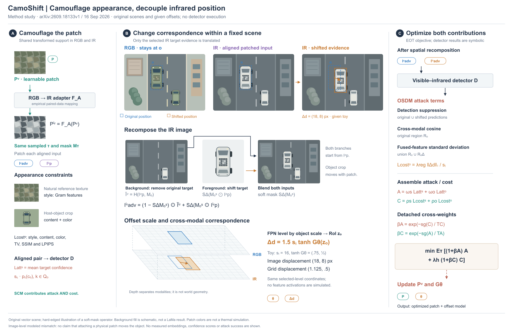
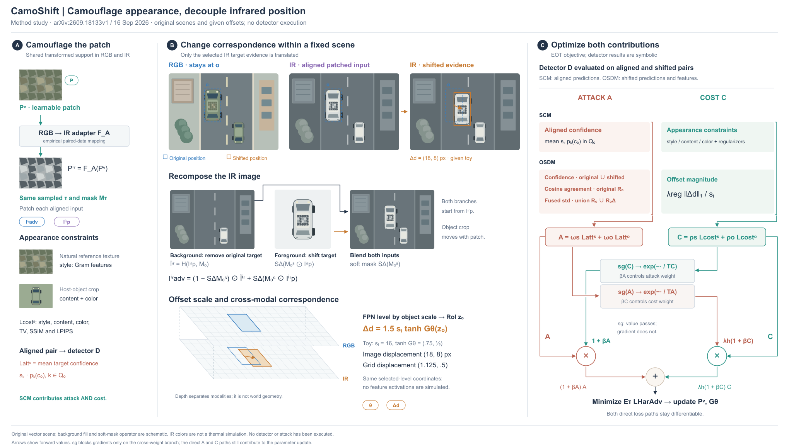

# CamoShift：固定背景中的目标错位

[2026-09-16预印本](https://arxiv.org/html/2609.18133v1)。读§3.1–3.4 / Eq1–16，实际看PDF p3 / Figure3。没有执行模型或攻击。

## 主视觉选择

比较按SCM/OSDM分支与按同一场景的跨模态位置关系组织，选后者。可见图像的目标与街景不动，红外输入经历目标补全和移位后重组；同一车身、窗、轮胎和补丁贯穿原位置、裁块与结果。空间层只是两个模态坐标的展示，不画传感器物理距离或假热场。

SCM保留适配器、共同变换支持、外观约束及对齐攻击项；OSDM保留尺度相关位移、背景补全和软mask合成公式；右栏保留三种攻击项的区域、位移代价与sg交叉权重，再接Pᵛ/Gθ更新。没有将联合优化误画为独立阶段，也没有制造目标丢失结果。

## 示例与限制

原始车中心(96,70)，给定s=16、tanhG=(.75,1/3)，α=1.5得到Δ=(18,8)，格位移=(1.125,.5)。层级选择未执行。背景、非目标车和目标形状都保持；IR颜色是原创视觉编码，不是适配器输出。硬边替代软mask、已知背景替代LaMa，仅用于操作示意；详细公式在图中，不能把结果当Eq9的精确像素计算。

论文§3.3是图像级错位建模。不能据physical patch语境画成真实物体被贴纸推走。需要区分物体世界位置、图像坐标与展示层深度；格子也不是模拟激活值。

## 看图修订

R1误将inpaint→crop→result串起来；R2改成背景与前景独立汇入合成，两者源于同一Iⁱʳp。此错误已经被AdvFractal案例的融合规则覆盖，实际绘图仍出现，故不再追加重复检查清单。原图四区中的损失地形也未照搬，缺少测量依据时用公式和区域定义即可。

图中间有辨识度的街景，右栏仍偏文字，跨栏符号需查找；没有用户审美反馈。可借的是固定背景呈现局部差异、同源对象复用及空间含义的区分，不是固定三栏模板。

## R4：交叉权重的值路径与梯度边界

重读本地Eq13–16。比较保留紧凑公式加梯度作用表，与展开前向计算图；选择后者，直接说明哪个值乘哪个系数。SCM/OSDM作为两行，attack/cost作为两列，各列汇成A/C。外侧是A/C自身，内侧由另一项的sg副本产生β，再分别带入(1+βA)A和λh(1+βC)C。图的箭头表示前向值，不是反向梯度。

stop-gradient只截断交叉权重分支，A/C的主路径依然对W=(Pᵛ,θ)产生梯度。节点保持符号，不增加臆造的损失值或“最佳平衡”状态。对齐pair调用D产生SCM项，移位pair调用同一个D产生OSDM项；两者不能混用。

实际看R3时，A进入权重计算的线与βA输出线共用一段竖直位置，白底覆盖也无法正确解释。R4错开两路，只留一个有白色间隙的交叉点；将权重标签移到线旁，模型调用说明改成一条跨列说明，避免其位置暗示attack/cost各自独占一种输入。

街景、尺度示意与位置数值按R2原尺寸保留，宽度1800→2040，高1160不变。更显式的计算关系占用额外宽度，适屏时全图会缩小；不是免费提升密度。原版适合窄横图，R4适合需要读交叉权重的场合。文字来源仍存在，上半表格也是归纳，不代表全图已达到用户审美目标。
