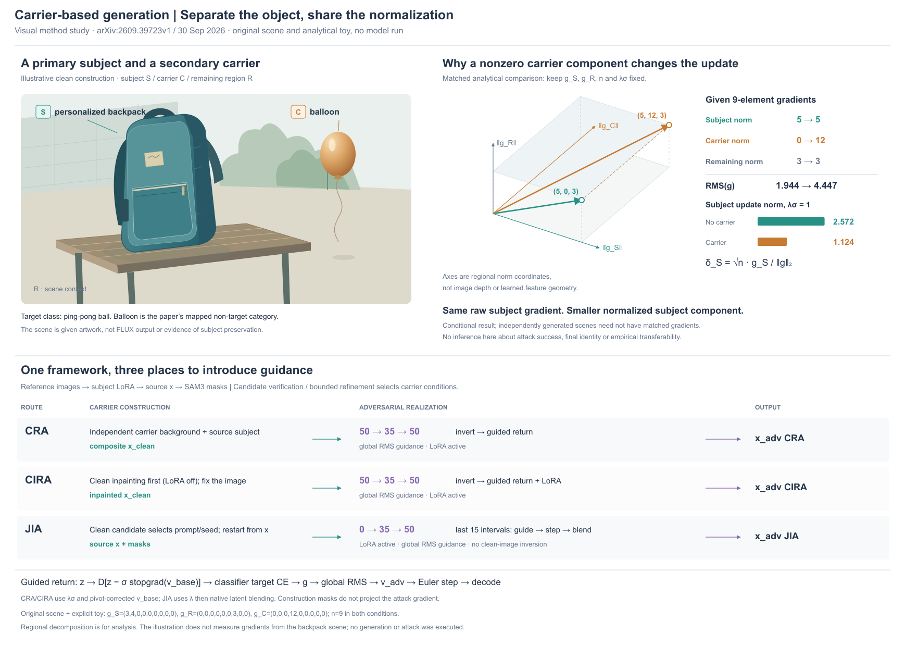
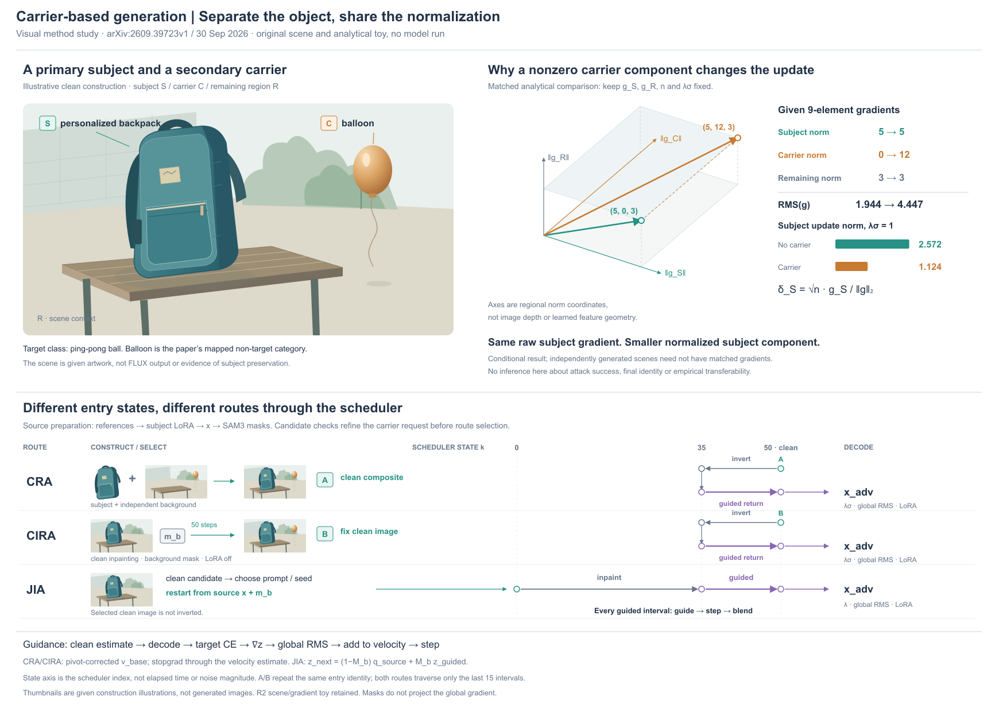

# Carrier：具体场景与条件性归一化分析

[Let the Carrier Carry the Attack](https://arxiv.org/html/2609.39723v1)，2026-09-30预印本。读§3–4、Appendix A/C/D/E，实际看原PDF p3/Fig1。原图是按subject/target列对齐、按clean/attacked行排列的真实样例，比较No-Carrier与carrier条件。新稿解释方法与分析，不复制实验效果。

## 构图与范围

比较连续场景帧＋三路线流水线，与一个大场景＋条件性几何分析＋对齐路线表。选择后者，以可识别背包为主体，小气球为载体，场景细节来自肩带、提手、拉链、口袋、长凳和背景；不把这些全部做成厚盒子。右侧三维只解释正交区域分量的范数，正视读数承担数值，底部区分三种路线的实际依赖。范围是框架总览与Theorem1的条件例，不展开全部候选重试、语义迁移界或实验结果。

## 机制依据与重要区别

源准备使用subject-specific LoRA与SAM3分割，载体位于主对象之外。CRA独立生成载体背景，再合入主体；CIRA先完成无LoRA的clean inpainting，选定干净图后加载LoRA做攻击；JIA先选clean候选的prompt/seed，再从源条件进行带LoRA的受引导inpainting，不反演该clean候选。正文泛称LoRA持续开启，但附录A/C对CIRA给出更细的阶段配置，本图采用具体配置。

CRA/CIRA的50→35→50指50步调度器末15区间的反演/返回，不是从纯噪声重生；反演无攻击引导。return用pivot修正v_base，stopgrad仅作用于估计干净图时的velocity支路，梯度通过decoder/classifier到z。v_adv加入λσ·RMS(g)，Euler噪声差为负。JIA全程50步，末15区间用λ·RMS(g)，每步更新后原生mask blending；不能写成先遮梯度，也不保证decode后主体像素严格不变。Qwen是构造验证/提示反馈，不参与classifier loss梯度。

区域投影是分析分解，不是实际攻击对g的mask。Theorem1固定gS/gR/n/λσ，载体分量非零增大总范数，缩小归一化后主体分量；不说明原始gS下降，不保证最终图像保持。不同生成图也未必满足匹配假设。真实实现RMS有floor，本例远离floor。

## 本图的原创内容

750×404原创矢量场景，主体背包和气球的轮廓/位置分开；气球→ping-pong ball来自Appendix A映射，但画作不是DreamBooth样本或FLUX输出。图不展示攻击后的场景或成功预测，场景也不产生下面的梯度。

独立9维例：gS=(3,4,0,0,0,0,0,0,0)，gC=(0,0,0,12,0,0,0,0,0)，gR=(0,0,0,0,0,0,3,0,0)。No-Carrier仍有9个槽，仅gC为零，不改变n。λσ=1，RMS从sqrt34/3≈1.944到sqrt178/3≈4.447，主体更新范数从15/sqrt34≈2.572到15/sqrt178≈1.124。

三维坐标为三个互斥分量范数(5,0,3)/(5,12,3)，保留总范数的勾股关系；不是9D向量的任意降维，更不是图像空间或真实latent投影。透视长度不用于读数，右边给精确计算。虽然用三轴表示，但梯度元素数仍为9。空间图说明的是分母增大，主体分量是否缩小必须通过右侧归一化读数。

## 实际看图后的修订

R1视角让两个总量方向近乎重合，轴先画后被平面遮住；R2保持同一向量与数据，改投影，并把坐标轴放在面后绘制。补全JIA LoRA与每个末15区间内guide→step→blend的顺序。实际查看两版；高主体和小载体有尺寸区分，背景低对比，但没有用户判断其审美或视觉重要性。

下半部路线仍文字偏多、全局引导只给紧凑操作链；没有比较语义载体三种条件的具体造型。主要可迁移经验是让情境对象说明角色，让分析对象说明条件结论，并明确它们是否共享数据：同一配色/相邻放置不能暗示梯度来自场景。构图参考不是必须左右各一大块，另一个任务应重新分配面积。

未运行生成器、分割、攻击或模型，没有导出/格式检查，也不声称完成论文实验复现。

## R4：同一调度轴上的不同入口

R2下半部已有完整三路线，但50→35→50只是文本。比较每行独立流程与共用状态坐标，选择后者：CRA/CIRA从clean端50反演至35，再引导返回50；JIA从源条件开始0→35→50，末15区间引导后逐步blend。轴按scheduler index排列，均匀像素间距不表示均匀sigma、耗时或latent距离；未访问0–34的留白有意义，不应拉长箭头来填满。

保持R2场景、投影、梯度、计算和1740×1240画布，复用bag/scene定义生成构造缩图。CRA显示主体＋独立背景→给定合成；CIRA显示源图＋背景mask→给定clean图，50步clean inpaint与后续反演分开；JIA明确选定prompt/seed后回到source，不反演clean候选。合成与inpaint缩图复用同一场景是说明性替代，不暗示两种生成结果完全相同。mask仍是符号，未执行SAM3或FLUX。派生源图/背景移去对象时也移去其附属阴影；没有改变上半部场景。

A/B在构造结果与state50重复同一身份，替代跨过整条状态轴的长线。端口增加一次对应查找；精确9D列表从图面移入已有brief/图注，计算不变。下方保留target CE梯度、RMS、velocity更新、pivot/stopgrad与JIA混合公式，不能将流程压成只剩形状。

实际看R3/R4：分隔线贴近下一行invert标签，R4调整分隔位置；补50端为clean、CIRA clean生成50步，去掉派生缩图里无对象的阴影。重复文字减少、来回方向可见，但构造细节随缩图变小，右侧轨迹只占末端较短区间，整体不是各行同密度排版。没有用户审美反馈、模型实验或导出检查。

可借用的是共享状态坐标与访问方向，尤其适合回溯、恢复或部分区间优化；不通用于仅名称相似但状态不共用的流程。已有“同位置对齐”规则在此落实为具体路径例，不增加一套强制流程。
