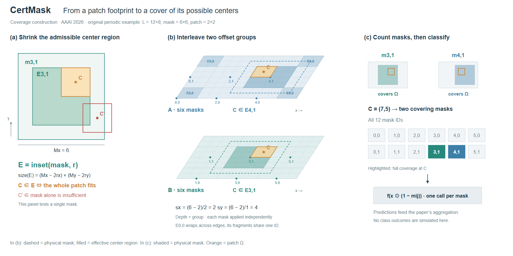

# CertMask：可行中心区域与显示片段的身份

[AAAI 2026](https://ojs.aaai.org/index.php/AAAI/article/view/37716)，参考[扩展版](https://arxiv.org/html/2511.09834v1) Definition 1 与 Offset Tiling。实际查看 Fig.1/p2、Fig.2–3/p3。

## 从操作选择构图

完整遮住一个补丁，要求它的中心进入掩码内缩后的区域。采用二维局部表达这个判定，再用两张同投影层板分开偏移组；每层六个独立掩码，右侧按对象ID计数。分类器作为出口，图的范围明确为覆盖构造。

## 实际修订带来的经验

R1左侧局部用向下的纵坐标，层板却向上，同一个C的位置无法直接核对。R2统一坐标方向。局部视图可以换投影，但共同坐标不能无说明地翻转。

周期边界把E0,0分成四块，它们仍属于一个对象。R2复用ID并加强四片的同色边界，右侧计数采用完整mask ID。这也适用于裁切、展开图或跨页延续：可见片段数量不一定等于算法对象数量。

图例区分实际遮挡的mask和允许补丁中心落入的E。相同颜色跟踪同一mask身份，但不同子图的填色承载不同角色时，应就近限定图例，避免把两个区域当成同一个集合。

## 迁移与局限

示例采用周期域12×8、mask6×6、patch2×2，按几何算出C被两个mask覆盖，未生成分类结果。覆盖几何不单独证明分类证书；本图不能代替完整系统或定理。

图稿从skill入口和构图指南重新实现，没有导入旧图脚本；这说明一次迁移可行，不是隔离上下文的独立评估。构图仍有三分区惯性，层板标签较小，审美继续等待用户反馈。

## R3/R4：把同域对象沿示意深度拆开

保留R2的全部几何参数、12个mask ID、两个偏移组和同一C。主图改为共同底面，只抬起覆盖C的m3,1和m4,1；竖直虚线只表示同一图像坐标。局部二维图解释内缩条件，右侧保留完整ID表及分类调用出口。

R3的底面标签贴近层板边缘，Ω标签又靠近一个mask中心。R4拉开显示高度，将Ω引至空白，补齐局部C/C′。几何坐标与覆盖集合没有改变。高度用于展示独立对象，不表示物理三维、处理顺序或多轮遮挡。

R4便于沿同一C查看两个覆盖关系；R2则更完整地显示两组的所有有效区域。R4省略其他有效区域的面片，保留其ID和构造参数；不能声称两图展示的视觉细节完全相同。共同坐标也没有消除小字与图注依赖，审美仍待反馈。
