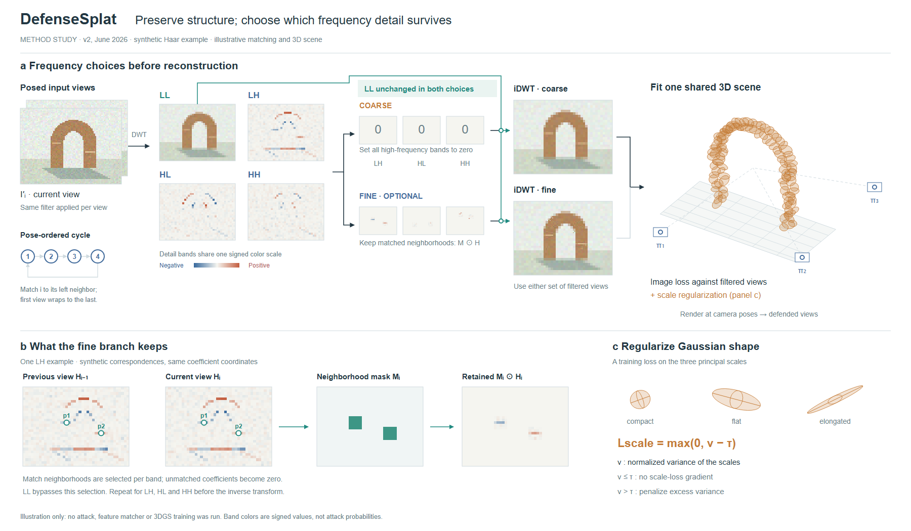
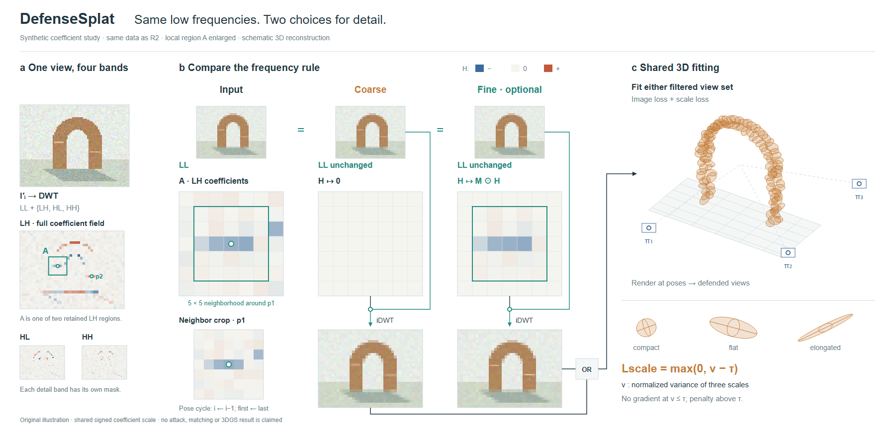

# DefenseSplat：替代分支与共同重建

[论文 v2](https://arxiv.org/html/2602.19323v2)，2026-06-27；实际查看 Fig.2 / PDF p4，读 §3.2–3.4、Eq.8–9。

## 从内容决定表示

核心差异是同一组高频系数全部置零，或按邻近视图匹配位置保留一部分；低频保持。试画将这两个选择并列，把共同的三维拟合放在出口，下面展开匹配邻域和尺度判定。二维区域比较系数，三维高斯只表示空间对象。

构图另一候选是中央场景加环绕视图。它更突出多视角，但本次需要比较保留规则，左右相邻分支更直接。两路属于替代方案，不能用汇合线暗示混合两套输入。

## 实际试画与修订

原创拱门图像采用同一数组的Haar分解、门控和逆变换；匹配点与掩码人工指定，场景未训练。显示频率系数的RGB均值，计算保留RGB通道，所有细节带共用色标。

R1只写LL保留而没有路径；R2补旁路接到两个逆变换入口。匹配长线穿过图像，改为成对p1/p2；尺度轴跟随旋转。细分支只保留少量细节，重建差异很小，未为视觉冲击捏造“恢复成功”。

## 可转用的决定与限制

### 从全幅流程到局部系数比较

R3/R4固定R2的全部数组、匹配点、色标和三维场景；全幅LH保留A的定位，将p1附近7×7系数放到输入、置零和保留三列。5×5邻域框让框内保留与框外归零直接可见。其他频带和p2仍参与完整逆变换，局部不能被理解为完整输入。

同宽下画布1800×1050变为1800×860；局部每格30像素，旧版全幅LH每格5.25像素。收益来自明确裁切，不能声称所有信息放大。R4补两个过滤集合的OR出口，错开逆变换箭头与文字。LL重复显示使每列自含，但占用了面积；另一匹配区域仅保留定位，完整掩码仍需旧版或图注辅助。

### 可转用的决定

- 对比替代算子时，固定输入并明确共有分量如何到达各输出。出口汇合旁写清选择，避免误读为顺序或混合。
- 原图没有展开的新版可选机制，从正文补出；版本与总览图可能不同步。
- 色彩增强可以改善系数可见性，但比较区域共用数值映射；不要逐图自动拉伸后暗示数值变化。
- 小变化不明显时，保留全幅定位，比较同一局部及同一色标；框内外同时可见能解释门控。局部的展示范围与完整计算范围分别说明。
- 新版仍需要读者在全幅、局部和邻居间对应，重建结果差异依旧很小。本轮改善了局部阅读条件，审美与首次阅读效果尚未得到用户确认。
