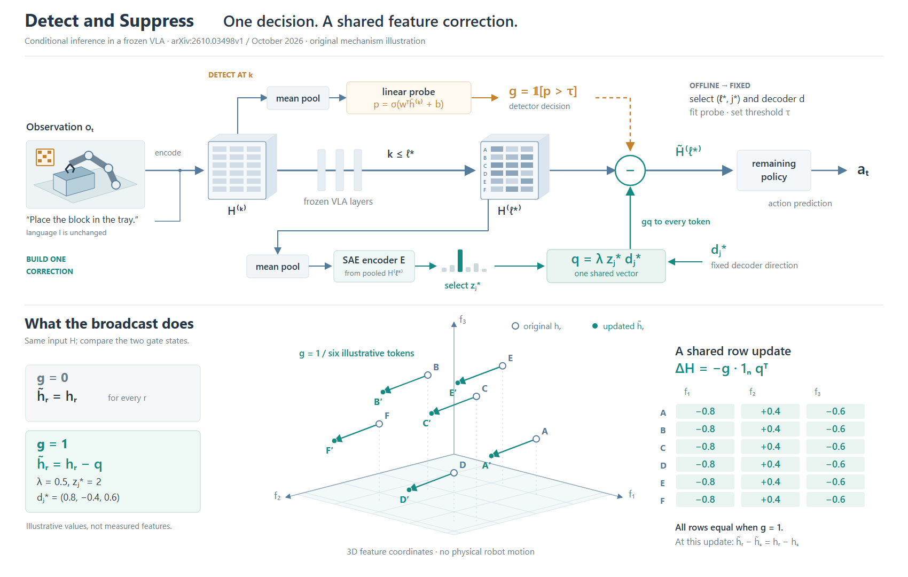
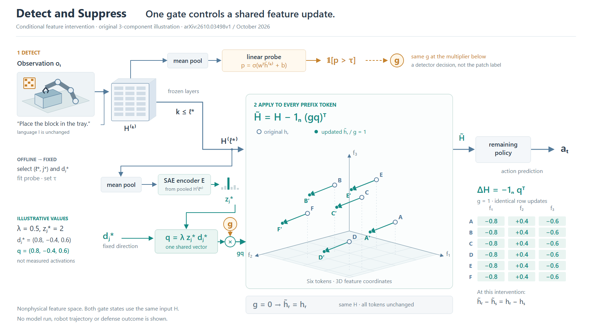

# Detect and Suppress：控制门与共同修正

[论文v1](https://arxiv.org/html/2610.03498v1)，2026-10-02；实际查看Fig.1/PDFp1，读§3与Appendix B。只展开在线条件干预，离线选择/训练概括成固定设置。

## 从两个有效方案选择

共同阅读任务是理解检测门、修正来源、全体token作用范围。A用一条网络主干保存层顺序，分支生成gate和修正，下方几何展开广播；B将同一输入下的门开/门关状态并排，以共同池化与编码解释两列。两者都保留k≤ℓ*、两个池化、固定方向、共同修正与动作出口。

选择A，因为当前论点是“一个修正向量如何产生并广播”。代价是非物理三维坐标需要交代；B更适合直接比较门控状态，但重复表示挤占修正来源的空间。只绘制A，不能据此宣称A优于B。此例是v0.8.5候选提示的一次实际试用，未做独立评测。

## 为什么二维和三维各有作用

二维保留数据和控制依赖：k层池化→probe；ℓ*层池化→SAE→选中z；固定decoder方向与z生成q。gate是probe结果，不是阈值化该SAE激活。修正作用于每个原token，不替换成整套SAE重建。

三维展示同一q引起共同平移；六条箭头由相同投影和同一向量计算，右侧矩阵保留正负分量及全部六行。三维代表原创3分量隐藏状态，不是机器人运动或实测降维。示例λ=.5,z=2,d=(.8,−.4,.6)，不是作者参数或训练特征。门开/关比较使用同一H，不是两个真实时刻。token间差分只在这个更新处保持，不延伸到后续网络或防御结果。

## 看图修订与限制

R1实际看图后发现池化分支穿过标签、橙色正分量与门控语义冲突。R2移开分支、统一修正颜色，明确语言输入连到编码；移去跨主干的离线提示长线，增加原状态/更新状态图例，H⁽ℓ*⁾的A–F对应几何实例，颜色来自相同坐标。原论文的实际机器人图像以原创矢量场景概括。

此图仍需在全图与局部几何之间阅读，三维不是最省面积的表示；没有证明比并排特征板更易读或更美观。没有模型、攻击、导出或格式检查。可借用的是按真实依赖分离控制与数据，再用几何解释广播的选择，不是要求所有门控方法都画特征空间。

## 把局部对象放进运算节点

R4保留R2的在线机制、六个坐标、z、d、λ和带符号修正值；移除上方独立H⁽ℓ*⁾色块网格，让同一组几何状态直接成为干预节点。单次运算的输入、修正和输出接到这一个对象。右侧逐行表和g=0表达保留，三维只是g=1的展开。它属于同一机制/数据的表示与布局变化，但不再提供原网格中逐分量色深查询。

旧版的连续主干更适合追网络先后，新版适合看修正发生在哪里；新版主干转弯，并用两个同名g端口代替长控制线，代价是按符号对应。不能把少了一条线等同于更容易理解。本例没有绘制初始候选B的两列状态板，而是在A基础上改成对象内展开。

R3看图时中央几何偏小、上方留白过多；R4在同一对象框内上移并放大投影，画布980→950，同时给数值表加g=1条件。R2画布1080高，R4为950；对象本身较R2略小，不能将节省高度全部归功于合并，也不能以缩短画布证明美观。两版均可查，尚无用户审美反馈。

可迁移取舍：已有主干与局部重复同一对象时，可让局部承担运算节点；必须保留来自原状态的支路和实际出口。需要追踪整体顺序时保留连续主干，复杂控制则在长线和命名信号之间选择。此经验与ReMoE的对象内贡献展示相邻，但不是要求所有系统图合并成一块三维对象。
