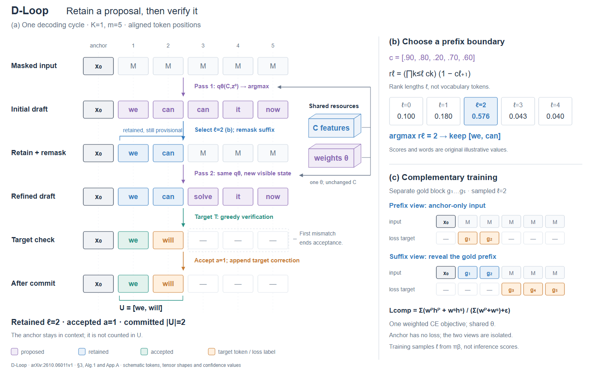

# 案例七：内容保留与验证通过是两种状态

**来源**：[D-Loop v1](https://arxiv.org/html/2610.06011v1)，2026-10-05，§3.1–3.3、算法1、附录 A.3–A.4；原 Fig.1 在 PDF p4。

原论文用一个 drafter 框与回路线表达两次调用。试画改为固定 token 列、按时间排列状态；共享参数和 context 用局部薄块标识，所有 token 文字保持正视。保留、再生成、接受分别由明确状态编码，不把“这个词没变”解释成“已经验证”。

选一个有区分力的原创实例：保留前两个提议 `[we,can]`，重新生成后缀；目标却在第二位选择 `will`。于是 ℓ=2、a=1，新增输出为 `[we,will]`。这个例子展示保留前缀仍可能被拒绝，不是性能收益示例。已知 anchor 始终占同一上下文列，新增输出 U 的括号只覆盖两个新 token。

右侧分开推理的边界评分与训练的互补视图。训练用另一个符号化 gold 样本，避免让未验证的推理词被读成训练标签；两视图共享 θ，但各自可见内容和监督位置不同。图注明确当前为 K=1、ℓ≥2 示例，并指出未展开的多分支验证和短前缀 fallback。

首稿的停止说明叠在提交操作上，且行标题把 anchor 包含在 U 中；修订把说明移到后缀旁，末行标为提交后状态，用括号单独定义 U。颜色先区分状态、位置保持身份，二者各有作用。

迁移到候选搜索、计划修订、事务提交或人工审核时，先找清哪些操作只保留内容、哪些操作改变其确认状态。若两种状态是图的关键区别，选择一个边界不同的实例；不要求所有动态算法都用 token 行，也不把 D-Loop 的验证规则泛化给其他方法。
