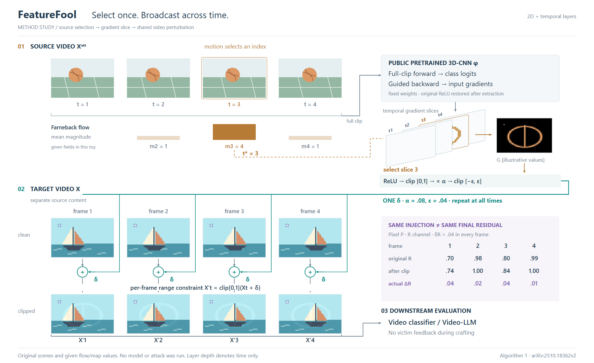

# FeatureFool：选中一个索引，作用于整条序列

[论文](https://arxiv.org/html/2510.18362v2)，预印本 v2 2025-10-22；CVPR 2026 会议版本。读取 §3.1–3.3、Eq.10–18 与 Algorithm 1，实际查看 PDF p4 Fig.2。实现未核实。

## 构图决定

主视觉是源视频的选择与另一段目标视频的全部应用。源视频在上方，目标的前后状态在下方；右侧完成全片计算、切片提取与后处理。单条共享分配线跨过全部目标帧；小型时间层只展开被选择的梯度索引。另一成立方案是单向横流程加帧堆，便于通读，但选择和全帧应用的数量关系不如双时间线直接。本例选择后者，保留折返阅读的代价。

借用原 Fig.2 的同坐标源帧/特征图配对思想，不借照片。此图的 G 是独立给定的示意数组，不应声称它从示意球场计算而来。源图与目标图使用不同场景避免输入身份混淆；其时间轴不代表同步拍摄或跨视频逐帧匹配。

## 决定画法的机制

- 运动只选 t*：相邻源帧计算 Farneback，平均位移模长取最大。图中 1/4/1 来自给定位移场而非实际光流估计；最大值在内部帧3，回避原文边界下标矛盾。
- Algorithm 1 先 forward 整段源视频、对对应类 logits 做 guided backward，再取 t* 切片；不能把选中一帧画成 3D-CNN 的唯一输入。
- G 经 ReLU、[0,1] 裁剪、α 缩放及 ±ε 裁剪，得到一张 δ，再沿时间复制。所有后处理都在通往分配线的路径上。
- 最后对每帧 X+δ 作 [0,1] 裁剪。同一预裁剪 δ 不保证相同最终残差；右侧表只展开这一条件，不冒充论文实验。
- 公开预训练模型有前后向；受测模型在下游，制作时没有其反馈。zero-query 不意味着所有模型都不计算梯度。

## 实际试画与修订

R1 的层编号被前层遮住，G 到共享线的连线绕过了后处理；SVG 小矩形抗锯齿接缝又放大了扰动视觉。R2 把编号移到各层上缘外，连线明确经过后处理，离散像素组使用 crispEdges。输出增加全帧收集括号，避免只把末帧送入下游。目标背景保持同色，只有标记 P 的数值有意改变，减少与机制无关的色差。

这次是机制连线、显示和局部组织修订，不是两种完整构图的受控对照。R2 仍有像素化场景、较长折返线；层片只承担索引解释，空间感较轻。未得到用户审美认可，未运行模型或导出检查。

## 可迁移提示

当“选择的对象”与“实际作用范围”不同，先把两者按索引和输入身份分开：选择标记连接选择器，共享值画一次，再分配到全部受体；实例只在后续确实依赖各受体的运算处显示分歧。局部空间展开适合解释索引，主体仍可用正视序列保持比较清楚。不要以添加更多层片替代输入、选择与应用范围的说明。

## R4：上下文收拢，主要实例放大

R2 的目标场景只有64×40、几何粗简，位于大面积留白之间。R3/R4 将源片、模型和切片组成上方紧凑支路，共享分配线贯穿目标的前后两行；目标帧宽190→260，整图同宽1800、高1100→990。源帧约190→135，源侧细节相应缩小。实际看图后还移除了盖住输出箭头的说明底色，保留 Farneback 操作名。

目标场景重新绘制弯曲帆面、船体、索具、远岸，采样提高到256×160。仍以 SVG 原生色块呈现数组，读者看到的前后帧由同一新场景和给定 G 计算。G 保持相同归一化环/竖条函数；旧单像素 P 改为4×4小区域，对应数值与 α/ε 不变。海岸和索具属于身份语境，不是方法贡献；不能因这些细节多就判定机制更丰富。

R4看起来不再是大像素图标，前后差异在更大的实例中可见；共享线仍占据较长路径，源场景更小。这里同时改变了几何、分辨率、版式，不能称固定输入的纯布局对照，也未证明阅读性能或审美提升。

**可借用决定：** 当图像/几何本身承载比较，先保证它有足够的图面尺度和可识别轮廓；如果粗采样不是方法对象，别让默认低分辨率决定最终外观。收紧重复的普通上下文后再扩大实例。场景细节用于身份和层次，机制证据仍由同一输入的运算结果承担。
