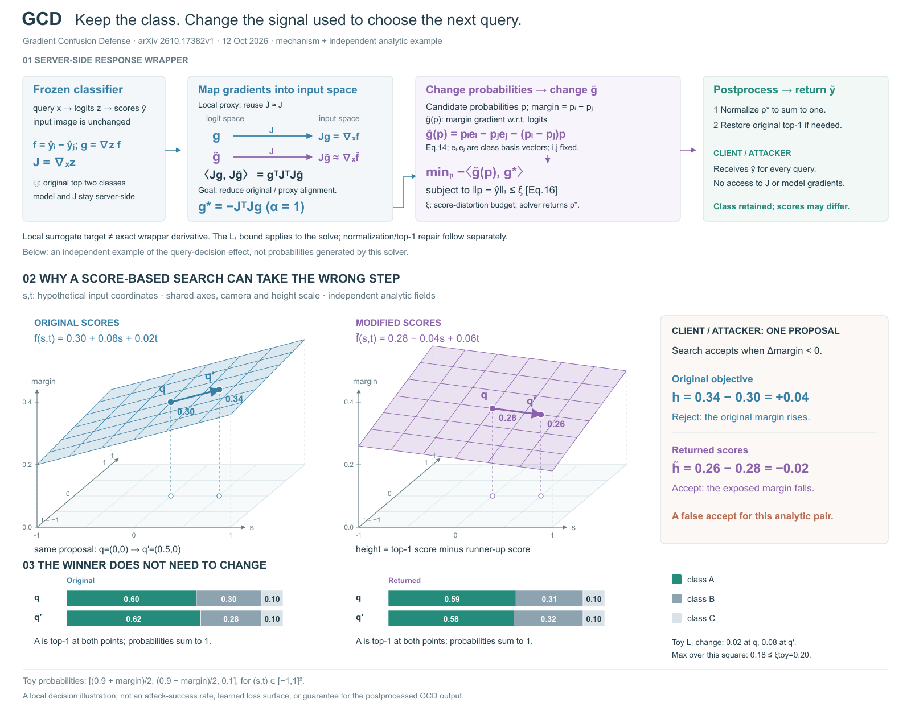

# GCD：效果例不能替代构造解释

[原论文：Mitigating Black-Box Score-Based Query Attacks via Gradient Confusion](https://arxiv.org/html/2610.17382v1)，2026-10-12。依据§3的搜索接受规则、§4.2 Eq12–16和后处理、§5.1。实际看原PDF p9/Fig1：是方向的极坐标统计图，不是三维方法图。

## 已观察的设计问题

R1以相同查询对的原/修改分数面为主视觉，概率条验证类别不变，Δmargin明确拒绝/接受。四位独立评委看懂作用，却不能从顶部简短流程复述分数如何构造。四维均分84.50/80.75/75.00/83.25，方法解释是共同瓶颈。

## 方法与证据

冻结分类器的原margin为top-1减runner-up概率；i/j取原始top-2。J为logit的输入Jacobian，g为margin对logit的梯度。论文用局部J̃≈J，把输入空间方向内积写为gᵀJᵀJg̃，选择g*=−αJᵀJg作为目标。候选概率p决定g̃(p)=pᵢeᵢ−pⱼeⱼ−(pᵢ−pⱼ)p，再解L1约束目标；之后归一化并必要时恢复原top-1。图把求解约束与后处理分开，不承诺所有最终返回值仍满足该预算。

独立例在输入切片(s,t)上定义f=.30+.08s+.02t，f̃=.28−.04s+.06t，概率为[(.9+margin)/2,(.9−margin)/2,.1]。q=(0,0)→q′=(.5,0)给原差值+.04、修改差值−.02，两端仍为类别A。两分数面同尺度/相机；高度是margin，不是学习流形。此例不来自GCD求解器，不证明防御效果或成功率。

## 两次重绘后的实际结论

三版各四位独立评委，固定职责和冻结v0.11.0量尺。保留R2在进程报错前写入的两份评审，补齐另两份；R3使用四份新鲜上下文评审。均实际看图并读原文。

| 重绘次数 | 图稿 | 美观 | 专业 | 方法解释 | 丰富 | 总分 |
|---|---|---:|---:|---:|---:|---:|
| 0 | gcd-r1 | 84.50 | 80.75 | 75.00 | 83.25 | 80.88 |
| 1 | gcd-r2 | 85.25 | 88.25 | 86.75 | 88.50 | 87.19 |
| 2 | gcd-r3 | 86.00 | 89.25 | 86.25 | 88.75 | 87.56 |

R1→R2补全表示映射、候选概率梯度和目标关系，主要构造缺口改善；代价是画布增高150像素与更多公式。R2→R3将映射改成两行箭头，目标连接求解式，并修正术语、预算名与局部读数；保持R2画布、数据、相机和主体尺寸。

最后一轮仍反复指出g*的角色/对齐动机需要公式推读、上部密度偏高。两行映射图没有彻底解决“为什么这样选目标”，不把小幅分差当成方法论成功，也不因四位ready而抹去问题。具体取舍见最后的decision；本案已用完两次预算，未继续第三次微调。

可迁移结论：构造与作用分别找证据；替换公式的画法也要保留关键量的角色和操作目的。若图能回答“怎么映射”却不能回答“为何选择”，应重写该关系的解释，而不是把箭头更多当作机制更清楚。评委措辞也需与真实目标核对：内积优化不能随意改写成欧氏距离最小化。

没有导出/格式检查，没有真实模型或GCD求解实验；分数为代理判断，不是用户审美认可或最优重绘次数的统计证据。

# GCD最终选稿与本例停止理由

选择：gcd-r3

三版均有四份独立评审、原始证据与主代理决定。R3四维均值86.00 / 89.25 / 86.25 / 88.75，总87.5625；R2为85.25 / 88.25 / 86.75 / 88.50，总87.1875。R3总分仅高0.375，方法均值反而低0.50：视为整体持平附近的代理波动，不能说第二次重绘使方法解释明显更好。

## 问题追踪与取舍

- **首轮构造缺失：已明显改善。** R2/R3都保留J映射、局部近似、候选概率到梯度、目标与约束及后处理；相较R1，各评委能完整追踪范围内流程。下部同查询对的证据保持。
- **术语与局部定义：已改善。** R3修正logit-margin的歧义，明确候选margin、ξ含义、底部Original/Returned及t刻度。选R3主要依据这些具体改动与可追踪的两行映射，不依据0.375的总分差。
- **目标动机：部分改善，仍在。** 四位R3评委的A1/M1/PE2/CR1仍要求解释g*的目标角色及负内积动作。R3清楚画出了“J怎样映射”，但R2原有Choose a target提示在替换中消失，g*身份更多依赖公式。不能称该瓶颈已解决；两行映射与目标动机是两个问题。
- **密度与段间距：仍在。** A2/A3、M2、PE3、CR3指出顶部密度、02/03交界及小字对比，均为minor，无实际遮挡。没有为提高评分增加新面板或扩大整张图。
- **新提出的局部阅读问题：记录保留。** PE1服务端后处理与客户端共框，CR2攻击偏好较小margin的直觉，M3示意预算名。文字与数值仍足以区分角色/规则，四位未认定核心错误。后续若专门重做顶部，应与目标说明一起处理；不将全部小问题逐条堆进图。

## 停止与适用范围

本例已完成预算内两次评审驱动重绘，四位均ready且无critical；核心职责和同源证据完整。最后一轮收益有限，重复瓶颈需要重新组织目标解释，继续同类加字的收益不清楚。因此保留R3作为当前工作稿，R1/R2和全部意见可回看，不追加第三次微调，也不拼接未经复评的新版本。

适用于屏幕全宽的机制说明；尚不能称紧凑投稿终稿或读者测试通过。未做导出/格式检查，未运行论文求解器、真实模型或攻击实验。此停止只针对GCD案例，长期skill优化目标继续。
