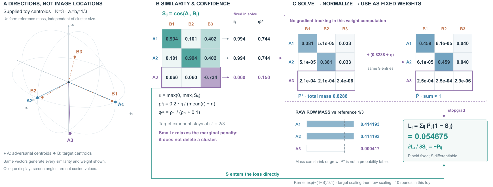
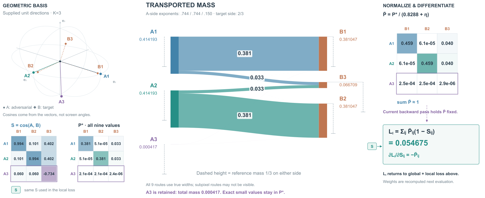

# IAU-FOA：求解运输权重与用权重求导



## 来源与展开范围

[Visual-Invariance-Augmented Feature Optimal Alignment for Transferable Adversarial Attacks against Closed-Source MLLMs](https://arxiv.org/html/2610.06977v1)，2026-10-04，arXiv 2610.06977v1。阅读§III-B至G与附录Algorithm S1；实际看PDF p4/Fig.2。原PDF和页图保存在项目references目录。另筛选了10月12日ProAda，但本轮未试画，不能算作新增案例。

图上保留增强、代理编码器、全局/局部目标、动态加权、跨视图平均梯度、扰动更新及迁移出口的符号上下文；只数值展开单代理、单次局部运输。没有运行作者代码、图像优化或模型推理，也不表示攻击效果。给定的三维簇中心不是从任何图像提取的特征。

## 原图观察与入口试用

Fig.2用共同编码器串起增强、局部/全局对齐和动态加权；特征条与聚类连线承担全局位置，实际运输求解藏在模块中。本稿借它的“总览定位局部”关系，进一步展开矩阵及固定权重的使用。原图图片和造型没有复用。

现有对抗入口中的Ancestor VLM可帮助区分权重来源与受体，但其权重由clean一侧生成，不能套到这里。IAU-FOA由当前两侧相似度求解计划；固定仅指当前反向传播，下一次目标评估重新计算。本稿需要跳出已有入口，显示求解器、总质量归一化与直接相似度路径。

## 构图选择

比较两种成立的组织：

1. 以二部图为主体，带宽表示每个运输量，旁边补相似度和置信度。适合追个别对应，但本例有多个很小非零量，直接带宽几乎不可见，还容易误以为运输质量总和必须等于1。
2. 左侧共同三维方向建立余弦依据，中间S与逐行置信度，右侧并列P*和归一化Ptilde；下方同尺度行质量说明约束放松，直接S支路绕过权重求解器进入损失。

选择2。三个矩阵保持A行/B列身份；紫色仅强调A3及固定权重路径，不把它当删除标记。上/下方总览与返回出口压为符号，主要面积给实际运算。代价是数表较密，S直接支路仍长，三个视区需要按ID追踪。三维只解释同一组方向，不叠加虚构图像或网络特征。

## 原创算例

输入向量先分别归一化：

```
A = [[1,0,0], [0,1,0], [.1,.1,-.98]]
B = [[.98,.1,.05], [.1,.98,.05], [.4,.4,.82]]
```

K=3，参考质量a=b=(1/3,1/3,1/3)，独立于任何簇成员数。给定中心后直接计算余弦S；没有声称运行KMeans。主图的球面大圆、射线与点均使用同一组单位方向，仿射展示不用于屏幕角度度量。

数值局部求解采用正文的rho=.2、epsilon_ot=.1、gamma=1、eta=1e-8；r=max(0,row-max S)，按均值归一化后得到行指数phi_a；目标列指数为2/3。先更新v再更新u，最多100轮，v平均变化<.01停止，本例10轮。它是论文停止规则下的数值近似，不宣称精确最优解。

- 相似度第三行约[.060411,.060411,−.733590]；其余两行各有一个约.993555的匹配。
- 行指数约[.744343,.744343,.150402]。这不是图中直接显示的运输比例。
- P*原始行质量约[.414193,.414193,.000417]；总质量.828802884。质量可以增加或减少，不把它强制归一成每行1/3。
- Ptilde=P*/(sum P*+eta)，保留同样9个位置，小非零量用科学记数法而非舍入成0。
- 最终局部loss=sum Ptilde(1−S)=.054675432。求解器中的熵和边缘KL罚项不额外加进这个读出。
- 对S的局部导数为−Ptilde，前提是当前反传固定计划；没有计算对图像的梯度。动态代理权重也只画符号，其来源是相似度分数比而非将距离loss直接当分数。

精确输入、S、核、系数、原始计划、两侧边缘和最终权重保存在iau-foa-toy.json，均由build_iau_foa.py生成。没有调整数值来使排版更好看。

## R1→R2看图与修订

R1主要关系已可追，但三维坐标标签靠近A1/A2；顶部“Dynamic weights”紧接loss，可能暗示权重直接由距离loss得到。R2移开坐标标签，将该节点明确为加权求和，并在其下标注omega来自相似度分数比、反传固定；r/phi也注明在求解中固定。实际查看R1和R2渲染，数据与主要布局保持。

R2仍有较长S直达路径、密集小量数字及上下重复的目标上下文。后续若重排，应先解决这种重复或路径，不能把微小运输量画粗后仍声称宽度代表真实质量。当前自我修订没有用户审美/阅读反馈。

## 回写skill

在已有数值读数段落中补充条件经验：中间质量、归一化权重与最终加权读出分别命名；求解权重的目标不自动等于最终训练loss。此例支持保留小非零项和固定支路/直接支路的分工，不要求任意图都画三个矩阵或单位球。

文件：iau-foa-r1/r2.svg/html/png、iau-foa-caption.txt、iau-foa-toy.json、build_iau_foa.py。项目目录<原实验项目目录，仅作历史记录，不是运行依赖>。只渲染看设计，无导出或格式检查。


## R3→R4：让质量分配成为主视觉



R2可核对运算，但主要视觉仍是数表与公式。重新比较：只移动矩阵和损失以缩短直达线，或把P*变为定量流带、数表与三维依据退居支撑。选择后者，检验“先看出分配，再查精确值”。与初稿时拒绝二部带宽的决定不同，本次用完整矩阵补充看不见的小量，不要求流带独自承担全部读取。

读取原toy JSON，所有向量、S、P*、边缘与Ptilde不变。Matplotlib生成9条质量同比例流带和端点，未设置最小宽度；低于像素尺度的非零量可能不可见，完整P*数表保留科学记数读数。灰色虚线高度为1/3参考，不是实际输入质量。两端实际总量同为.828802884，放松的是指定参考边缘约束，不是流带无故丢失质量。

目标展示顺序改为B1/B3/B2，减少主要路线交叉；矩阵仍按B1/B2/B3列排，通过ID对应。颜色改为A来源A1蓝/A2青/A3紫，并同步到方向、行标签和权重。流带属于二维分配关系，不表示物理运动或特征坐标。三维表示仍只解释余弦方向。

R3实际看图发现B3的1/3参考刻度与B2刻度同轨重叠；R4移到外侧独立轨，并用横线接所属端点。修正“raw mass not conserved”为参考边缘被放松且两端总量相同。标题改为机制主张。再次查看R4，主要分配关系突出，A3微小质量仍须查数字，三维和小表的字号/面积比R2更小。

S长线改为成对S端口；底部重复全局公式缩为返回说明，完整符号上下文保留在顶部。置信度细式和求解规则移入随图caption。画布1800×1030，R2为1800×1080。新增流带、目标重排、配色与表示比例变化，因此这是同数据改变表示，不是所有内容尺寸保持的纯布局对照。

适合读主要分配与参考质量偏差；R2更适合逐步核对求解链。单次自我观察不证明用户更喜欢R4，不把流带定为所有权重图的默认模板。经验回写到已有主视觉段落：当主要关系仍只能逐项算表时，让关系本身承担主视觉，精确表作为支撑；需要说明不可见小量及改序代价。

新增：build_iau_foa_ribbons.py、iau-foa-r3/r4.svg/html/png、iau-foa-ribbons-caption.txt。原始toy未更改。只渲染作设计观察，无导出或文件格式检查。
