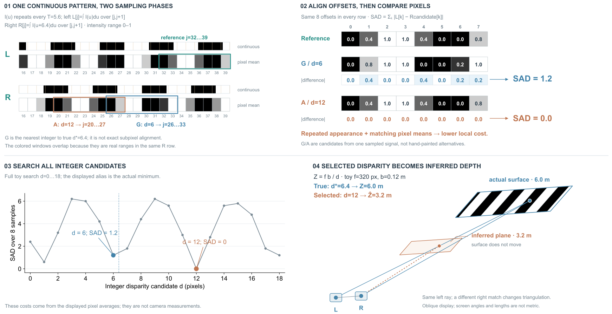
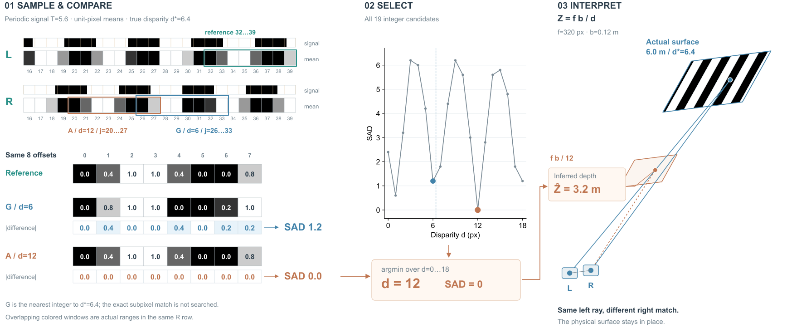

# Illusion of Depth：同一信号贯穿采样、匹配与深度

## 来源与范围

[Illusion of Depth: Revealing Hidden Stereo Vision Vulnerabilities in Depth Estimation](https://arxiv.org/html/2609.16336v1)，arXiv 2609.16336v1，2026-09-14。读§2.1、§3.2.1、附录A，并对照§3.2.2区分校准误差。实际查看PDF p4的Fig.4–5、p5的Fig.6；p6亦看过，但不是本稿的主要视觉参考。原论文PDF与页图保存在项目references目录。

只展开像素采样如何改变重复块的代价排序，再影响三角测量。校准误差、学习模型、完整攻击构造和防御没有展开。图面不使用作者图片，也未运行作者代码、模型、真实相机或攻击。

## 参考改变了哪些决定

Fig.5将场景、左右影像和局部块并置，启发本稿保留“同一信号的区间→逐项比较”；Fig.6同时给搜索代价全貌与局部低谷，启发保留全部19个候选，而不只挑两块展示。借的是对应和比较关系，未复制作者场景或实验曲线。

## 两种成立的组织

1. 水平四阶段：条纹→采样→SAD→几何，顺序直接，但要么灰度单元太小，要么画布太宽。
2. 上部“采样源／放大比较”，下部“全部候选／几何解释”：上部让对应和差值成为主体，下部分别回答选中的是否为最低代价、错误匹配意味着什么。

选择2。2D承担像素与数值读取，3D只承担两相机射线的交点关系。没有把每个步骤包装成立方体。分图共用候选身份与参数，主要成本是读者仍需跨区按d查找。

## 原创算例与可追踪性

I(u)为完整周期T=5.6的黑白方波，白半周期2.8。L[j]是[j,j+1]内I的精确平均；R[j]是同区间I(u+6.4)的平均。用解析原函数计算，不手填灰度。所有强度在0–1内。

- 显示左右全行j=16…39，参考L[32:40]，长度8。
- 参考值：[0, .4, 1, 1, .4, 0, 0, .8]。
- G：d=6，R[26:34]，SAD=1.2。它是几何视差6.4的最近整数，不是真正亚像素对应。
- A：d=12，R[20:28]，与参考完全相同，SAD=0。完整搜索d=0…18，A确实为本算例的全局最小值。
- 两个右侧候选区间真实重叠，未为排版而移开。
- f=320 px、b=.12 m，Z*=fb/6.4=6 m，Zhat=fb/12=3.2 m。三维两个相机、射线和面片用同一组参数生成，条纹也来自同一I(u)。橙平面表示推断的前平行深度，不是物体移动。

实际几何点P与假设点Q位于同一左射线上，右射线不同。整个平面按常视差假设展示，不声称计算了整幅图每个窗口的结果。斜投影各方向尺度不同，屏幕长度和角度不用于物理度量；精确值留正视文字。

这是理想前平行1D积分＋整数搜索的分析例。允许精确亚像素匹配时，真视差也可得零误差；因此不宣称所有算法、任何条纹或真实相机必然失败。没有相机噪声、畸变或网络输出。数值曲线用Matplotlib生成SVG后嵌入主图。

## 看图后的修订

R1：四区能追踪，但右下标题“same disparity”与不同视差的内容不符；实际表面的标签压在条纹上；曲线缺少可用字体，显示为与全图不一致的衬线字体。空间平面正对读者，深度层次较弱。

R2：标题改为选中视差转成推断深度；标签移到表面外；曲线使用Arial；固定数据，改变同一仿射展示投影，让平面倾斜并露出深度关系。实际查看了R1与R2渲染。R2的候选、代价与几何数值未改变。

## 对skill的回写与边界

重写已有“世界、图像与展示深度”段落：重建任务里，推断位置、真实位置和图稿投影是三个不同层次；可以由同一匹配索引推导几何，但不能将推断变化画成物理移动。保留CamoShift作另一类坐标变化的对照，不增加通用检查流程。

本稿仍较规整，分区之间靠符号对应；它证明了一次具体算例能够贯穿混合表示，没有证明整体审美或任意论文的泛化效果。后续可固定这组数据，把局部比较和三维交点放得更近，比较视觉重点；不需要新增机制或更多说明。

## 文件

- `illusion-depth-r2.svg` / `.html`：可编辑图与随图图注。
- `illusion-depth-r1.svg` / `.html`：初稿。
- `build_illusion_depth.py`、`illusion-depth-toy.json`：原创生成逻辑与数据。
- `illusion-depth-caption.txt`：解释范围及模型假设。

项目：`<原实验项目目录，仅作历史记录，不是运行依赖>`。只渲染作设计批评，没有导出或格式检查。

## R3→R4：固定算例，把选中量连接到解释

比较两种组织：保留四区、仅加跨区连线，或把采样/比较归在左侧，中间完整搜索、右侧空间解释，以选中量作为连接。前者保留宽曲线但增加跨区边；选择后者，让d=12成为代价和深度之间可读的中间对象。

`build_illusion_depth_focus.py`直接读取原toy JSON。参考、左右24个样本、19个候选的代价、相机/几何参数全部保持，比较块仍为52×42单元。采样行单元高度32而非38；曲线长宽比和几何展示投影改变，长公式/说明随图注。画布1800×960，R2为1800×1120。这是固定数据重排与改变展示比例，不是全部对象尺寸保持。

R3实际看图发现深度计算边悬空、真实平面标签贴近轮廓。R4把算出的深度变为有实体的读数，连到选中视差，并用无箭头引线指向几何假设；标签移开表面。没有把计算边画成物体移动路径。实际看R4后可沿橙色路径追选择及计算，成本是曲线变窄、19个候选较密，推断读数也略靠近射线。未取得用户阅读或审美反馈。

可迁移的是“跨表示的共同变量明确出现，并接到实际运算”，不是固定三栏。该条件加入已有等重分区提示；不新增模板、评分或导出步骤。

新增文件：`illusion-depth-r3/r4.svg/html/png`、`illusion-depth-focus-caption.txt`、`build_illusion_depth_focus.py`。完整假设沿用上述算例说明。
