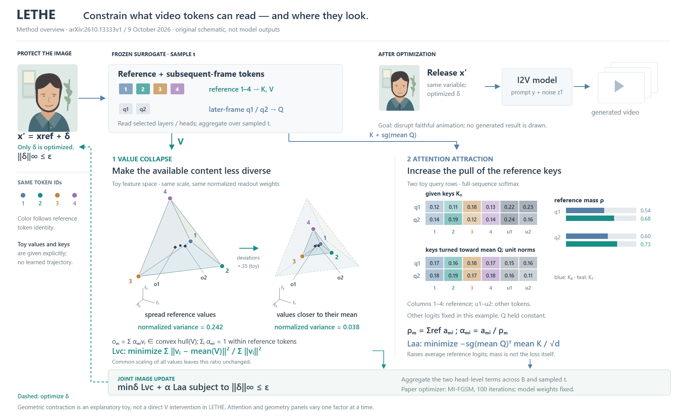
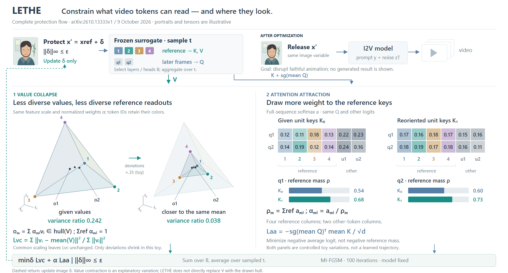

# LETHE：让数学对象承担三维主视觉

[论文v1](https://arxiv.org/html/2610.13333v1)，2026-10-09，预印本。实际查看Fig.2/PDFp5，阅读§3–4、Eq.1–6；未核对实现。

## 从完整机制选择展开

图保留图像δ、冻结surrogate、层/头与t聚合、K/V与Q来源、两项loss、仅更新δ、发布x′和后续I2V出口。两个可行组织分别是“整体入口+双目标展开”与“完整attention读取居中、两个loss旁路”；本图选前者，让几何和权重各有可读面积，代价是跨区理解。

原论文Fig.2是按收缩系数排列的生成画面与测量曲线，没有三维机制图。本例三维来自正文中的value凸包，不是把原图挤出。四个给定3维向量、透明三角面和两个凸组合读出真正承担几何关系；彩色ID贯穿token、顶点及attention列。主图的肖像是原创上下文，视频卡是输出符号，没有伪造生成结果。

## 几何不能改变实际算法

直接收缩V是论文的动机干预，实际方法优化图像δ。图中给定两个V状态仅说明偏差收拢，虚线更新返回δ，不把示意几何画成算法内部替换。Lvc为方差能量除以总能量，共同缩放所有V不改变它；因此示例固定非零均值，缩小偏差。特征轴不是物理深度，也不是高维模型的实测投影。

理论α在reference子集内归一化；实际a在全序列归一化。右侧保留other列，另算ρ及α=a/ρ，不能因解释凸包就删掉其他token。Laa是负平均logit且mean Q作常量，不是负ρ；所示ρ增长只来自给定K变化。两个展开分别控制变量，不冒称同一训练轨迹。

## 实际修改与迁移

R1中心标签挤在一起、出口连线碰说明；R2外移文字后右侧o1仍靠顶点3，R3继续移到凸包外，并把“×.35”明确为偏差缩放。保持实际读出位置，没有为好看把菱形拉远。全图仍有矩阵小字；尚无用户审美反馈或阅读速度测量。

迁移到新论文时，先问深度能否表达真实数学对象，再决定是否画几何。局部论证涉及的归一化、固定量与整体优化变量会直接改变图意，不应为得到漂亮收缩形状而省略；也不要求每篇都画凸包或把3维示例当实测特征。

## 压缩上下文，把面积还给读数

R4–R6沿用R3同一份V、K、Q、softmax、读出与两项目标，完整发布路径也保留。原来左侧身份说明和上方输入/出口占较多面积，矩阵只用14字号；新稿将上下文收成窄横带，矩阵改为左右并排，原先的侧边说明归入相邻标题与图注。两案都能覆盖完整流程，旧版的上下文较宽松，新版优先查数和观察几何。

在相同1760宽度下，矩阵数字14→18，几何投影尺度97→125，画布高度1070→950；这些是设计尺寸，不是用户阅读性能。人物、普通流程与部分说明变小，不能只报核心放大而忽略代价。图内损失、参考/其他列、ρ与α、单独示意范围、固定model/更新δ仍在。

R4放大后的顶点4碰到上方说明，返回δ的虚线穿过人物；R5下移几何并绕开人物后，坐标轴又靠近右图标题；R6将两组轴移到各自左侧。三稿均实际查看，未改变数据来避让。剩余问题是全图文字仍较多，顶部已经较紧；未获用户审美反馈。

可借用的是先从重复上下文收回面积，再分配给真正需要看清的数值或几何，并记录缩小了什么。不能把“整体高度减少”单独当成设计更好的证据，也不必让新论文采用同样横带。
