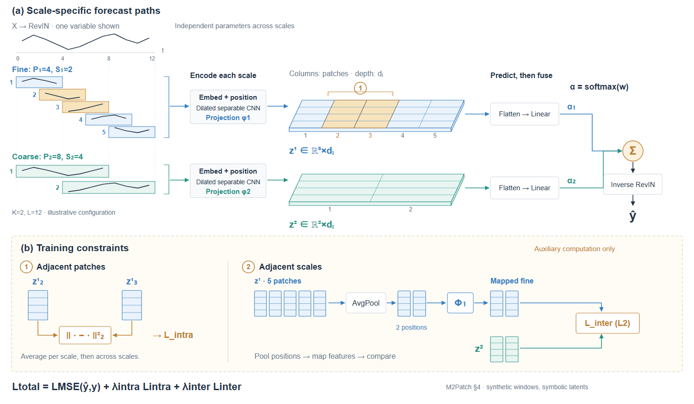

# 案例三：扩大机制，而不只是扩大特征面

**来源**：[M2Patch v2](https://arxiv.org/html/2607.19404v2)，§4.1–4.4。

初始图将三个尺度的编码器、潜在表示、预测头并排，两个约束在下方。第一次调整缩小编码器、扩大三张特征平面，仍存在问题：网格更显眼，但关键对齐过程没有靠近要比较的对象。

第二个构图假设只展开相邻尺度 s 与 s+1：

1. 两张浅三维矩阵表示潜在 patch 序列，水平是 patch 顺序，向后方向是特征维度，薄边仅帮助识别。
2. 相邻列高亮对应尺度内约束，不用虚构的特征数值表达“学到了结构”。
3. 两面之间放 fine→AvgPool→Φₛ→L2 的计算；coarse 单独进入 L2。该区域明确标为训练专用。
4. 每张特征面仍有独立出口通向自己的预测头，头部之后才按尺度权重汇合。
5. 图注说明只展开一个相邻尺度对；省略的尺度仍参与完整模型和平均损失。

这个案例的具体收益是比较对象与操作更接近；不是所有多尺度论文都应画两层平面。需要完整总览时可保留另一张图。正文中使用 dₗ 表示潜在特征维度，图中应沿用，不从通用模板带入 dₘ。

### 从局部机制迁移到完整双尺度实例

后续试验用显式标为示意的 K=2、L=12 配置展开完整路径：P₁=4、S₁=2 得到 5 个窗口，P₂=8、S₂=4 得到 2 个窗口。所有曲线片段来自同一条合成序列，并保持共享时间坐标；细尺度窗口 2、3 与潜在矩阵的同编号列一起高亮。CNN 会混合邻近上下文，列索引对应不能被解释成只依赖单个窗口。

从 RaG-Tree 迁移的是图注分工和面积分配方法。此图按尺度平行布置前向预测，训练约束另置下方；没有照搬共享索引居中的画法，也没有把跨尺度训练映射画成前向预测融合。矩阵保持符号表示，不编造特征值来增加“丰富度”。

首稿的列编号与维度标签挤在一起；修订留出独立标签行，补共享时间参考线及“深度表示 dₗ”的说明。图内给出窗口、操作和去向，图注说明示意配置、跨变量共享和网络内部省略。

取舍：此版适合说明完整双尺度路径，但从主表示查到下方训练操作比前述局部图更远。完整范围与局部解释各有用途，不因为新版看起来更紧凑就撤掉旧版。迁移时先找新领域真正需要共享的坐标、身份和参数范围，再决定子图位置。
