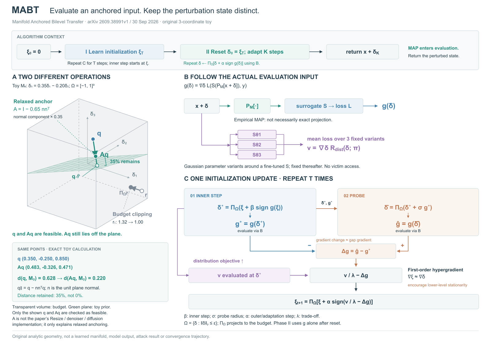

# MABT：锚定、预算与实际求值对象

## 依据与范围

[Anchoring Adversarial Trajectories to Data Manifolds: A Bilevel Transfer Optimization Framework](https://arxiv.org/html/2609.38991v1)，2026-09-30。读§3/Eq2–7、Algorithm1、Appendix A.2/Eq9，实际看PDF p1/Fig1。原图用网格曲面、模型边界和脱离曲面的轨迹解释动机；这是概念几何，未提供能照搬成真实特征曲面的坐标。

本图解释MAP求值与扰动状态的区别，顶部保留两阶段和返回出口。按算法展开初始化内步、探测、梯度差、分布梯度、ξ更新。下层梯度通过MAP后的输入求得；Eq4/9分布目标对原x+δ在固定的三个代理变体上求损失平均，不把MAP自动补到这一路。论文的变体来自代理周围局部近似，不等于真实未知受害模型分布。返回x+δ_K，不能画成返回MAP输出。主文有“minimizing expectation”的文字，但Eq3负风险与Eq6/算法的正号更新对应增大攻击损失；图遵循公式和算法。

## 从原图借什么

借曲面/体积/路径分别承担不同关系、保留普通流程作上下文。没有复刻原图的三栏对比，也没有虚构模型决策边界。原文强调实践MAP不一定精确求解理想变分问题，因此选可计算的松弛几何解释，不把箭头端点放到曲面上暗示严格保证。

两种可行组织：以完整算法循环为主体，几何作小插图；或以两种操作的差异为主体，旁边展示实际输入路径和更新协议。选择后者，左侧负责“是否落在先验/预算集合”，右侧负责“什么对象被求值和更新”。沿用前例的稳定行列提示组织右侧内步/探测的梯度状态，但没有将整图套成View Swap的矩阵。

## 原创三坐标算例

平面M₀满足z=0.35x−0.20y，单位法向n为(-0.35,0.20,1)归一化。设A=I−0.65nnᵀ，q=(0.35,-0.25,0.85)，q∥=q−nnᵀq。

- Aq=(0.482586,-0.325763,0.471183)。q与Aq都在示意预算[-1,1]³内。
- 到平面的距离从0.628366变为0.219928，保留35%的法向分量；Aq不在平面上。
- 独立提案r=(1.32,0.35,-0.45)，逐坐标裁切为(1,0.35,-0.45)，展示预算投影。它不是q的后继状态。

全部坐标和投影来自`mabt-toy.json`/生成器。这个A只是松弛锚定的独立解释，既不等于论文Resize/去噪/扩散实现，也不保证对整个立方体的所有输入都保持预算；只有本例q/Aq处于预算内。右侧梯度全为符号，不从这个几何例推断学习结果。透明壳表示集合，没有“越透明越低置信度”的含义。

## 看图与修订

R1立方体侵入标题与读数区，三个代理的线只接中间节点；R2减小展示尺度220→166、前侧边改实线后侧边保留虚线，保留所有几何数据和相机。输入分配与均值归约连接完整三个代理。加入单位法向解释、明确r在预算外。

实际看R2：标题和读数区分开，q/Aq/q∥可区分；预算外r在屏幕投影中仍落在外轮廓内，因此用r₁=1.32的正视读数明确越界，不能用投影轮廓判断三维包含关系。右侧仍偏公式密集，主体与更新协议的阅读关系还可改善；图中缩小坐标后细节辨认度有代价。未做导出/格式检查、模型实验或用户审美测试。

## 可迁移提示

同名“投影”先拆成实际算子：严格可行域投影、经验滤波/净化、松弛先验约束可能具有不同保证。几何的端点是否恰落到集合，按操作依据决定；未给真实坐标时使用显式独立算例或符号关系。图内区分用于求值的中间对象与最终更新/返回对象。

## R3：四评委驱动的修订

四位独立评委初评与四位新鲜上下文复评：美观 83.00→84.00；专业 82.00→86.00；方法解释 82.00→86.25；丰富程度 84.75→86.75；等权总分 82.94→85.75。分数是代理判断，不代表用户审美通过。

根据首轮意见，补目标与gap罚项含义、状态到梯度连线、T次循环和第二阶段更新，解释参数，统一数学下标，强化同一几何位置的35%残距。算例、相机和图的职责保持一致。主代理实际查看新版，复评只提供新版及同一原文依据。

复评仍指出左侧立方体视觉权重偏大、右侧梯度回折线偏长，一阶超梯度近似和局部高斯模型来源可以更明确。这些问题保留在评审记录中，未宣称全部解决。查看项目 jury-review-report.html 及 reviews/mabt-jury/ 两轮原始意见和决定。

## R4 / R5：不同重绘次数与策略

用户授权继续深入打磨，本次预算为累计三次评审驱动重绘，保留0/1/2/3次图稿。0表示已有R2作为四评委初评起点，不表示之前从未修改。每版四位新鲜上下文评委，评分尺冻结为rubric-v0100.md，任务/原文依据相同。

| 评审驱动重绘次数 | 图稿 | 美观 | 专业 | 方法解释 | 丰富 | 总分 |
|---|---|---:|---:|---:|---:|---:|
| 0 | mabt-r2 | 83.00 | 82.00 | 82.00 | 84.75 | 82.94 |
| 1 | mabt-r3 | 84.00 | 86.00 | 86.25 | 86.75 | 85.75 |
| 2 | mabt-r4 | 83.75 | 86.75 | 87.00 | 85.25 | 85.69 |
| 3 | mabt-r5 | 85.25 | 88.00 | 88.25 | 87.50 | 87.25 |

R4保持构图，补一般预算、高斯参数变体来源与一阶近似，改中性预算配色和q∥标签。专业与方法得分略增，整体分数几乎不动，长回线和左大右密仍被反复指出。R5改为内步/探测并列卡片和邻近的正负差分端口，缩小几何区占比；相机方向和数据不变，显示尺度166→140，画布1900×1160→1600×1120。它是内容组织与展示尺度同时改变的试验，不是纯次数的控制实验。

选择R5：第三次评审驱动重绘后，四维均分85.25 / 88.00 / 88.25 / 87.50，等权总分87.25。方法关系保持完整，梯度汇合与左右面积分配更清楚；保留小字、裁切对比度及梯度差动机仍依赖正文等不足。

- 重绘0、1、2、3次的等权总分分别为82.94、85.75、85.69、87.25。局部完善没有带来持续的总体提升。
- R4补齐来源、预算与近似定义，但长回线、主次失衡在评审中反复出现；这类问题应改变组织方式，而非继续补字。
- R5并列内步与探测，两个梯度从明确正负入口就近汇合。较R4，四维均分分别变化+1.50、+1.25、+1.25、+2.25；结构改变在图上可见，但分差不作统计显著结论。
- 所有R5评委均给ready且无critical；跨领域读者的方法分仍是85，说明更清楚地展示怎么计算，尚未完全解释为什么如此计算。
- 几何数据与相机方向未变，但显示尺度从166降到140，版面由1900×1160改为1600×1120。不能把结果只归因于重绘次数，也不能据单例规定每张图必须重绘三次。

完整对照：项目jury-redraw-report.html；逐轮决定：reviews/mabt-jury/round-3及round-4/decision.md。
