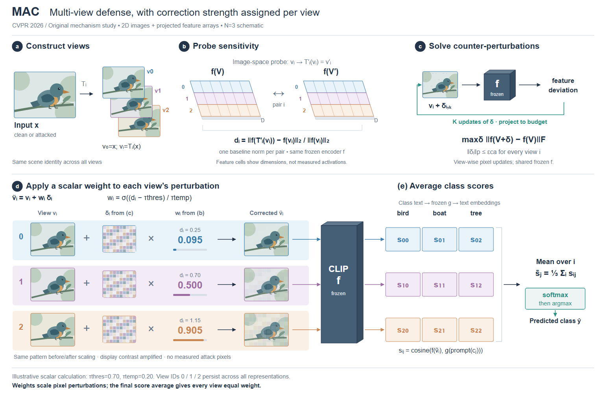

# 案例八：图像修改与特征依据分开表达

**论文：** [MAC](https://arxiv.org/abs/2606.06938)，CVPR 2026，v1 §3.3–3.6，Eq.4–8，Fig.3。

**要解释的变化：** 图像中添加的反向扰动由特征空间的目标求解，再由另一条探测分支产生的逐视图标量缩放。最终集成按视图平均分类分数；同一个“weight”不能画到错误的阶段。

选择上方机制依据、下方逐视图算术的构图。原图已有同场景的多视图，把这种对应转成 0/1/2 三行，贯穿图像、两组斜投影特征、dᵢ、wᵢ 和 class scores。局部厚度表示集合/特征表示；原图像内容和标量计算保持正视。N=3 是原创示意，鸟为原生矢量场景。

正文要求 V′ᵢ=T′ᵢ(vᵢ)，即对每个已有视图再次增强；dᵢ 的两项共享 ‖f(vᵢ)‖₂ 为分母。反向扰动 δ 作用于像素，f 冻结，目标让 f(V+δ) 远离 f(V)，没有已知 clean endpoint。图中不给出虚构的语义恢复轨迹或实测注意力图。

用 d=[0.25,0.70,1.15]、阈值 0.70、温度 0.20 演示 sigmoid 得到 w≈[0.095,0.500,0.905]。这些数字只解释标量公式，不能从鸟图推断为实测。分数矩阵保持 sᵢⱼ 符号，不补上虚构预测类别。三行的标量乘在扰动上，而非对右侧分数加权。

首稿有两个实际问题：增强箭头位于两组特征之间，容易被读成直接在特征上增强；扰动格纹与结果叠加使用不同图案，破坏“同一内容仅改变幅度”的关系。修订明确图像空间探测，统一每视图扰动格纹，再用幅度展示缩放；同时移开反馈箭头与图像标签的交叉。叠加为视觉示意，仍不等于真实有符号像素加法。

迁移到视觉论文时，先确认控制量索引到 view、patch、pixel 还是 channel，再决定它该是一列数、一张网格还是一组特征条。真实 heatmap 需要数据；示意则标明性质、保留可追踪的空间对应。此例仍有较大的冻结编码器块和重复图像，后续可以比较更紧凑的主视觉，但不通过省略作用对象来压缩。
