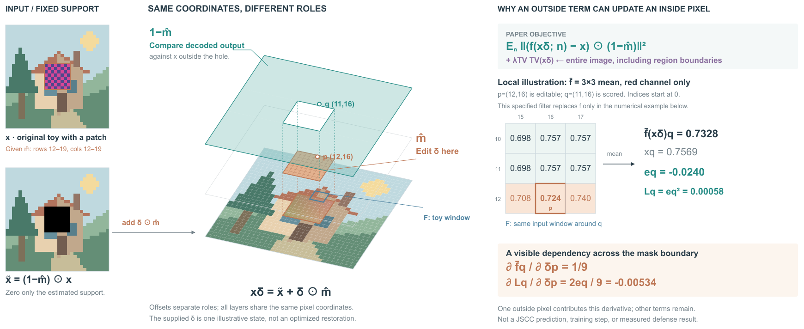
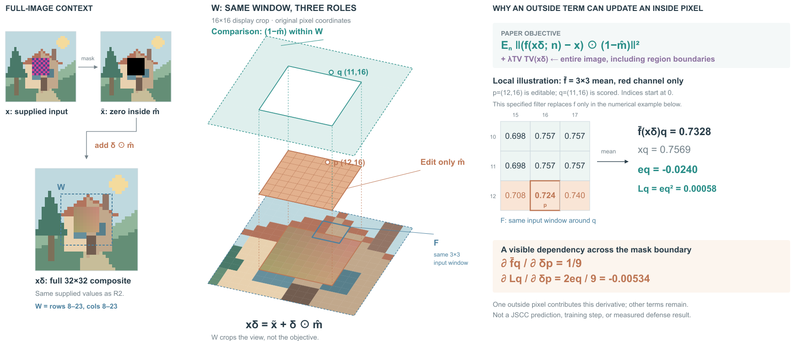

# MROP：修改域与比较域

## 依据与范围

[MROP: Mask-Region Optimized Purification Against Backdoor Attack in Deep JSCC](https://arxiv.org/html/2609.00786v1)，arXiv 2609.00786v1，2026-09-01。读§II–III、Eq7–14及实验设置，实际看PDF p3/Fig2。本图展开Phase 2的支持域及一个明确的局部算例，顶端保留检测、H0旁路、Phase 1定位和最终传输。不是完整模型复现。

检索同时看到SAWR（2606.08745），但本轮选择MROP：它的重建防御跨越图像与通信，且更新区域和数据项比较区域互补，能检验不同于WebMirage“身份—地址”的画法。

## 画前决定

阅读任务：通过同一坐标上的输入、可修改区域和区域外损失支持，理解“只改里面，为什么能够用外面监督”。参考原Fig2的局部仿真与两阶段分工，不照搬它的三个同等大框。

两种成立组织：①三阶段流程，把每阶段掩码、输入和目标配成小图；完整流程易读，但Phase 2的两个支持域需要跨模块查找。②主图展开Phase 2的共同坐标域，普通阶段缩为定位条，数值依赖另用正视局部。选②。透明镂空框显示补集，中间区域显示可修改支持，底层保留同源合成图。偏移距离只用于分开角色。

## 论文机制中影响画法的内容

- 防御发生在发送端，可本地调用编码器与解码器的组合f；比较重建和输入决定是否净化。H0跳过两阶段，仍编码传输。
- Phase 1优化mask logits，使用带logistic噪声的sigmoid松弛。其重建项比较f(软掩码输入)和软掩码输入，另有稀疏项。它不等同于Phase 2的区域外损失。
- Phase 2冻结mask与模型，只优化δ。输入是先置零的图像加δ乘mask；重建误差只在mask外计分，TV作用于完整合成图，包含区域边界。
- 本文正文未明确最终二值mask的具体阈值规则；本图不给它编阈值，也不把示意mask冒充优化结果。

## 原创同源算例

32×32房屋场景由生成器绘制，SVG用原生色块呈现。给定mask覆盖行12–19、列12–19；疑似patch用紫色棋盘，已知原画仅用于构造输入，不作为防御的可用参考。给定δ是平滑数值，不来自原画被覆盖的真值或模型推理。

所有图稿状态来自同一个x、mask与δ：x̃=(1−mask)x，xδ=x̃+δmask。空间主图最下层显示xδ，未画未经计算的JSCC输出。整个32×32数组及派生状态保存在mrop-toy.json。

右侧明确另指定算子f̄为3×3均值，仅解释一项局部依赖，模型f仍保留符号。红通道、p=(12,16)、q=(11,16)，零起始索引：p在可改域，q在比较域。输入窗口取自同一xδ的行10–12、列15–17。

f̄q=0.7328366013，参考xq=0.7568627451，eq=−0.0240261438，Lq=0.0005772556。该局部项对δp的导数为2eq/9=−0.0053391431。这是一个明确非零的依赖示例，不是完整梯度、迭代更新或净化收益；其他区域外项和TV未进入这个单项算例。

## 实际观看与修订

R1的三个域可以辨识，但输入置零图与合成图之间缺明确连接，p/q只写字母，数值窗口要自行寻找。R2补残差相加连接、p/q坐标和与局部表同名的F窗口。看R2发现窗口说明压在底图上，移到右侧留白。数据、投影和损失项均未改。

剩余不足：32×32图像是原创像素画，读者可能期待更写实的内容；这不影响本次支持域解释，但审美未获用户确认。透明比较层面积较大，局部窗口相对很小，想读精确量仍需转向右侧表。上下层是表示的展开，不能理解成真实物理层或信号直接沿竖线传播。

## 写回skill

重写现有“更新”表示行：先区分可改变量/区域、各损失实际比较区域和整体正则，再决定哪些共享坐标、哪些保留正视读数。不要把“哪里有损失”直接画成“哪里允许修改”；也不要把某个数据项的补集支持误用于全部目标。

这次提示迁移得到不同主视觉，没有沿用WebMirage并排页面，但仍不能据此证明任何论文都能稳定生成美观图稿。

## R4：同一窗口放大，目标范围保留

R2中央支持域只占完整32×32图像的一小块，p/q和F窗口可追踪但较小。本轮比较两种可行组织：扩大整个三层图并压缩右侧算例；或保留全图定位，只将掩码周围窗口展开。选择后者，保留右侧完整数值面板的尺寸与内容。

新生成器直接读取mrop-toy.json；窗口W为行8–23、列8–23，16×16。空间视图沿原投影方向，将单个像素的线性尺寸扩大为R2的两倍。mask边界、p/q和F都继续使用全图坐标。左侧增加同源xδ正视全图，标出W；原输入和置零图由224缩到154，换取展开空间。这新增了同源全图定位视图，不是只移动原有元素。

W是展示裁切；区域外重建项仍作用在全图mask外，TV仍作用于全图。透明层画的是比较支持与W的交集；虚线外边界提示视图截断，孔边界保持实线。没有改变样本、支持集、损失或局部计算。

实际看R3：局部放大后mask与F明显扩大，但比较层前沿靠近p点，角色容易混淆；上方说明引线擦过标题。R4增加比较层与修改层间距、重排短引线，p不再紧邻青色前沿；上下文像素色块去掉不必要的白缝。画布高1120→1150，不宣称更紧凑。实际看R4，空间边界分开，右侧数值保持原大小。

代价：完整输入图缩小，中央不再显示全部比较区域；读者要结合全图定位和“裁视图不裁目标”的说明。底图仍为像素画，未获用户审美反馈。此例支持在放大时同时明确显示范围、参与运算范围，而不是默认所有方法都应局部裁切。
