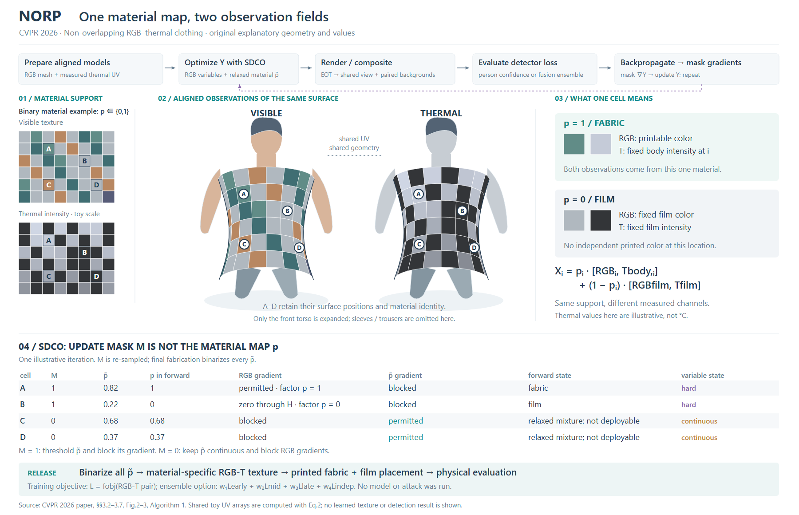
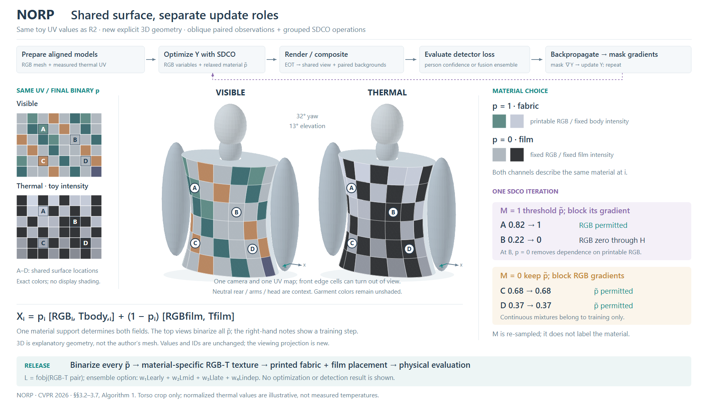
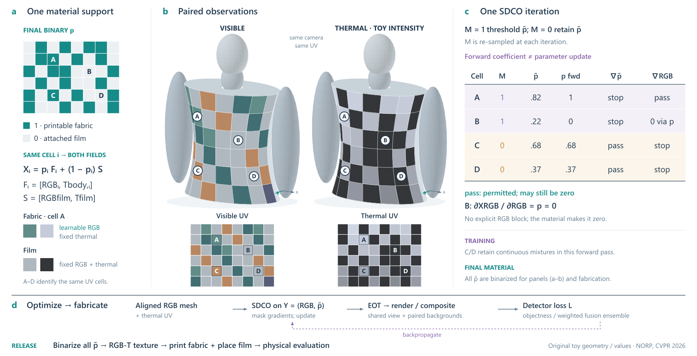

# NORP：共享表面与不同的掩码角色

[论文](https://arxiv.org/html/2605.04675v1)，CVPR 2026；本次读会议PDF§3.2–3.7、Algorithm 1，实际看Fig.2/p3和Fig.3/p4。未核实代码。

## 为什么采用这张构图

比较“共享曲面与双模态观察为主，更新表在下”和“四维像素及更新规则为主，衣物退为上下文”。选择前者，让同一位置从UV到曲面保留A–D；完整准备、优化、成像、目标与最终二值化/制作出口留在窄带。仅展开前躯干，其他服装部位注明未展开。

## 同位置不等于同一作用

材料系数p同时决定RGB与热强度；更新掩码M决定本轮哪些变量离散、哪些梯度被阻断。前者可画在表面，后者按同一位置列出状态。连续p是训练松弛，最终材料必须二值；不把灰度M图当作衣物的热图，也不画成两个模态各自一层材料。

原创6×8数组按Eq.2生成两套观测，解析曲面与UV相同。四个局部含M=1且p=0：RGB虽未被掩码显式阻断，但∂X_RGB/∂RGB=p=0。区分更新许可与实际变化，避免给所有“可训练”格强行画变化箭头。合成例未运行优化，不假造下一轮参数或检测输出。

## 实际观察和代价

R1的腿部挡住说明；R2缩短中性腿部并增加训练返回线，缩短贴近分隔线的标题，补表头。两稿实际查看。保留数据色而不额外加阴影，因而曲面纵深较轻；表格便于逐项核对，但文字较多。没有用户审美结论。

可迁移点是根据作用区分同形状的变量，并用相同位置建立联系；不是让每篇论文都加入人体或训练状态表。

## 斜视曲面与就近操作：R4

R2保留作为逐项核对的前视版本。R4保留全部6×8 UV数组、材质系数、颜色、热强度和A–D位置，新增显式三维解析曲面、背部与中性人体部件。相机采用正交投影，yaw32°、elevation13°；双模态使用同一几何和相机。前图只是二维曲面示意，因此本次是同数据、改变几何与投影的构图试验，不能称为固定模型的纯排版对照。

在原本的同一阅读任务下，两种组织都成立：R2的表格方便逐列查更新状态，R4按M=1/M=0分组，把四个位置的前向p值和梯度角色放到模型右侧。保留材料解释、完整流程、目标和最终二值化；更新数值没有变化。组内箭头是p̃到本轮前向p的转换，不是优化后参数。

三维依据实际顶点投影、朝向筛选与深度排序；背面无已知纹理，保持中性，不随意补画。衣物色块不加照明，依靠轮廓、缩短和遮挡显示深度；只对不承载数据的中性部件加明暗。这里没有模型渲染或热物理仿真，不能解读为真实拍摄视图。

R3/R4均实际看图。R3面片边缘的细缝干扰数据格，颈部比例也抢眼；R4调整面片边缘覆盖，缩短颈部并补中性肩部连接。数据不为更好看而重着色。R4同宽1800，画布从1160降至1030；这只是面积取舍，不证明阅读更快。文字仍多，部分边缘网格缩短，正视UV因此继续保留。无用户审美结论、导出或格式检查。

## 紧凑分图：R6

R4仍有大标题、完整顶流程与多段重复解释；空间主体虽然清楚，但各区视觉权重相近。比较两种成立组织：共享p居中向两观测展开、训练围绕其组织；或材料—成对曲面—状态表并列，普通流程放底部。选择后者，保留两模态同高度比较与各自UV查询，避免主图再加入交叉回路。不是所有内容都采用三栏。

R6保留R4的全部数组、解析曲面、相机和主体显示尺度；已有二值p新增为分类材料图，与RGB/T观测用A–D对应。两个UV从独立左栏移到各自曲面下方。右侧将两组说明整理为同列状态：M、松弛p̃、本轮前向p、p̃梯度、RGB梯度。B仍显示经p=0自然归零，不能以通用“可更新”代替。训练连续值与最终二值、示意热强度留在图内；大标题、相机角度、示意生成设置和长来源移到图注。

同宽1800，图高1030→920，主体和UV显示尺寸保持不变。完整准备、SDCO、EOT、共同视角/背景、目标、回传和最终制作/评价出口仍在底带。加了新的材料表示，又移出了说明，因此不是图内信息严格相同的排版对照；没有测得阅读速度收益。

实际看R5/R6：R5右模型的坐标标记贴分隔线，R6移近主体；补热图示意标记，材料色样注明取A，避免暗示所有布料颜色相同。缩短画布后矩阵关系更集中，但三维人体仍是解析示意，四位置标签与规则仍需配合阅读，不把本次视为用户认可。使用SVG图像预览，没有导出/格式检查或浏览器页面验证。

