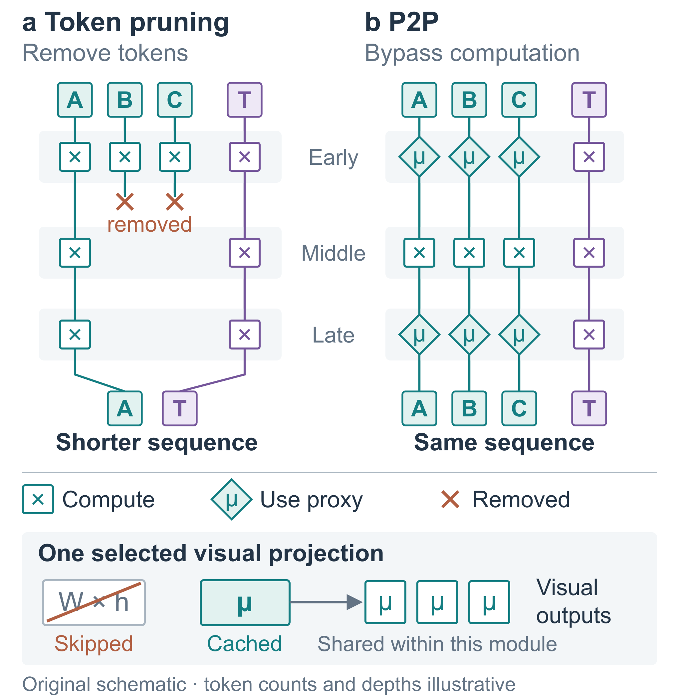
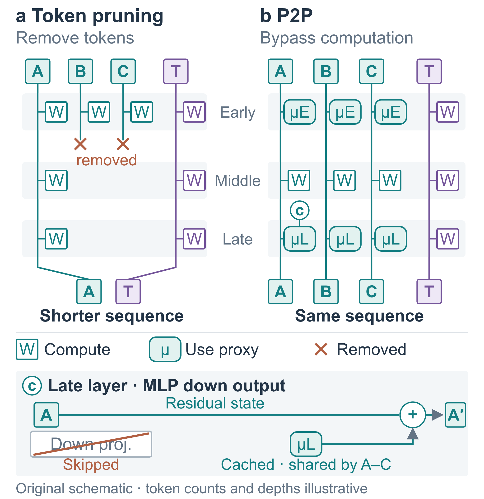
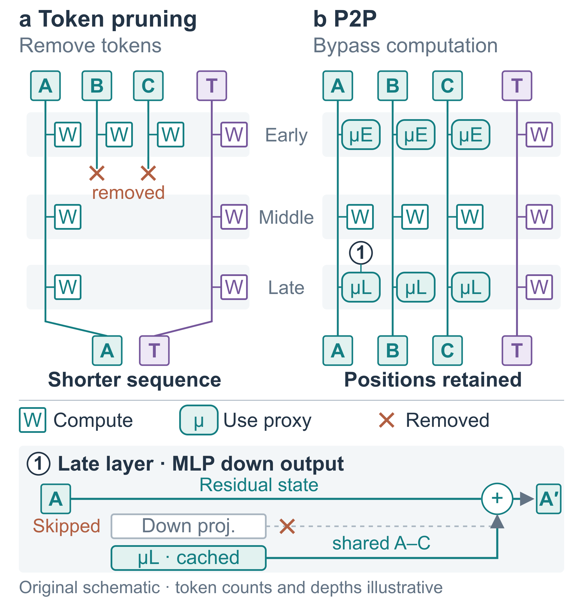
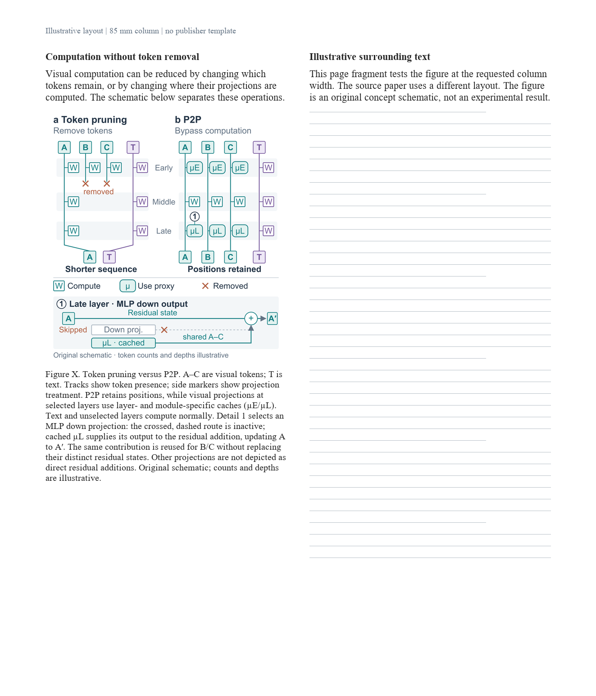

# P2P：单栏概念对比，少字后仍需分清替换对象

[论文](https://arxiv.org/html/2610.03389v1)：From Patching to Pruning Visual Computation in Vision–Language Models，2026-10-02。已读保存的全文§1、§3.1–3.2、§4.4、A.1及PDF p2/Fig.1。任务是区分token pruning与P2P computation bypass，不覆盖整篇方法的离线构造、搜索与可选适配。

## 本次输入与组织

独立设计代理获得skill、原文及“85mm单栏概念对比”的任务，自行选择参考与构图。比较并列轨迹与共享序列/侧边差异，选两列同身份、同深度对齐：左侧token轨迹被删除而终止，右侧位置保留但投影计算来源改变；配一个具体局部。该任务适合二维精确对应，没有强加三维。

三版均85×87.5mm；主要字体约8.15–9.56pt，辅助标签约7.1–7.8pt。页面预览用10pt正文与9pt图注；这是相对版面设计试验，非出版社模板适配。token数、删减位置、深度均为原创示意，不是实验结果。

## 三版的实际变化

- **R1**：贯穿轨迹上串联μ，底部另画缓存广播。四位均看懂删除/保留，但三位将“整token状态是否被μ覆盖”列major。计算和删除都用叉号；早晚μ未区分。少字没有自动消除语义歧义。
- **R2**：投影标记移到token轨迹旁；计算改W；早晚缓存用全尺寸µE/µL；局部展开明确的MLP down输出加回残差，不能泛化为Q/K/V等都直接加回残差。四位ready，但四位仍指出停用投影与缓存无共同输出接口。
- **R3**：旧投影与缓存上下对齐到同一个残差入口，停用虚线、活动实线；索引c改1，避免与token C混淆；结果标签改Positions retained。最后一版图内无完整公式，保留必要符号。替换关系更直接，代价是局部更密，叉号再次被用于两个相近但不同的动作。

每版四位新上下文评委，先看同尺寸页面比例，再看原图和原文；不给旧图、旧分数或修改说明。四维/评委等权：

| 重绘次数 / 版本 | 美观 | 专业 | 方法解释 | 丰富 | 均分 | ready |
|---|---:|---:|---:|---:|---:|---:|
| 0 / R1 | 86.25 | 82.00 | 80.50 | 83.00 | 82.94 | 1/4 |
| 1 / R2 | 86.75 | 85.00 | 84.75 | 83.25 | 84.94 | 4/4 |
| 2 / R3 | 86.75 | 85.00 | 86.00 | 83.75 | 85.38 | 4/4 |

本次选R3：共同出口与位置保留表述更切合概念任务，承认R2局部更松。两次重绘预算用完，保留minor而不继续刷分；R2到R3不足一分的差异不能证明稳定提升，更不能推出“两次最好”。这些是代理判断，不是用户认可，也不能与[全方法大屏稿](p2p.md)直接比较。

## 可迁移的经验与边界

减少文字后，先检查图元是否混合了**对象身份、当前状态、处理方式**。身份轨迹可连续，但状态仍可改变；将处理标记与状态区分，展开一个准确实例，常比补一句长说明更直接。替换关系让新旧来源对应同一接口，并区分活动与停用，避免画成“先计算再覆盖”。这不是要求所有图使用轨迹或残差图。

R3仍有局部缺点：Skipped靠近A、橙叉兼指token删除与运算停用、局部较密；共享缓存对B/C的作用由重复主图标记和短注释说明，未重复三套局部。图注仍偏长，没有验证更低高度、跨栏、真实模板或其他图型。此次实际证据支持的是该单栏概念任务的关系澄清，不能宣称通用美观或混合三维能力已验证。

## 看图

R1：

R2：

R3：

[R3可编辑SVG](../visual-studies/p2p-concept-r3.svg)

版面比例：

