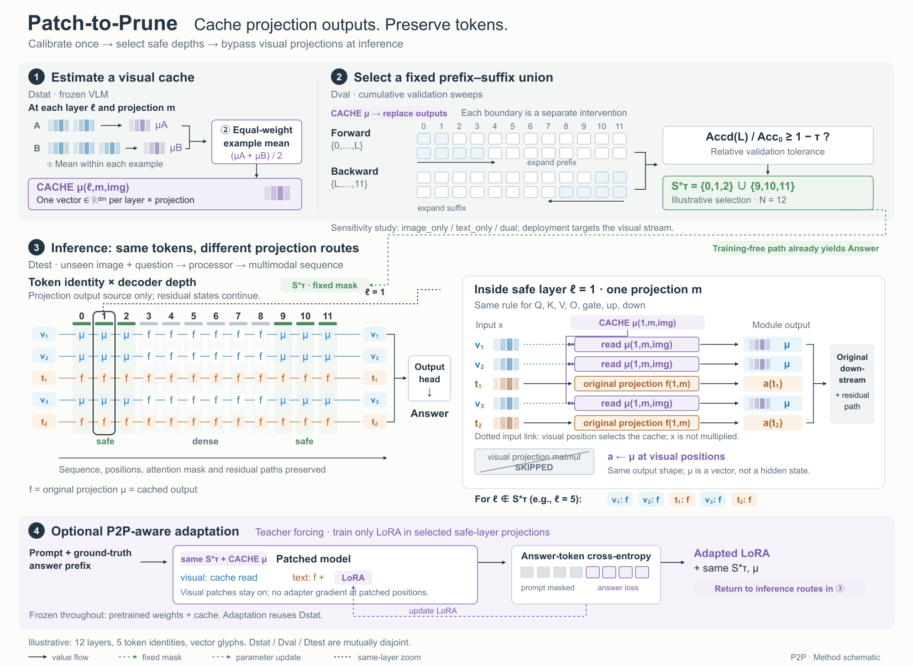
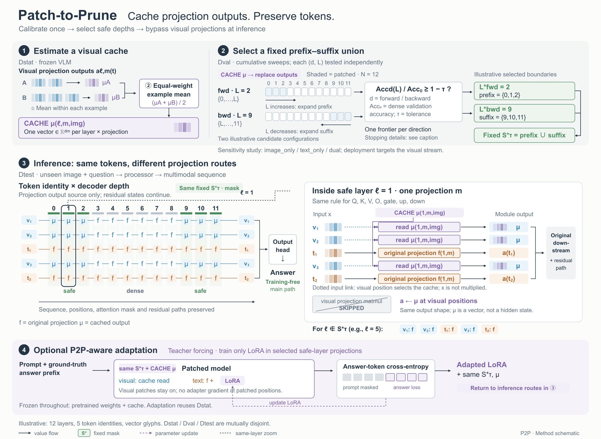

# P2P：保留对象，改变运算来源

[原论文](https://arxiv.org/html/2610.03389v1)，2026-10-02，依据§3.1–4.5、§5.1与A.1，实际看PDF p2/Fig.1。原图阶段分工见[近期原图比较](../hierarchy-references.md#p2p阶段分工明确不代表关键操作已足够大)。

## 可借用的组织

比较等宽三阶段与“配置带＋token×depth主体＋同层局部＋可选适配”，选后者。五个稳定token身份贯穿12个示意层；同一层展开直接显示三个视觉位置读同一个μ、两个文本位置继续投影，接回原下游与残差。主视觉解释“序列保留、投影输出来源改变”，不靠大型模型外壳或剪刀图标。

输入照片不是必要证据；二维行列更适合精确追踪。缓存均值用两个不同长度样本先各自平均、再等权平均，避免只画一个CACHE模块。七种投影共享替换规则，不画成虚构的并联拓扑。可选LoRA的训练目标、冻结对象和返回推理保持出口。

## 实际失败与重绘

独立规划已把上述结构说清，落图仍出现缺口：R1扫描格显示的候选与最终边界2/9对不上，四位评委均不能从图上追踪并集来源。规划完整不是成图完整的证据。

R2把候选L、填色集合、示意选定frontier和前后缀逐一对应；平均对象就近命名，验证符号补定义，安全集长线换同名接口。推理主体与完整职责保持。每版四位独立评委、同一任务和评分尺：

| 评审驱动重绘 | 美观 | 专业 | 方法解释 | 丰富 | 总分 |
|---|---:|---:|---:|---:|---:|
| 0：R1 | 82.50 | 82.75 | 80.00 | 87.25 | 83.13 |
| 1：R2 | 84.75 | 86.25 | 84.50 | 88.25 | 85.94 |

选择R2：主要对应关系已改善，四位ready，无critical/major；剩余小字、断行与搜索展开问题不靠继续叠注释处理。最多两次预算未强制用满，不能据此推出一次重绘最佳。分数仅为代理判断。

## 有限范围与代价

- 原文§4.3的两次不合格停止与边界赋值有歧义。图展示已确定的累计集合、判据、边界和并集关系，未知停止细节留图注。不能因局部不确定删掉其他确定接口，也不能补造测量或保证。
- R2没有完整复演多候选搜索；这仍是解释上限。全宽2000×1460图稿在约1600px展示，不能宣称适合紧凑单栏。
- 同名端口缩短连线，代价是需要标签回认。μ在矩阵按模态着色、缓存区按来源着色，跨视图一致性还可改善。
- 适配区明确text:f+LoRA；返回主图后original f图例仍需更就近的条件说明。新修改需独立复评。
- 12层、边界2/9、五个token和向量图元均为原创示意，没有模型测量、加速或准确率实验。

## 看图

R1：

R2：

