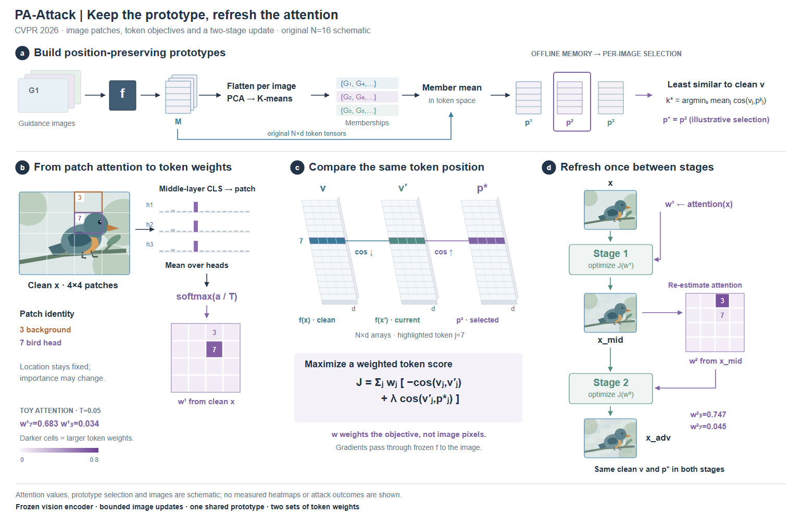
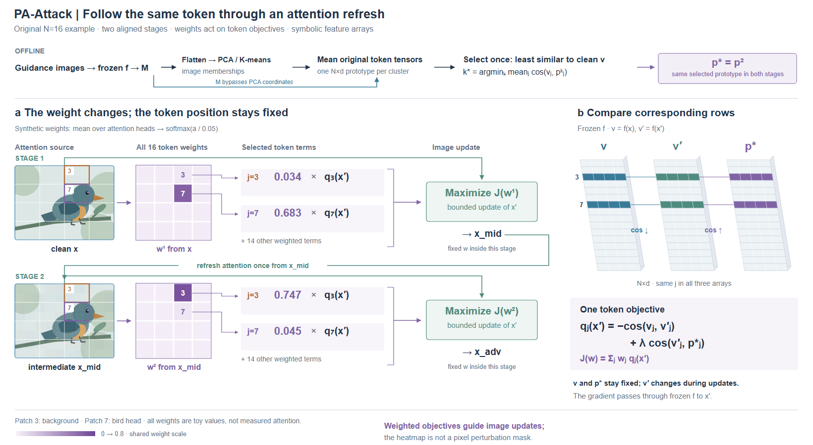
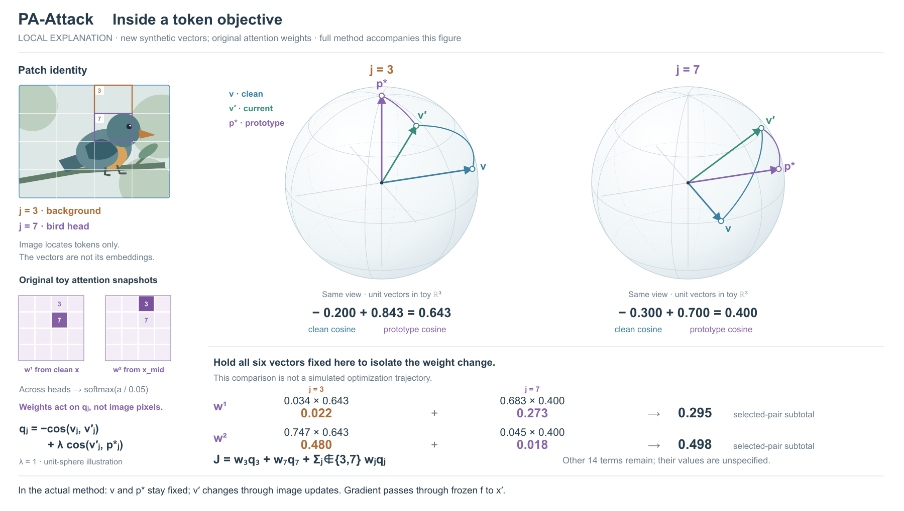

# 案例九：固定原型与重新估计的注意力

**来源：** [PA-Attack v1](https://arxiv.org/html/2602.19418v1)，CVPR 2026，§3.1–3.3、Fig.3；[作者代码固定版本](https://github.com/hefeimei06/PA-Attack/tree/772b48d5ba85d5c715c028c4bbedc1ed6fda3131) 中 prototype/prototype_pca.py 与 vlm_eval/run_evaluation_paattack.py。核对的是会改变图中对象或运算方向的部分，没有运行模型。

**主要关系：** 一次选定的 N×d 原型和 clean token reference 跨两个阶段保持不变；token attention 则从 clean image 与中间 adversarial image 分别提取。新权重对应同样的 patch 位置，变化的是重要性。

这次不沿用 MAC 的三视图逐行算术。上方窄带交代 guidance images、每图特征、PCA 聚类成员和 token-space 平均，选出的 p* 用相同符号进入下方。原始 M 另有一条通向平均操作的支路，避免让 PCA centroid 被误读为原型。中间三个浅投影 N×d 阵列将同一行 j=7 对齐，表示 clean/current/prototype 三方比较。右侧以两阶段图像状态为主线，把第二次 attention 的来源落到中间图像上。

左侧 N=16 的原创鸟图为 patch 定位，不是模型输出。原生 SVG 的 4×4 patch 网格、head attention 条、跨 head mean、temperature softmax 和二维权重图保留相同索引；j7 对应鸟头，j3 对应背景。两个热图都由显式 synthetic attention 计算，并就近标为 toy，使用同一个 0–0.8 色阶。第二阶段 j3 权重变大仅为说明重新估计，不能当作本鸟图真实的模型行为。

首稿的 repel/attract 箭头像是在搬运向量；修订用连接对应行的细线与 cos↓/cos↑，把关系落回相似度变化。单个 prototype 的重复叠片也改为一张特征阵列，避免暗示每原型还包含一组数据。首稿色阶上限 0.6 会使 0.683 与 0.747 同色饱和，修订为统一 0.8 上限。注意力值图的色阶必须覆盖示意值，不能只选好看的颜色。

**与 MAC 的迁移结论：** 两篇都涉及权重，但 MAC 的每视图标量缩放输入扰动，PA-Attack 的每 token 权重调节目标项。先确认权重的索引与作用对象，再选形状和连线。PA 图中的 weight map 不是直接的 pixel mask；梯度通过冻结编码器到达图像，可能跨 patch 耦合。

论文 Eq.10 与 ascent 记号存在符号不一致，官方代码也有第二阶段预算中心等实现差异。图定义独立最大化 score J 来表达 Eq.7 和实现支持的方向；不冒称完整代码复现，详细差异留在项目 brief。设计可以保留机制事实而明确选择表示层级，无需为每个实现差异膨胀主图。

## R3/R4：阶段对齐与局部目标项

保持R2的attention数组、T=0.05、共享0–0.8色标、原型选择与鸟场景。改为两个阶段上下对齐：图像来源、完整权重图、j3/j7目标项、图像更新。两个位置的权重接到同一索引的qⱼ(x′)，其余14项明确保留在求和中。目标项是符号，没有编造cosine值。固定参考与对应特征行在右侧集中展示。

R3从整个热图引出局部项，R4将引线接到实际格子，增加包括其余项的求和括号。图像状态另有绿色通路进入优化，紫线表示目标权重；阶段1的x_mid返回第二行，和行内固定权重说明错开。查看两稿并修订，没有运行模型。

这次迁移保留了“完整定位+局部展开”，但局部是两个离散索引，不是空间裁切。DefenseSplat框内外说明区域保留；这里按j相同表达跨阶段权重变化及作用位置。不要把局部展开固定为放大方框或三列模板。

取舍：R4更易逐行比较同一token，offline分组、head attention细条和最终图像改为紧凑文字/符号，原机制保留但来源细节不如R2充分。画布为1640×900而非1540×990，比较页按相同显示宽度；不能只凭原始像素尺寸声称所有元素更大。布局仍有一条跨阶段长线，三方张量仍是符号网格。用户审美尚待确认。

## R5/R6：抽象余弦目标的局部几何

R4的特征张量只表示维度与行身份，q仍是符号。本次比较两种局部表示：用正负标量条拆开两个cosine，或用单位球解释三个向量的方向关系、数字正视计算。选择后者，测试非物理三维内容；不把镜头/光线等物理造型移植到特征空间。完整R4随图保留，局部不冒充新方法总览。

保留鸟图、j3/j7、原attention及softmax权重，新增六个三维单位向量。λ=1，点积计算得到q3≈.643、q7=.400。六向量不是该鸟的模型特征，也不是从旧符号矩阵做PCA；新低维例仅解释余弦算子。球面、方向和曲线共用正交相机，曲线连接方向，既非向量搬移也非优化轨迹；投影后屏幕夹角不能直接当作真实余弦。

底部只为隔离权重变化，保持六个向量全固定。w¹/w²对选定两项的小计约为.295/.498，其余14项未知而仍在J中，不能当作零或据此宣称实际J改善。实际方法中current v′会随图像更新改变，clean v与p*固定，图内及图注都明确此差别。数据与计算保存在项目toy文件，未运行编码器或攻击。

实际看R5/R6：初稿公式压近右球面，底部连续等号容易被误读成错误连等式。R6将公式移到左侧、将各乘积和数值贡献上下对齐，再汇合为小计。新增几何有助解释方向关系，但占用更多面积，权重小计仍需数值；无需因此把每个token都画成球。没有用户审美结论，没有导出/格式检查。

可迁移：先按算子选择几何。余弦可用单位方向，原始点积或范数却不能无条件归一化；低维解释实例与实测特征投影是两种证据。空间表达负责关系，正视读数负责度量与乘法，局部范围保留可见。

## R7：同数据，只改展示相机

复看R6，j7的clean/current在屏幕上几乎沿同一直线反向，真实三维余弦.300却不易从造型理解。比较六个展示视角的端点分离与投影长度后，选az110°/el25°，两球共用。所有向量、q、w和贡献不变，标签跟随真实端点；R7实际看图后两方向可分辨，说明空间表示之外还需选择可读视角。屏幕夹角不能量作三维余弦，原数字继续保留。

R6仍保留对照。本次是同数据换展示相机，不是改变特征或优化结果；不能把这组角度写成所有球面或物理相机的默认视角。
