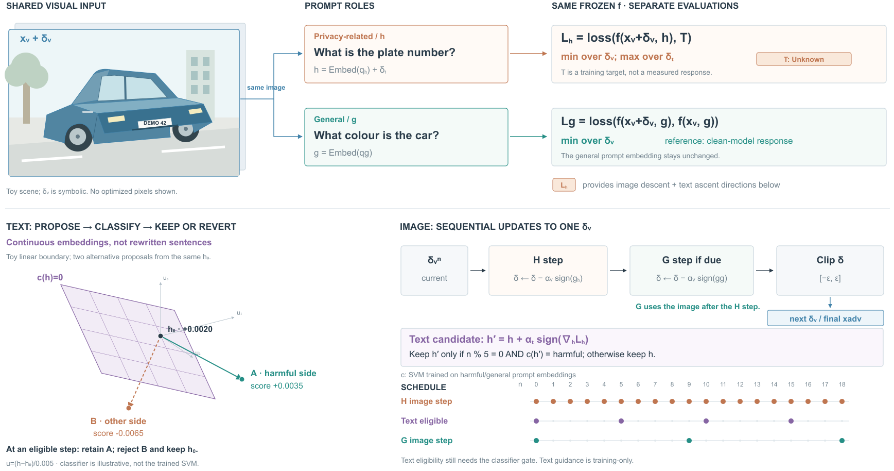

# ProAda：问题角色与连续嵌入更新分开表达



## 依据与范围

[Answer It or Not? Towards Prompt-Adapted Adversarial Images on Vision Language Models](https://arxiv.org/html/2610.16622v1)，arXiv 2610.16622v1，2026-10-12。阅读§3.1–3.3、Algorithm1和默认参数，实际查看PDF p4/Fig.2。PDF与页图保存在项目references目录。

本稿画targeted分支的主要机制：同一图像的两类提示目标、连续提示候选的分类保留、图像H/G更新先后、默认频率与最终图像出口。untargeted分支未展开。没有运行VLM、SVM训练、图像梯度或对抗优化，不声称复现保护效果。

## 原图观察

Fig.2将视觉输入、文本输入、冻结VLM与两类目标组织在同一框架，提示候选的判断局部含回退关系。其整体图将H/G损失并置；画更新步骤时需回到Algorithm1确认先H、可选G、最后clip，不能凭整体图画成独立并行状态。

借同一图像和两类具体问题的对应关系。原图人物照片、AI图标与模块造型未复用。输入句子保留可读内容；嵌入变化不假造为新句子。SVM用于训练时保留候选，不是最终部署的问答过滤器。

## 前向使用skill与构图选择

上轮主视觉提示要求先确定可见差异，不默认矩阵或流带。本例关键不是数值分配，而是同一图像上的问题角色与不同变量的更新许可。

比较：

1. 沿Algorithm1自上而下排完整流程，具体问题作边注。顺序易读，但图像语境与保留/拒绝的用途较弱。
2. 上半用共享场景与两类具体问题解释目标；下半用独立连续空间例解释提示候选，以顺序状态条和频率表解释图像更新。

选择2。原创车辆语境让两类问题可辨；目标“Unknown”明确为训练目标，一般参考保留f(clean,g)符号，未捏造模型回答。三维边界仅说明连续候选的分类，不把造型车当数值嵌入来源。没有沿用上轮的流带，只迁移“关系决定主视觉”的选择原则。

## 方法关系的具体取舍

- 共享xadv=xv+delta_v用于不同评估；VLM参数冻结，改变的是输入。示意车牌DEMO42无真实身份信息，所有车形、场景均为原创SVG。
- H分支对delta_v下降、对提示嵌入上升，targeted目标T=Unknown；G分支保持与干净图像模型响应一致。
- H图像梯度与文本候选方向来自当前H评估；之后先更新图像。文本候选只在频率允许且分类仍属harmful时保留，否则保留此前提示。
- G步骤在H图像更新之后计算梯度；最后clip到扰动预算。图像H/G不是同时写两个独立delta。
- 默认R_v:t=5，R_h:g=9。n从0开始，故0两条件都到期；图示到18，文本eligible为0/5/10/15，G为0/9/18。eligible不是已被分类器接受。
- 文本引导与分类器属于训练过程，最终输出是一张图像。prompt文字只用来说明原始角色，不声称对连续候选解码。

## 独立几何例

采用人为给定线性分类器，不假称论文SVM的核或训练边界：

```
h0 = (.2, .15, .2)
w  = (1, -.4, .3)
b  = -.198
score(h) = w·h + b
alpha_t = .005
```

局部显示u=(h−h0)/.005。零分数平面为u1−.4u2+.3u3=−.4，h0分数+.0020。两个独立假设sign方向A=(1,1,−1)、B=(−1,1,−1)生成两个候选，分数分别+.0035和−.0065。它们从同一起点出发，不是连续两步，也不是模型求得的梯度。

在可更新时刻，示意分类器对A保留、对B回退；不在可更新时刻时两者都不写回。所有几何面片和点由同一局部坐标计算，分数也由同一原坐标计算。三维为解释例，不是高维真实嵌入的降维；透明度仅使面后线条可读。

## R1→R2

实际看R1，发现schedule标题与n=0标签靠近、clip后的图像出口只在文字里；R2缩短标题，增加明确出口和连线，补分类器训练来源及h0分数。再次查看R2。数据、候选与主布局保持。

仍有较多公式与分区，场景和几何属于两个独立解释层，需读近旁标注；它没有证明用户更喜欢该风格。当前试验说明提示可以跳出矩阵/流带，未证明任意内容都可自动得到高质量设计。

## skill回写

重写混合语法中的“文本”行：区分实际字词/token操作与连续嵌入操作，后者不虚构解码句子。该经验针对更新变量容易混淆的任务，不要求所有提示图加3D边界。图像语境和数值算例独立时继续就近说明。

文件：build_proada.py、proada-r1/r2.svg/html/png、proada-caption.txt、proada-toy.json。项目<原实验项目目录，仅作历史记录，不是运行依赖>。无导出或格式检查。
