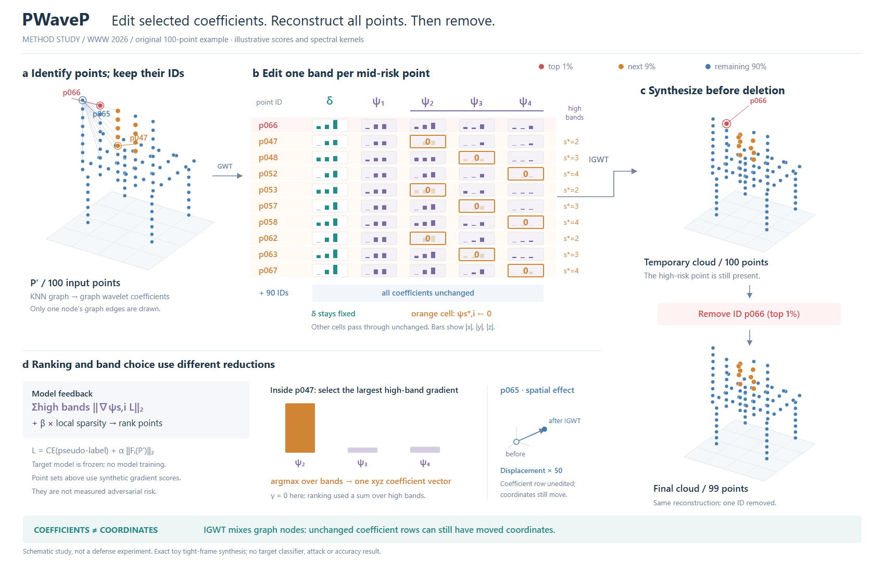
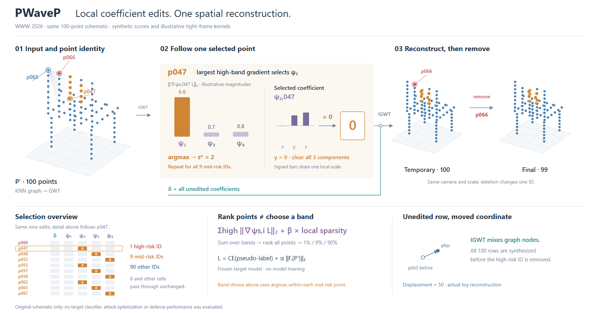

# PWaveP：修改发生在哪种表示中

[论文v1 / WWW2026](https://arxiv.org/html/2602.03333v1)。实际查看Fig.1/PDFp3，读§2.4、§3.2–3.4、Eq.7–17。以下是原创示意经验。

## 关键决定

采用点ID×频带表作为主体，点云只承担空间身份和前后状态。每个中风险行只选一个高频带；每格代表xyz系数向量，不是三个频带。低通列固定，其他90行压缩但继续参与重建。高风险红点在临时点云中保留，到删除操作才消失。

否决“高、中、低风险三份点云并行处理再合并”的构图：它容易把系数选择误读为空间上独立处理。图谱提示可借用PA-Attack的索引操作和DefenseSplat的固定低频，但此论文没有两个替代重建分支。

## 两种选择与一次整体合成

排序使用高频梯度范数之和加局部稀疏项；中风险点内的频带选择使用argmax。前者选点，后者选带，不能用同一个max图标代表。

未编辑的系数行不保证该点的坐标不变。逆图小波合成混合节点，因此三组最后共同进入N点临时重建，再删高风险ID。以同一蓝色p065展示实际示意位移，避免只有一段抽象警告。

## 实例与边界

100点原创椅形、合成梯度和四个原创带通核；K=20无向无权图。核经归一化形成紧框架，实际计算系数、清零和合成，未复现作者核参数或运行模型。10行展开、90行压缩；1/9/90分组是合成分数排序。临时/最终点云同视角同尺度，局部位移放大50倍并明示。颜色跟踪原始分组，不重新判风险。

R1地面与说明重叠、两个输出尺度不同、变换标签压行标签。R2调整间隔与尺度，把一个未改系数行的空间位移可视化。表格占较大面积、点云偏疏；尚无用户审美反馈。只记录此次有效的设计决策，不把三维点云或系数矩阵升级为所有论文的模板。

## 可借用提示

先确认修改作用于输入、参数、系数还是最终空间；再确认后续合成是否混合对象。保留同一ID贯穿各表示，把局部选择和整体作用分别画出。若同一算法用不同归约选点与选带，让它们各自对应明确的输入和出口。

## 代表性展开：把重复操作让出的面积交给关键运算

R2适合逐行查询系数，但选择规则在表外。R4保持同一组点、分数、编辑位置与重建数据，将表改成编辑位置总览；主区域只展开p047的三个高频梯度以及所选xyz向量清零。九个ID及其不同选带仍可查，并明确对九点重复操作。右侧临时/最终点云横向同尺度比较。画布同宽1700，高度1080→900。

两种画法服务不同阅读任务：R2看多行幅度与对应，R4看一次操作怎样执行。R4舍弃其他行的幅度细节，主局部改用带符号柱，因此不是只改变布局、内容完全不变的对照。数字仍来自同一示意，没有重新优化或改善防御效果。

实际看R3时发现“只展开一个点”容易被读成“只执行一次”，并发现输入红/蓝编号引线交叉；R4补重复范围并调整引线。紧凑不等于已证明更美，单点展开也不适合创新恰在各行差异的论文。

可借用的决定：重复运算占满主图时，用一个实例展开计算，用小总览保留不同参数、位置和覆盖范围。说明省去了哪些读取能力；若差异本身是论点，则保留并排展开。
