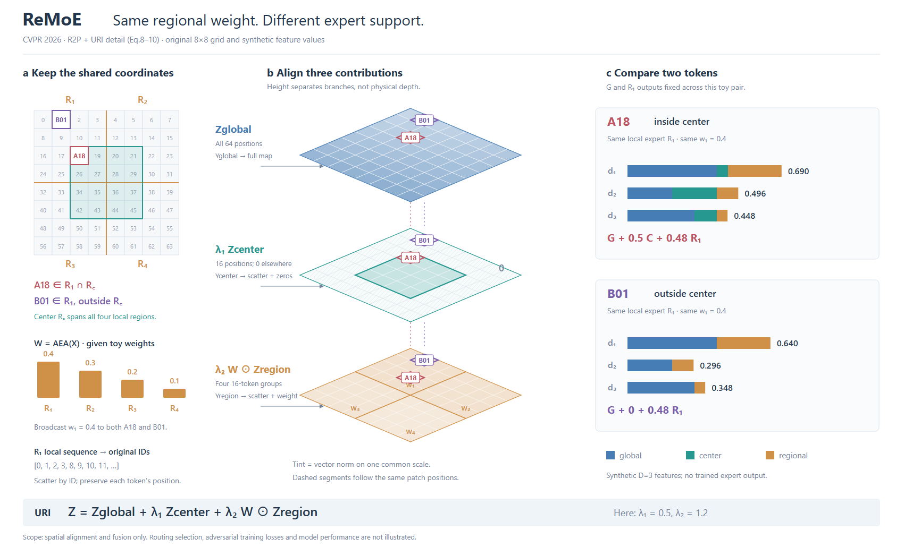
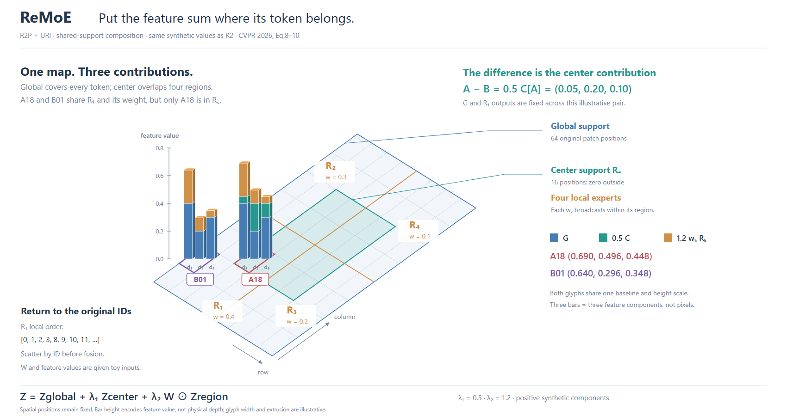

# ReMoE：单个代表不足以解释覆盖差异

[CVPR2026论文](https://openaccess.thecvf.com/content/CVPR2026/papers/Zhong_ReMoE_Region-Mixture_Experts_for_Adversarially-Robust_Vision_Transformers_CVPR_2026_paper.pdf)。实际查看Fig.2/p3与方法公式p4；读§4.1–4.4。此图仅展开R2P与URI（Eq.8–10），权重作为给定示意输入；不代表路由与训练全框架。

## 为什么需要一对对象

上一例PWaveP可用单点解释重复编辑；这里的论点包含全局、中心、区域覆盖的差异，只画中心内一点会隐藏中心外零填充。保留三个分支的完整支持域，并挑选同R1的A18/B01：前者在中心，后者不在。两点共用区域权重，但贡献项不同。中央层板高度表示分支分开展示，不是物理空间或时间。

三维层板负责共同位置、支持域和回填；右侧二维向量条负责相加。中心区域与四个局部区域都相交，不能把global、center、regional画成一组互斥分区，也不能把整个区域汇成一个token再广播相同特征。R2P保留各token的输出和原索引。

## 实例选择和修订

8×8网格、四个4×4象限、中央4×4。A18=(2,2)，B01=(0,1)。W=(.4,.3,.2,.1)、λ1=.5、λ2=1.2、D=3特征均为原创示意；没有运行AEA、专家或训练。

R1两点的其他分支输出也不同，分散对中心项的注意。R2固定二者G=(.4,.2,.3)、R1=(.5,.2,.1)，仅中心项有无不同。实际求和后A−B=(.05,.20,.10)，直接对应缩放中心向量。此设置用于解释，不声称真实模型必然输出相同其他特征；也不是R1同内容纯排版变体。另将压网格的长标签移开。

## 来源冲突不拼接成想象的算法

作者[固定提交vit.py](https://github.com/zhongskr0114/ReMoE/blob/d7b6af2a6cfba29766b70e9d513e4847701de9af/model_for_cifar/vit.py)在非shift forward里softmax加权全部区域，直接相加三分支，区域输出cat后未调用现有回填辅助函数；正文分别描述top-k、λ系数和Eq.8逐ID回填。图稿明确按Eq.8–10，不猜k、不冒充代码运行。冲突记录在项目brief，而非把所有差异塞进主图。

## 可迁移边界

代表性展开的数量由要解释的差异决定。若单例无法显示覆盖、分支或条件差别，保留一个最小对照组；可在合成实例中固定无关贡献，让变化来源可辨，同时明示哪些值是人为选择。若各对象差异就是方法重点，仍保留总览。单点、点对和全体展开服务不同论证，不规定所有图采用两列或三个层板。

剩余取舍：全层板支持域与局部加和之间依靠ID查找；图面仍偏分栏。尚无用户审美反馈。

## 同一主体承载覆盖和相加

R2需要从中央三层跳到右侧局部查ID。R4把支持域合在一个坐标底图，三分量贡献柱直接放到A18/B01位置。两点的值、权重和区域与R2相同；底图不再用深浅显示每个位置逐分支范数，而只表示成员关系，因此减少了查询细节。它适合解释覆盖如何改变贡献；R2适合逐分支检查。

这里高度承担新的含义：不是分支层号，而是具体特征分量。投影u=332+55c+32r、v=610−40c+20r让两个选中点的柱基线相同；两点共用数值轴，每点三柱对应三个通道，不是三个patch。柱宽和小侧面只是显示样式。当前合成贡献非负，可向上堆叠；有负值时应改用有符号表示，不能把绝对值塞进同一加和。

R3实际看图发现主体上方留白过大；R4保留对象大小，上移主体并收短画布100像素，再调整全局覆盖注释避免挤到顶端解释。没有修改底层数值，也没有用户美观评价。矩阵读数、局部计算和真实几何可分别采用合适的表示，不必全部挤出或统一为一套投影。

可迁移的决定：当位置和运算结果本就相关时，尝试把运算放回对象位置，减轻跨面板查找。空间索引、数值高度和展示厚度分别说明；若同坐标放置导致遮挡或难以比较，就保留二维局部而非强行合并。
