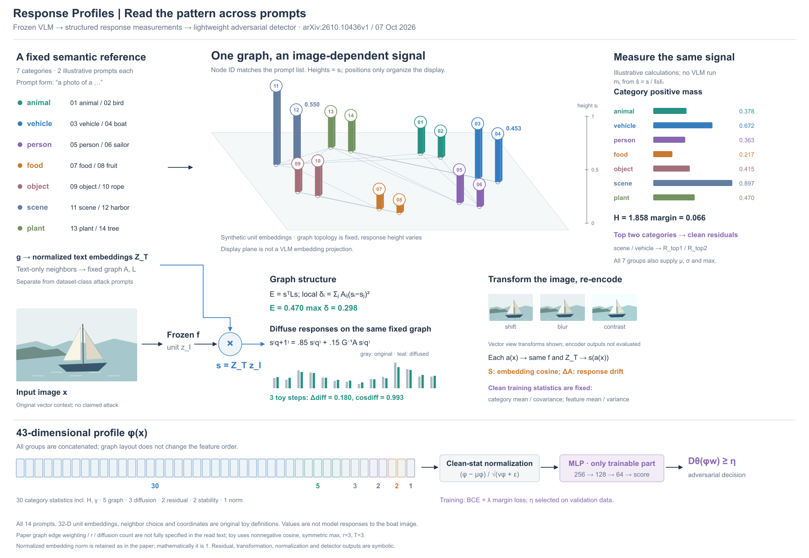
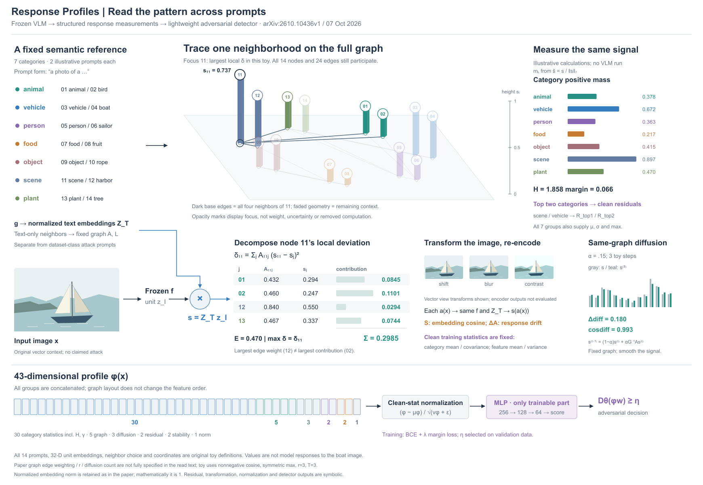

# Response Profiles：固定关系与变化信号

[2026-10-07论文](https://arxiv.org/html/2610.10436v1)。读§III–IV，实际看PDF p6/Fig2；原图是围绕中央特征条的统计面板。新稿选择以prompt graph上的信号为主视觉，普通流程与统计保持开放布局，底部完整43维输出链保留。

## 主体如何由机制生成

原Fig2七类各选两个原创提示，自行构造14个单位文本向量和一个单位图像向量。固定图来自文本向量的非负余弦top3/max对称，原始响应来自同一Z_T z_I。布局坐标不等于嵌入坐标，底面只显示图拓扑，柱高只显示响应，类别量放正视条形。输入船图是原创语境，向量不由船图编码得到。

类别统计用L2归一化s，图能量/local deviation/diffusion用原s。三步扩散采用α=.15，图形和数值都来自同一toy。作者未完整说明的图边细节与步数显式作为本例选择。43槽表示各组数量而非值；clean residual、变换响应与MLP保持符号，norm=1的数学事实保留。

完整流程仍包含frozen VLM、七类统计、图/扩散、top2残差、弱变换稳定性、clean-stat标准化、MLP、验证阈值和BCE+margin训练。未执行任何模型或攻击。开放图不等于省略这些组成，只是让来源和统计围绕主体分工。

## 看图与边界

实际看R1/R2：高节点碰标题，R2下移底面、稍缩高度单位并加尺，值不动。变换图在R1只是副本，R2实际施加矢量位移、模糊和对比度；模型稳定性仍未计算。补扩散前后色标。余下问题是边较密、输入与主体依赖s符号、部分量未数值化；不能声称完整实验证明。

可借的是固定结构与附着量的分工，以及对齐/留白替代一部分外框。它仍有横向区域，不能仅因没有边框就宣称全新构图或用户已认可。没有必要把同一方法的一切都画成三维。

## R4：保留上下文，展开一个邻域

比较独立放大邻域与在完整图中弱化上下文。选后者，保持R2全部14点、24边、布局坐标、柱高比例和统计数据。节点11按既有local deviation数组最大值选择，四邻居01/02/12/13均保留；其他节点仍参与每一步计算。深边和透明度只表示展示重点，不编码边权或置信度。

正视表由同一A和s计算A₁₁ⱼ(s₁₁−sⱼ)²：贡献约.0845/.1101/.0294/.0744，总和.2985。边权最大的12不是贡献最大的02，适合说明权重和响应差共同决定结果。此处是合成算例，不是异常阈值或模型实测。

R3实际查看后，R4将标题改为“分解局部偏差”，避免仅展示四行就声称证明全体排序；补Σ与扩散递推式。所有扩散前后条保留，但移到较窄区域，文字公式较小。淡化节点身份可读性下降，09附近仍有投影遮挡。改进的是局部追踪，不是所有阅读任务都变好，也没有用户审美认可。

可迁移提示：密集结构不必删去背景或增加一层容器；固定对象，按问题强调局部，配同ID运算。但若透明度已有统计含义，应改用轮廓等强调方式。原始图的完整分布仍有用途，保留旧稿作为另一阅读选择。
