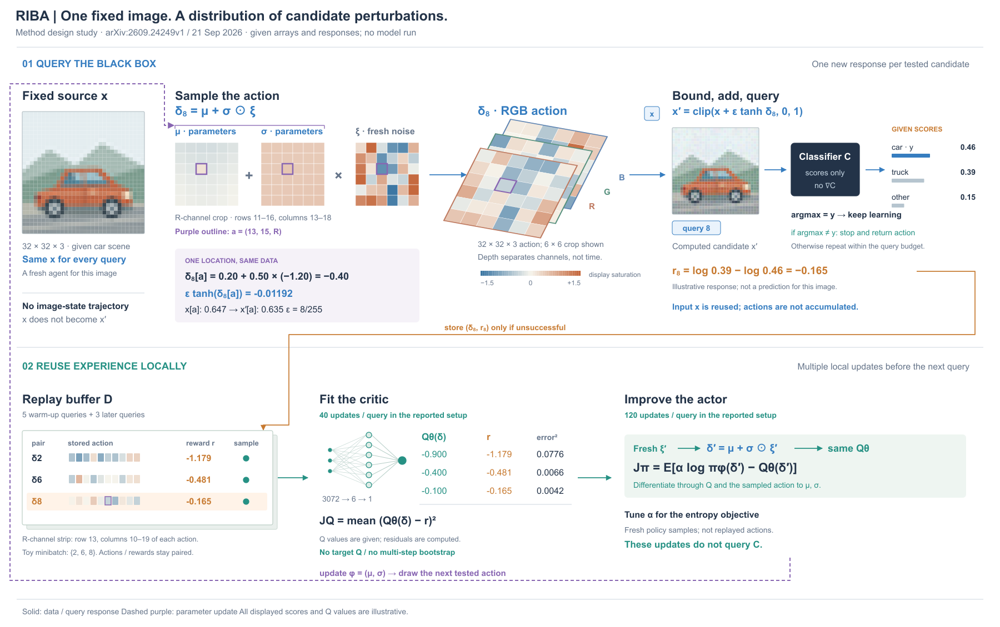
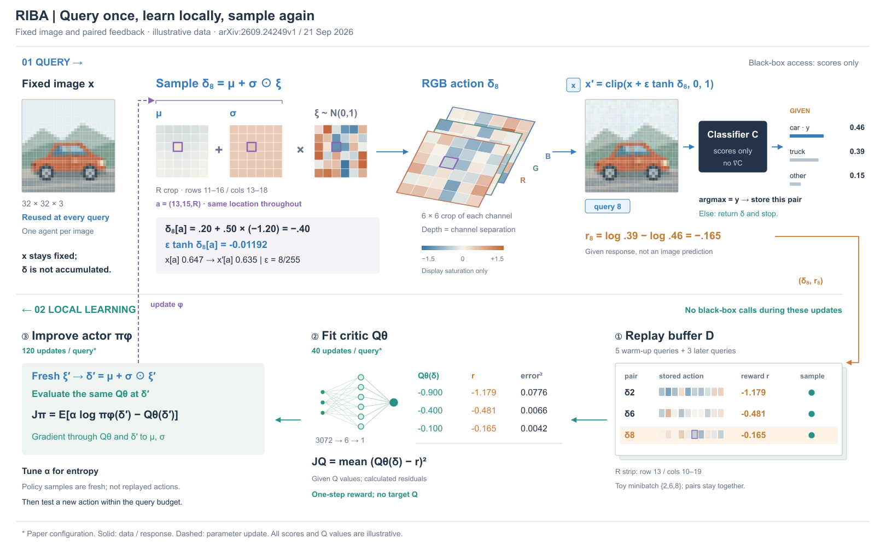

# RIBA：查询响应与本地学习分开

[Reinforcement Learning Inspired Black-box Adversarial Attacks for Computer Vision](https://arxiv.org/html/2609.24249v1)，2026-09-21预印本。读§3、Algorithm 1、§4/Table 1；实际看PDF第1页Figure 1。网页图片请求失败，随后下载PDF并查看。原图以Actor/Environment/Replay Buffer/Critic四个容器解释回路，扰动和原图汇入Environment；这里借用反馈关系，改为两个有成本边界的区域。

## 新版提示怎样影响构图

本例是v0.9.37整理后的一次新论文试画。两个成立方案：以固定图像为中心、采样/查询/拟合围绕它循环；或者上部查询、下部本地学习，固定图像作为输入锚点。选后者，让黑盒响应与可微critic的角色分开；代价是回到参数的更新线较长。回看Carrier共用状态轴图后，只借“相同状态不要重复画”的判断，不照搬调度坐标。这里固定的是图像，不是按步移动的图像状态。

主视觉是μ、σ、ξ到RGB动作的同位置展开；正视小格显示运算，浅空间只分通道。源图用汽车、车窗、轮胎与背景建立辨识度，保持32×32输入事实；不把高分辨率装饰画当真实计算对象。下部把记录配对、critic残差和新策略样本放回各自操作，普通模块缩为短标签。

## 范围与依据

单图优化，x固定，actor/critic分别训练，actor并非读入图像的条件网络。动作δ经tanh限幅、加x并clip。失败记录入D，critic拟合奖励；actor用新噪声经critic学习，不调用黑盒梯度，也不直接拿replay动作更新策略。成功在入D前返回；预算用尽停止。40/120次更新、5次起始查询属于实验配置；完整批大小和ImageNet放大分支未展开。α优化保留为紧凑说明，未虚构作者未给出的实现细节。

## 同源示意与边界

汽车由原创几何在256像素画布绘制，再抗锯齿采样为32×32 RGB，图稿以原生SVG矩形呈现。给定μ、σ与seed23的ξ产生3072维动作；通道局部显示rows11–16/cols13–18。索引a=(13,15,R)固定μ=.2、σ=.5、ξ=−1.2，δ=−.4；ε=8/255，实际原像素约.647，更新约−.01192。候选全图也来自同一数组，未把局部算例套到不相干图像。

分类器概率和Q值为给定示意，奖励与平方残差实际计算。缓冲区展示ID2/6/8，历史动作由seed31另采样，ID8是当前动作；色条显示各自row13/cols10–19的R值。它们不表示真实训练历史。三行只说明配对和小批采样，不冒充作者batch=400。显示色在±1.5饱和，计算数组不截断。层片深度仅作通道分离，不是时间或物理体素。

## 实际看图与修改

R1参数回线穿过经验表，入表线穿分区标题，网络维度贴节点；色条也只是当前动作的不同切片，不足以代表各记录。R2把入表路径放在留白通道，色条改取各ID真实给定动作，并下移维度标签。R2的参数线仍横穿原图上方内容，R3沿画面外缘绕到参数括号，避免暗示更新图像；同时补预算条件。三版均实际看图，修订来自图面观察。

这次试用把“主视觉要承担解释”落实到同索引参数、噪声、动作与算术，也把“输入→操作→返回”落实到记录与更新。它是可迁移的一个例子，不证明新提示优于旧提示；没有对照生成或用户审美反馈。当前长回线仍占外围，源图低分辨率且候选图较小，文字较多；若下一步强调采样分布变化，应另行给定前后参数并重新组织，而非给现有层片加厚。

未运行模型、训练、攻击效果实验或导出/格式检查。

## 折返布局：先改变节点顺序，再处理回线

R3上下两行都从左向右读，查询端要跨页送到左下经验表，actor又要从右下跨页返回左上参数。比较保留顺序并用同名端口，和下部按回路顺序折返。R4/R5选后者：查询正下方放Replay，向左经过Critic、Actor，更新从Actor上方就近返回μ/σ。逆向阅读有代价，R5补①②③，区分局部学习顺序和上层区域编号。

直接读riba-toy.json，不运行旧生成脚本。原图、候选、参数、噪声、动作、历史记录与所有读数保持；层片投影也保持，只缩小显示单元。原图与候选均170×170，替代原来的220×220与156×156。画布1800×1130改为1620×1020，长边说明移入图注。没有新增分布变化或虚构训练后参数。

实际看R4/R5：长回线已收回两个区域之间，经验写入和参数更新分别就近发生；R4下方阅读起点不明显，R5补步骤编号，并把奖励连接线靠近数值末端。源图低分辨率不变，层片与参数格略缩，actor卡片较密，图面仍有较多说明。紧凑和线短不能自动证明阅读更快或整体更美。

可迁移的是把布局顺序视作设计变量：长线来自节点相对位置时，先比较折返/围绕对象组织和端口对应，再决定绕线。折返仅适合依赖确实成环的部分，不应把并行支路强行变成序列。本次是同数据重排，不是新论文的第二次前向试用；没有模型运行、导出检查或用户审美评价。
