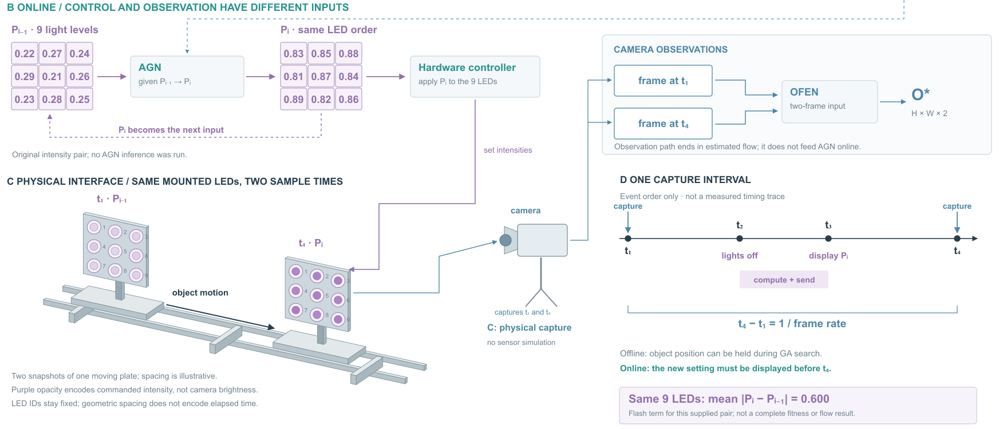
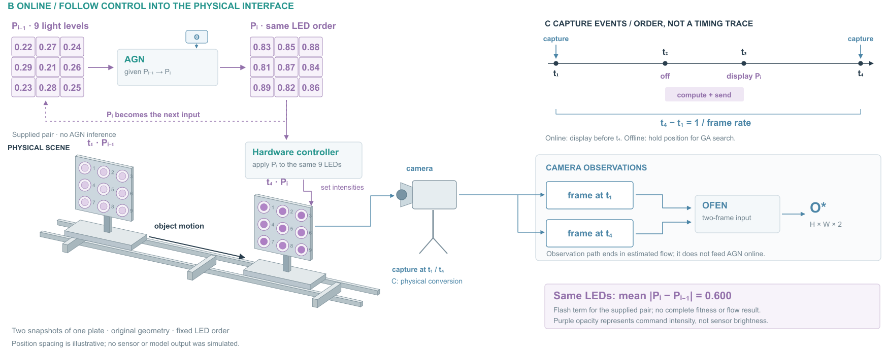

# RILA：控制递推、物理捕获和事件时间

## 来源与范围

[Physically Real-time Infrared Attack against Optical Flow Estimation Networks](https://arxiv.org/html/2607.26651v1)，arXiv:2607.26651v1，2026-07-29。读取§3–4、Algorithm 1与§5.1，实际查看PDF p3/Fig.2和p4/Fig.3。未查作者代码，未运行GA、AGN、相机或模型。

Fig.2把采样时序与物理序列并列，Fig.3围绕物理捕获展开GA回路。这是可借的分工；其中Fig.2把GA/AGN合成一个节点，输入表示较概括。新图按§4.3和Algorithm 1明确在线AGN只接上一灯光强度向量，图像对进入OFEN；不能从概括原图推导出在线图像反馈。图2的t1–t4是一个区间内事件，P的i是相邻状态索引，不能把两种编号混为一套。

本图覆盖离线搜索→相邻向量对→AGN训练→在线递推→物理显示/捕获/光流输出，核心展开在线两种信号与一段事件序列。GA内部候选种群、交叉位置、变异等收为标签；没有自行编造AGN训练损失或额外图像输入。

## 使用上轮入口的实际决定

读取候选、反馈、共享权重入口后，仅借RIBA的“区分外部响应和本地运算、更新接实际对象”。RILA不是actor/critic，也没有replay更新，因此不移植那张图的折返学习回路。AdvPCS的候选共享支持与Ancestor固定权重均不匹配主机制。跳出三种局部图，采用原论文时序与物理接口的分工。

比较方案A：离线/在线各一等宽大栏，复制两套相机、控制器与载板，便于逐阶段读完整链；方案B：上方紧凑离线来源，中间分开控制递推与观察链，下方空间接口和事件时间并列。选B，避免复制场景，给同一组LED的身份、位移与强度变化更多面积。参数训练以虚线接AGN；状态递推用紫色回线，捕获与模型输入用蓝线。

## 原创对象和给定数据

原创轨道、载台、九LED载板和相机均为SVG面片。两载板是一个对象两个时刻的示意；投影与编号固定，只沿轨道平移。九值按载板上从左到右、从上到下映射。上一向量为[.22,.27,.24,.29,.21,.26,.23,.28,.25]，下一向量为[.83,.85,.88,.81,.87,.84,.89,.82,.86]；均是给定教学值，不是AGN输出。平均绝对差0.600可从这组值直接算出，只说明Flash项。

紫色圆心透明度编码指令强度；不模拟红外人眼颜色、相机曝光、辐射或传感器噪声。两板的几何距离和时间线横向间距均为展示选择，没有速度或实测延迟含义。时间线保留t1采样、t2关灯并计算发送、t3显示、t4采样的次序及帧率关系。

## 不确定之处怎样处理

论文Vis公式的绝对值符号与“越接近1光流越空白”的解释、Per的一减方差与“更混乱”的解释，不能仅凭文字唯一重建具体实现。图中保留三项名称、权重和评价反馈用途，不画虚构的空白/混乱光流、不计算完整fitness。Algorithm 1末尾对R的毫秒描述与前面帧率定义混用，本图依据§4.1保留t4−t1=1/frame rate，不自行填时间数据。上述歧义不影响将在线AGN的向量输入与OFEN的图像输入分开。

## 看图与修订

R1查看发现：硬件控制箭头停在场景留白，相机入边没有接载板；fitness接存储容易被读成存储分数；采样箭头穿t1/t4标号。R2让控制接当前载板、物理观察接相机，并将相机两时刻捕获接到两个帧输入；离线节点明确score后选择best P再存相邻对；t1/t4标号移到零线下。两版保持同一给定数据和几何。

R2实际查看：对象接口和箭头端点更明确。仍有问题：上部网络训练参数线较长；主视觉分为控制/空间/时序三块，跨块需按t和P身份对应；小LED编号不适合缩到很小阅读。没有用户审美反馈，不能从完成图稿推断已获得更好效果。

## 这次迁移支持什么

入口帮助排除主题相同但机制不同的局部图，而不是提供可直接套的整图。可复用的决定：先写出控制器、环境和估计器各自输入，再区分离线与在线；把物理位移、采样事件和模型状态索引分开命名。未知传感器输出保留符号，让具体设备和给定控制量承担形体细节，不凭“空间传播”补光锥、热图或攻击结果。

## R3/R4：让接口相邻，训练参数改为对应端口

读取R2 SVG与原JSON，不重新生成场景或数据。比较保留分区后只用同名端口缩短连线，与让控制器、当前载板、相机、观察链相邻。选择后者作为主要数据路径，仅离线训练参数用Θ对应标记。两侧Θ指同一训练结果，不新增训练或网络。

将控制器放在当前强度矩阵与载板之间；载板组整体上移65像素，所有面片/LED/编号/运动箭头保持；相机图标靠近载板，观察链位于右侧。相机图标是模块示意，移动它不是换实际拍摄相机，也未重算模型图像。采样事件移到右上并收拢竖向间距，仍只表示事件顺序；矩阵、实体和标签字号没有整体缩小。画布1800×1120改为1800×1060。

R3实际看图：场景标题贴到第一块板上缘，强度设置标签与相机标题相近。R4缩短场景标题并放在板外，设置强度标签靠近控制输出端。两版实际查看。相比R2，控制→载板→相机→两帧路径更连续；代价是Θ需跨区对应，时间线横向比例仍非实测，原始载板快照与观察链仍靠t1/t4身份连接。中部留白没有用装饰填满，也没有新增模型结果。

此改动是同数据重排加图注分工，不是全部可见文字原封不动的位置变换。紧凑来自接口邻接和非核心训练线的对应标记，不能仅凭画布缩短证明阅读更快或更美。没有用户审美反馈。

可借：长线和跨区查找集中在核心数据路径时，先改变产生/消费该数据的对象位置。低频但必须保留的训练关系可以用同名端口；不要把所有连线都替换成端口，从而丢掉主路径。实体图标与真实观测几何的身份分清。
