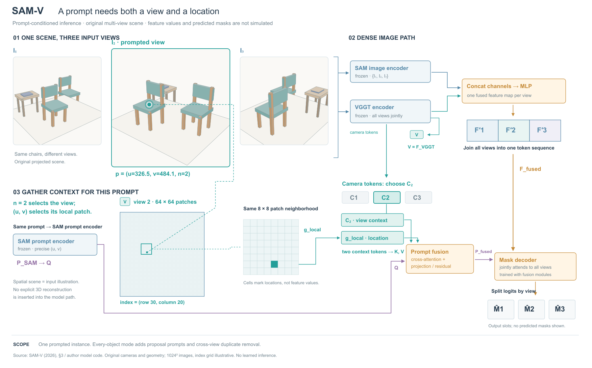
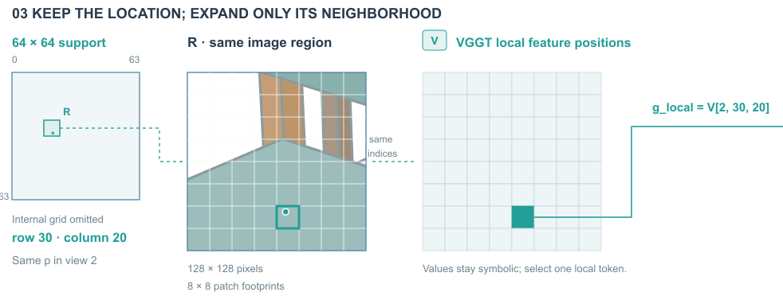

# SAM-V：视图身份与局部位置分开选择

## 依据与范围

[论文v1](https://arxiv.org/html/2609.25490v1)，2026-09-21；看PDF p4/Fig.2，读§3。另读[作者实现](https://github.com/gong208/SAM-V/blob/main/model/sam_vggt_model.py)的fuse_prompts、CrossAttentionFusion和图像融合段，以确认两类拼接的区别。当前代码分支可能更新，本图记录的是本次读取内容，没有运行网络。

本图展开单实例提示推理：一个提示的视图编号与局部坐标提供两种上下文，融合后与全视图图像特征进入decoder。每物体模式和训练安排不展开，图注说明范围；输出保留符号槽，不画伪造掩码。

## 画前选择

候选A复制原图的三条等大图像序列与中央模块，便于看全流程，但提示点容易淹没。候选B放大提示所在视图、两侧视图提供身份语境，下方展开同一坐标索引，右侧合并两路上下文并接回decoder。采用B。二维平面负责坐标、索引、token选择，原创三维椅子投影建立辨识度；不增加独立的模型三维重建环节。

## 同一场景与位置

所有视图来自同一组箱体面片：两把同色木腿绿座椅、一张带闭合笔记本的边桌。相机位置分别为(−4,−5,3.4)、(4,−5,3.7)、(4,3.7,3.2)，朝向共同目标(−.1,.15,.62)；透视投影、背面剔除和按面平均深度排序生成SVG。未做光照模拟，面平均排序只适用于当前简单分离部件，不能称通用精确可见性算法。

选第2视图中第一把椅子座面中心(−.65,−.38,.78)为提示点。R2归一化焦距1.7，投影到1024²图像得(u≈326.5,v≈484.1)。以16像素为格，行30、列20；64²全图中的8²邻域起点为行24、列16。全格图与放大图使用同一索引，青色仅表示选择，不代表特征幅度。

三幅图显示尺寸不同，但坐标均按同样1024²定义；点坐标与相机投影是本项目示意，不是原论文数据。相机token是学习表示，不是绘图相机参数；几何图只是原创输入内容。

## 表示选择的依据

论文中的Concat字样不足以决定画成一个长向量还是多个token。作者实现把选定camera token与local feature堆成长度2的上下文序列，SAM提示提供query，融合含投影与残差。图像特征则沿channel拼接，再投影。图中前者画成两个分离项，后者标明通道融合。数值未知，所以不添加随机注意力热图或任意特征条。

V端口在VGGT输出和第2视图特征图间保留来源，点到局部的虚线表示定位/放大，实线表示值流。模型编码器冻结与训练模块用语义配色区分；相机C2高亮表示所选身份，非权重较高。

## 实际看图与修订

R1场景显得小、两行说明越入第2图框，点的引线穿过坐标文字；F_VGGT只写了名称，来源不够明确。R2增大归一化焦距至1.7（R1为1.2），重算投影坐标和索引，缩短说明，绕开提示标签，并增加V端口与Q端口标注。R1为(u≈381.0,v≈492.3)，行30列23；R2不是同观察图的纯布局对照。

剩余：Q路径长，局部图与dense路径之间依赖端口查找；完整64²网格信息密而视觉贡献有限。只展示索引与结构，不能证明模型识别正确。后续可以保留同一输入改成紧凑的索引带+局部放大，但不能把64²任意换成模型实际更粗的特征分辨率。

## 可迁移提示

> 一项提示同时包含来源身份和局部位置时，分开显示两次选择，再让它们在真正的融合处汇合。保持视图ID、位置索引和输入对象可追踪；确认拼接沿什么轴，按一个向量或多个token画。场景的空间感用于识别对象，不能替代模型的真实中间表示。

## R3/R4：省略重复格线，增加同源图像局部

本轮读取R2 SVG与现有JSON，保持全部三视图、焦距、坐标、索引和1800×1120画布。比较保留全64²格并缩小，与省略全图内部格线、保留完整边界/选区/坐标并扩大解释局部，采用后者。仅画边界不等于将分辨率变为1×1；仍标64²、0–63与行30列20，选区R仍为8²邻域。

新增128²像素的同源图像裁块：直接取原SVG第2视图的面片组，用精确裁切变换显示x=[256,384]、y=[384,512]。不是重画一个标准座椅，也没有复制VGGT特征值。裁图与8²特征位置图逐格对齐，提示点和选中格共用坐标；图像格内的颜色是真实原创输入的图形颜色，特征格只表示索引。

SAM提示编码器移到fusion下方，用同一p标签传递输入身份，短上行Q线替代原外围回线。V端口仍表示VGGT输出来源，相机选择和上下文token保持。R3回看发现长定位虚线穿标题、图像局部说明挤到特征说明；R4用相同R区域框代替长定位线，将像素范围和patch数量分两行。两版实际查看。

相较R2没有改变观察数据，但增加了图像裁块、移除了重复格线，属于同输入换表示而非所有图面内容不变的纯布局比较。全图定位的精确感降低、需要读坐标；短线减少绕行但增加按p/R/V身份查找。此例仍未计算学习特征、注意力权重或输出掩码，没有用户审美反馈。

可借：完整支持域、实际值和解释局部分开设计。全网格只承担定位时，可以保留边界、尺寸与选区，把面积给同源局部；若单元格数值或覆盖关系本身是证据，则不能套用这种省略。图像局部与学习特征相邻时，明确是索引对应，不让前者冒充后者。
