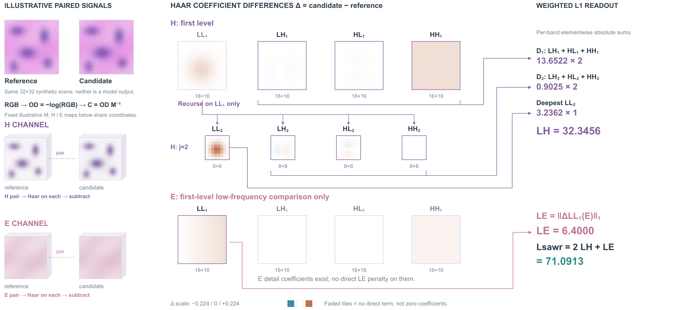
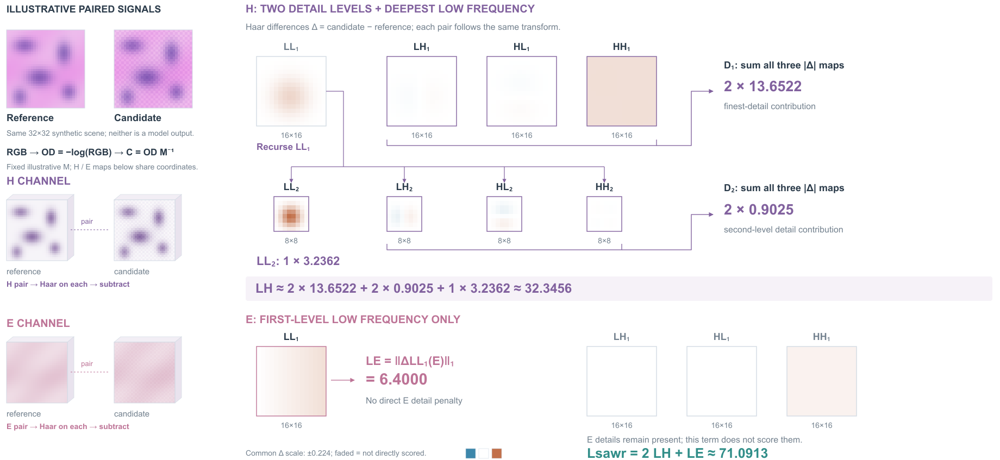

# SAWR：按染色角色选择比较频带

## 依据与范围

[Stain-Aware Wavelet Regularization for Instant Adversarial Purification in Histopathology](https://arxiv.org/html/2606.08745v1)，arXiv2606.08745v1，2026-06-07。读取§3.1–3.3、Eq1–9、实现权重；实际看PDF p6/Fig2。绘制训练目标总览与频域局部计算；基础蒸馏内部、模型特征与推理结果保留符号，没有临床结论或净化性能复现。

原Fig2将冻结teacher、学生、编码器/解码器和小波区域分开，真实图像与染色图支撑语境。借其训练/推理职责和两层小波分工，重新展开正文Eq5–7中的H/E非对称性。原图最深低频标签看似LL1；本稿按正文H最深LL2、E第一层LL1区分。Table2同时勾选mDWT和SAWR，正文Eq9的最终式没有额外独立mDWT项，本稿遵循Eq9并记录此表示差异。

## 构图决定

阅读任务：读者通过各通道实际比较的频带集合，理解为何H与E的正则路径不同。

两种成立组织：①左右两个同构小波金字塔，靠颜色显示所选频带；方便看两通道的全部层级，但会为E额外展开未用的第二层。②H两层递归树、E单层支路，正视残差图配精确L1读数。选择②，完整基础路径缩在顶部，H/E实际计分集合占主要面积。

浅厚度仅区分输入染色场的载体，不代表组织深度。层级用递归线与真实尺寸16×16/8×8说明，未强行把频率变成物理z坐标。色彩映射为有符号系数差，不能把图的红蓝读成生物染色或病变。

## 机制边界

- 在训练时对预测图与clean reference做相同的OD、固定矩阵逆变换，再分H/E。推理路径不携带clean reference和监督损失。
- H的LL1继续分解为LL2、LH2、HL2、HH2；H直接计分为第一层3个detail、第二层3个detail、LL2。不能再加一项LL1损失重复监督。
- E只比较LL1。细节可以存在、可非零，并且其他训练目标仍可能约束它；“此项不直接计分”不等于删除、归零或全局停止梯度。
- 总式按Eq9：Lbase + .01 Lsawr + .01 Lsem。Lbase包含GAND与CIG；Lsem由冻结的病理预训练特征提取器提供。训练student，teacher/encoder/decoder/semantic encoder冻结，冻结不意味着禁止输入梯度。

## 原创同源计算

32×32解析密度场：H含五个椭圆高斯峰，E含平滑背景变化；候选另加给定棋盘变化与平滑变化，完全是信号解释例，不是病理图像、攻击或模型预测。

使用明确给定的示意矩阵M=[[.65,.70,.29],[.07,.99,.11],[.27,.57,.78]]，不是论文未列出的真实固定矩阵。参考/候选密度先通过RGB=exp(−CM)生成RGB，再通过−log(RGB)M⁻¹得到染色密度；第三通道固定.04，仅参与可逆混合，不进入H/E损失。

逐2×2块的正交Haar约定：LL=(a+b+c+d)/2，LH=(a−b+c−d)/2，HL=(a+b−c−d)/2，HH=(a−b−c+d)/2。两层均对实际LL递归。图中显示候选减参考的系数，L1计算逐元素绝对值之和，不是均值。实现权重取正文H的2/2/1和外层H/E的2/1。

原始数组、矩阵与差分保存在sawr-toy.json：H D1=13.6522452958，D2=.9024606818，LL2=3.2362351081，LH=32.3456470634；LE=6.4；Lsawr=71.0912941268。Lbase、Lsem仍为符号，未计算完整总损失。

系数共享±.224左右的全局颜色范围；非直接计分格淡化显示，旁边明确说明，不能跨活跃/淡化格直接凭颜色比较数值。信号较小的LH/HL在共用色标下接近白色，这是真实差值小，不通过逐格归一化夸大。

## 看图与修改

实际看R1发现D1、D2汇总线从最后HH图出发，容易暗示只取该子带；LL1递归箭头只连LL2，同样遗漏3个细节出口。R2改成完整细节组括线，LL1分配到第二层4个子带，LL2另走独立读数路径；H/E成对输入补同名Haar来源提示。看R2后又将三条汇总线按顺序分轨，移走与LL2路径相交的层级标题。保持所有数据、图幅和数值不变。

剩余不足：E的损失线绕过整个未计分细节组，较长；H的独立LL2路径也增加折线。统一色标使小残差较淡。简化输入是信号图而非写实组织图，未得到用户审美反馈。本轮证明能按另一种机制组织主视觉，不能据此断言通用审美已提升。

## 写回skill

选择频带、token或候选时，区分“本目标直接计分的集合”与“被删除或置零的对象”；递归展开时将父表示连接所有实际子输出，汇总边接完整集合，不从最后一个子对象借线。仅把已在本例发生的问题改写进现有选择提示。

## R4：集合旁边读贡献

R2的H汇总线多次折返，E的LL1为了接最右侧读数，绕过整组不计分细节。两种可行选择：保留统一右侧读数列，改为同名端口；或将每组贡献直接放在该集合旁，再用一行公式组合。选择后者，将H的D1/D2贡献各邻接本组，LL2贡献放在自己下方；H总式将三者明确相加。E的LL1和LE读数紧邻，非计分细节整体向右。

读取同一sawr-toy.json和原稿上下文，原始图像、染色场、残差图、权重、色标、淡化规则和每张图的显示大小均保持；画布仍1900×1190。没有为凸显小差值而独立归一化，也没有补模型结果。新图改变读取顺序，E不再与H各列一一竖直对齐。

实际看R3：E长回线消除，H各贡献可就近读取；LL1递归线却穿过说明。R4从LL1右侧接出，缩短递归标签，并将四舍五入后的组合读数标近似。实际看R4主体集合无新交叉；最终缩短仍靠近竖线的标签。图中极小残差仍浅，这是共用色标的取舍。H总式增加了重复数值，换来完整加权归约的可读性；尚无读者或用户审美验证。

迁移条件：归约跨越一组对象时，局部给出该组贡献，最后明确组合这些贡献，可以替代长距离汇总线。组内选择、权重和总式仍要保留，不能只写几个独立小计就漏掉最终结果。
