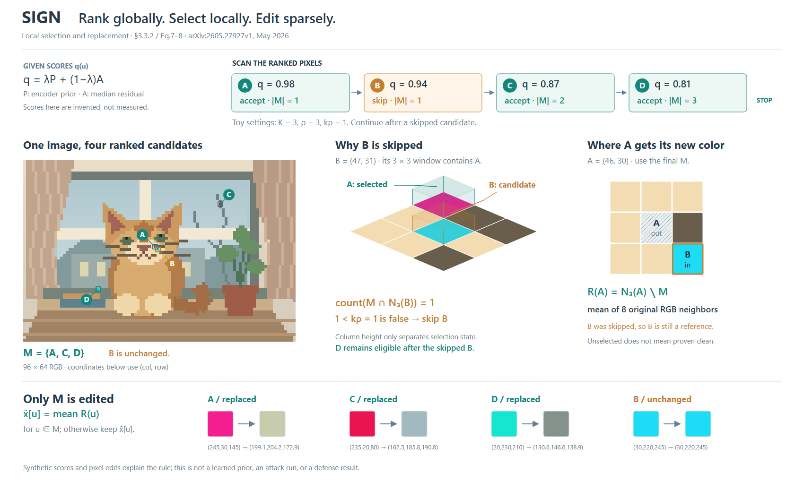
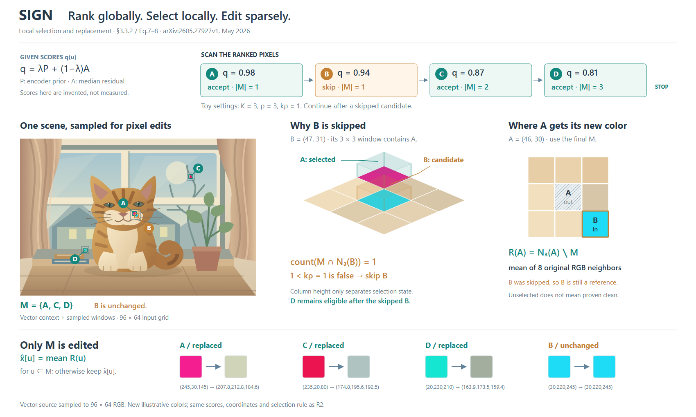

# SIGN：具体图像内容如何承担局部操作

[论文v1](https://arxiv.org/html/2605.27927v1)，2026-05-27。实际查看Fig.1/PDFp2，读§3.2–3.3和Appendix D–E。这里只展开§3.3.2的候选扫描及像素替换；q是给定原创分数，不代表完整SIGN运行。

## 为什么需要一个具体场景

前一案例Detect and Suppress适合特征几何；这里操作直接作用于图像像素，继续只画抽象向量会丢掉“同一邻域从哪里来”。选择一幅原创窗边猫场景作为位置索引，让A/B/C/D在全图、局部和最终色块中复用同一RGB。场景中的窗框、毛色和书本帮助识别位置，不被画成语义先验。

两个成立的候选是“全图+排名带+两种局部”和“四列全图候选快照+替换局部”。共同解释扫描顺序、预算、最终M和未选中参考。选择前者，以减少重复场景并保留足够大的邻域；代价是需要按ID对应。未绘制后者。

## 让两种局部承担不同问题

3D邻域以B为中心，浅透明柱区分已选A与当前B；深度只为分开状态，不代表图像深度或分数。正视邻域以A为中心，排除已选A，保留未选B参与均值。两者不是同一窗口，R2补出中心坐标。

原创96×64图像，A=(46,30)、B=(47,31)、C=(69,15)、D=(26,45)，以(col,row)记。给定分数.98/.94/.87/.81，其余低于.2，K=3、ρ=3、kρ=1。按Eq.7实际计算：接受A、跳过B、接受C/D；对最终M中的像素，从原图未选中邻居求均值。底部色块由同一数组计算，而非手工假设“修复后”颜色。B仍参与A参考，因此没有画成彻底去掉异常的成功图。

## 原图与正文的区别

Fig.1用global Top-K和local Top-k的AND概括，正文Eq.7则逐个扫描全体排名并检查当前候选窗口。本图按后者绘制，不把跳过后的序列截断在原Top-K。匿名代码仅根目录可读，子目录请求返回not_connected，未确认实现。Eq.7的候选中心检查也不能推出所有可能窗口的同一全局上界。

P是模型侧空间响应倾向，而非当前猫的语义mask；中值残差A与替换时未选中邻居的均值也不同。图中简写来源，但不声称已计算真实P或融合q。

## 修订与迁移

R1实际看图时三维B标签压在像素颜色上，两个邻域的中心不够明确。R2将标签移到空白处并加引线、标出中心坐标。两图都实际看过；没有攻击、模型运行、导出或格式检查。

可迁移：方法直接处理图像时，先选择可辨认、能体现局部差异的内容，再从同一份像素/几何中提取全图、裁切和修改。背景承担定位，不能被当作算法证据。局部差异不可见时放大实际窗口，不只增加纹理或复制照片。

限制：图像采用像素化的原创造型，不能说明对真实照片的防御效果。两个邻域仍依靠ID和坐标对应；图稿范围不包含先验提取全流程。尚无用户审美反馈。

## 连续场景与离散计算分别表示

R3用曲线、分离部件和少量渐变重画窗边猫，在原布局中替换像素画。它仍是原创示意；完整矢量场景负责识别与定位，真正计算的输入是从该场景采样的96×64 RGB。三个局部窗口将采样色块叠回原坐标，放大邻域和修改结果也来自这些新样本。

采样先将源SVG绘成576×384，再按6×6区域均值降到96×64，随后放入四个给定异常色。坐标、q、预算、选集不变，背景RGB与替换均值改变；不是仅改画风的同数据实验。图内与图注明确标出“vector context + sampled windows”。R2直接展示离散像素，R3外观更连续，但读者需区分场景视图和计算网格。

本轮实际查看源场景及完整R3，没有发现影响当前关系阅读的新遮挡，未为凑修订次数再改一版。形体连续性是可观察变化，是否更符合用户审美尚待反馈。该变体适合原创内容说明，不能用重画的场景冒充实测图像；若只改展示而要保留原数据，应继续使用原数组，而非悄悄换色。
