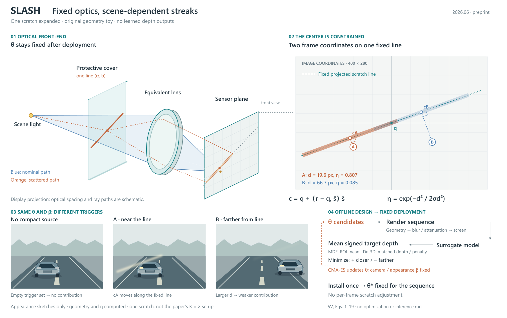

# SLASH：装配结构与正视几何分工

[论文](https://arxiv.org/html/2606.14504v1)，2026-06-12预印本。读§III–V、VI-A，实际看PDFp5/Fig.3；未查验实现或会议接收状态。

## 从内容选择构图

固定划痕不代表固定图像伪影。读者需要看到硬件参数、光源位置、光条中心及强度之间的关系。比较“共享参数＋多帧分配”与“装配结构＋正视读数”：前者适合时间对应，后者能直接表达扰动位于光学前端。本例选后者，物体位置承担主流程，优化回路另放局部；没有给网络模块统一加厚。

保护盖、等效镜头和传感器共用一个展示投影。蓝色名义光路与橙色散射光路只是位置直觉；旁边的正视平面实际计算r投影到固定线的垂足c和垂距d。两帧坐标叠在一个平面上，明示不是同时存在的两个光源。A/B贯穿距离、衰减与短序列。

## 计算和示意各到哪一步

给定400×280坐标、q=(200,140)、方向−20°、σd=30，A/B产生d≈19.6/66.7，η≈.807/.085。未优化这些参数。图内只展开一条划痕，论文实验为两条；长度210和宽8是图解设置，不是相机标定值。传感器平面复用A的支持和中心。

前盖/镜头的距离与折线路径没有进行物理追迹。软边白条只示意亮化与衰减，不声称复现完整外观卷积。右下保留模型评分、序列平均、目标方向、失配惩罚、CMA-ES更新及固定部署；无预测深度、成功率或模型结果。这个边界不能只藏在来源链接中，图内有简短标识。

## 实际看图后的修订

R1说明压到传感器，公式之间的空白被SVG折叠；优化回路跳过模型节点。R2把说明移到底部独立空间、分开两个公式、补模型节点与短回路；给传感器到正视平面的对应加虚线，图例说明固定投影线。场景只突出被展开的一个亮源，其余灯为中性色。

这种版式的价值是部件承担空间顺序、几何关系保持正视可读。代价是大主图保留较多空白，且直觉光路仍可能被读成精确光学，所以图内标识和图注必须随稿。不是用户认可的美观结论；未执行导出/格式检查。

## 可借用提示

当论文确实涉及装配、遮挡或传播时，让物体位置组织图；把度量移到相应正视局部，保持相同坐标实例。空间直觉与实际数值计算分开交代。不同条件共享同一结构时，保留条件如何改变响应，不把固定参数误画成固定输出。普通算法和纯特征变换不应硬套镜头或光线。
