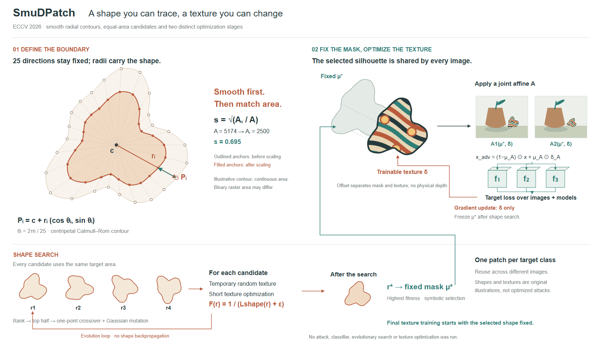
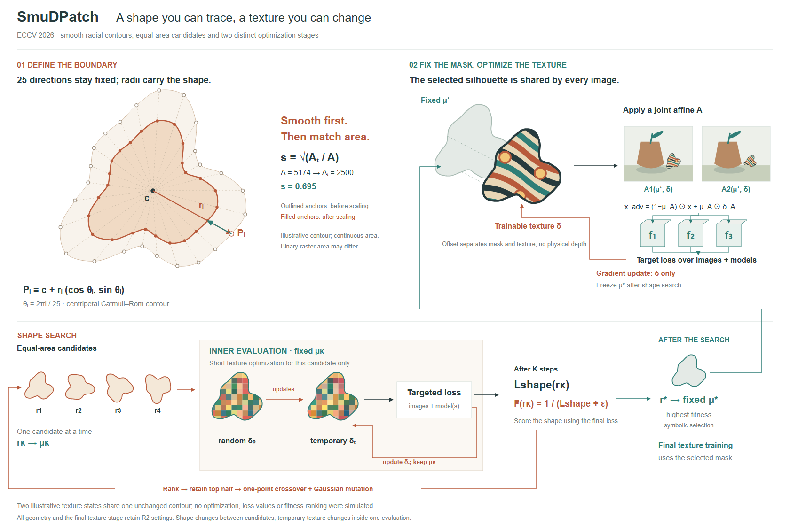
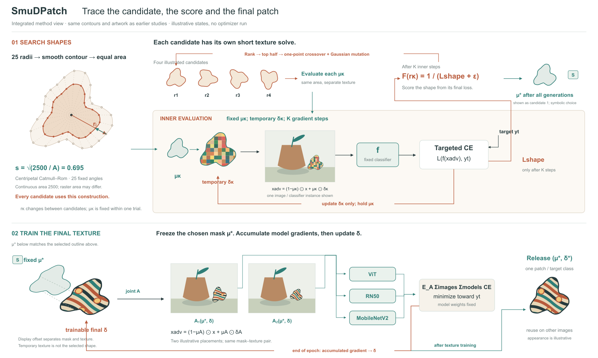

# SmuDPatch：让具体轮廓组织整张图

[作者项目与论文](https://github.com/visheshrajput2408/SmuDPatch)，ECCV2026。实际查看PDFp5/Fig.2，读§3.1–3.3、Eq.1–11。研究副本固定到提交a1a9bc48bd803b59c9661cfdb30e9558600c3419。

## 设计决定

大轮廓叠加缩放前后锚点和径向线，直接解释固定方向、变化半径和等面积缩放。候选搜索位于下方，右侧把固定mask与可变纹理分开。颜色主要区分几何/纹理变化和固定mask，未沿用四种浅色特征网格。

25锚点与插值、面积归一化由实际几何计算，半径和纹理均原创示意。四候选归一到同一连续面积，r*复用其中一个轮廓，排序不是实测。短暂纹理训练用于候选评价，最终纹理训练固定选定mask；两种循环承担不同关系。

## 实际修订

R1仅缩放轮廓，图案仍用显示坐标，导致小图并非同一纹理的变换。R2将轮廓、mask和纹理在同一局部坐标中定义，对整体施加仿射。修复mask选择和纹理更新的端点，模型集合全部进入损失。

## 可迁移经验

若论文的区别就在形状、边界或拓扑，主视觉可以直接由该对象占据，参数与约束围绕它组织。仍要画出改变对象的操作；大轮廓本身不能替代搜索或优化关系。已有构图分类是起点，不能把新内容硬塞进固定模板。

同一对象被变换时，内容、边界与对应mask一起变换；重新填充纹理会悄悄改变实例。说明插值几何、栅格像素与显示坐标的不同，不能将连续面积等同于精确mask像素数。

## 候选评价的局部展开：R3/R4

保留R2的大轮廓与最终纹理训练，将下方候选评价展开：固定µκ，展示临时纹理δ₀、δₜ、目标损失与梯度回线；K步后的损失输出到fitness。外循环再选择亲代并交叉、变异半径；选定µ*才进入上方最终训练。两张临时纹理是同一随机格场及人为颜色变化，不是优化输出。

R3回线穿过纹理和候选说明，选定mask的连线穿过阶段标题。实际看图后，R4将内循环放在局部框边缘、外循环放在全图边缘，mask选择线从标题下方进入具体对象。

此次收益是分清“一个候选内部改什么”和“候选之间如何评价”。代价是同为1680宽时，高度从980增加到1120，回线更长；R2仍适合总览，R4适合解释嵌套优化。不能把细节更多等同于更好的构图。

可复用的局部提示：固定一个候选，指出内循环不变的对象、更新的状态、离开循环的量；再决定是否值得展开。这里只验证了SmuDPatch，暂不增加通用流程步骤。

局限：内循环的图像组成和模型前向仍概括在loss模块中。图中空间错位只分开mask和texture，没有真正的物理深度。不能把本次外观变化视为已经满足用户审美。

## R5/R6：把局部评价接回完整方法

重读原文§3.2–3.3后，把R4藏在loss框中的图像组成与分类器展开。比较中央共享评价器和两个分开的阶段；前者可能误暗示内外训练配置完全相同，选后者。内循环固定µκ，临时纹理贴到同源场景，经过固定f和目标CE；只在K步后把损失变成形状fitness。外循环通过排名、交叉和变异改半径。S标记让选定mask跨阶段可追踪，临时纹理不作为选中形状传递。

最终阶段保持同一µ*，纹理和mask联合仿射；两个图像实例均进入整个模型集合，梯度累积后在epoch末更新纹理，训练完成才发布补丁。内循环只展开一个图像/分类器实例，不用同一个评价框暗示它拥有最终训练的全部配置。

R5/R6均实际看图。R5评分线穿过说明，发布箭头从loss框出发；R6绕开文字，并让发布从训练更新分支接出，加S身份标记，修r标签。轮廓、面积和纹理复用旧稿，临时纹理显示在实际合成图中而非只作色块。形状变小，主图1800×1080，比旧R4更宽；这是重新分配解释空间，不是纯压缩。没有运行优化或补出虚构的模型结果。

可迁移之处是局部入口、内部操作和出口连到正确对象；完整方法不是额外一行总览。剩余问题是整图仍较密、回线偏长，几何细节比R2小。并未得到用户对审美的认可。
