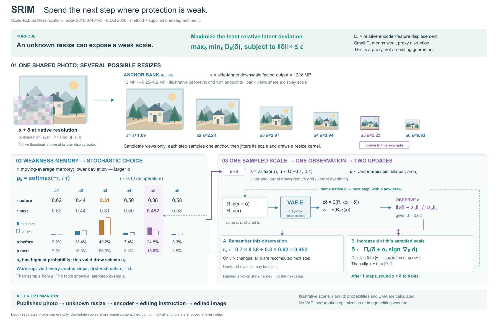

# SRIM：随机选择、首次赋值与双状态反馈

[原论文：Protective Perturbations Must Survive the Resize](https://arxiv.org/html/2610.07464v3)，2026-10-08。依据§III、§V/Algorithm1、S1；实际看PDF p5/Fig3与算法。原图以照片缩放组、抽样热图、效果曲线解释尺度保护。本例借候选身份贯穿，改为一个给定数值步的状态读写；不搬用作者实验结果。

## 为什么这样安排

比较两种有效组织：照片金字塔占主位，或共享图像作语境、概率与状态更新作主体。选后者，因为要解释历史估计如何影响抽样，而不仅展示多种缩放。局部深度仅区分图像载体，正视表格读数；没有强行把状态表立体化。

初稿四评委确认弱尺度目的、a3最高概率而a5被抽中的例子清楚；同时发现首次r如何建立缺失，d到两类更新及δ下一步回用主要靠文字。修订先重分面积、连接共享观测与实际写回，再补必要定义。

## 方法与原创算例

共享原生δ，‖δ‖∞≤ε。目标为maxδ min_s D_s，D是同尺度/核clean与protected编码的相对偏移。r是历史EMA，未访问时可能过时；每个锚点先访问一次，以首次d赋值，之后p=softmax(−r/τ)。抽一个锚点并施加对数尺度抖动，均匀选bicubic/bilinear/area；本次d同时用于所选r的EMA和共享δ的符号梯度上升，预算投影与像素裁剪分别执行，最后8位舍入。

例子给定r=[.62,.44,.31,.50,.38,.58]、τ=.1、选k=5、d=.62，计算r5=.452及全体概率变化。场景、扰动层、r/d均为原创示意；未运行编码器。只有一个r槽改变，但归一化后所有p改变。最大概率a3未被选，明确抽样不等于argmin。

12MP图像，输出像素12/s² MP；覆盖0.25–4.2MP，对应s≈[1.69,6.93]。六锚点是端点等比示意，非作者精确实现数组；原图标相邻比1.33、正文/S1写1.4，此差异保留在随图说明。原生缩略图独立显示比例，候选组内部保持比例。保护代理不构成未知编辑保证。

## 实际评审与选择

每版四位独立评委，先看图再读相同原文，固定任务与v0.11.2量尺。

| 重绘次数 | 图稿 | 美观 | 专业 | 方法解释 | 丰富 | 总分 |
|---|---|---:|---:|---:|---:|---:|
| 0 | srim-r1 | 84.00 | 83.25 | 85.00 | 85.75 | 84.50 |
| 1 | srim-r2 | 84.25 | 87.25 | 86.50 | 85.50 | 85.88 |
| 2 | srim-r3 | 86.25 | 88.75 | 87.50 | 87.25 | 87.44 |

# SRIM三版比较与停止决定

选择：srim-r3

已完成0/1/2次评审驱动重绘，各版四位独立评委，固定任务与v0.11.2评分尺。R3四维均值为86.25 / 88.75 / 87.50 / 87.25，总均分87.4375。四位ready，无critical；选择依据是可指认的关系改善，不把小幅分差当统计测量。

## 轨迹与实际收益

- **R1→R2：补全初始化与跨步状态。** 首次r=d、d分叉到两项更新、共享δ下一步回用、尺度/预算定义已明确。初评主要方法缺口解决；代价是局部回路和说明增加。总分84.50→85.875，场景与机制的密度失衡仍被四位指出。
- **R2→R3：重组状态比较。** r前后相邻、p前后用同刻度实心/轮廓柱比较，A/B状态框承载不同写入对象；减浅图像厚度，补灰盒访问与必要符号角色。评委指出概率变化与共享状态更直接。总分85.875→87.4375；表格增加轮廓柱和图例，灰盒小字略密。

## 问题追踪与采纳边界

1. **已解决**：首次赋值缺口、观测双更新不显式、原生δ回用只靠文字、s/Π/α解释不足、灰盒编码器条件缺失。各版依据见先前decision和独立JSON。
2. **部分改善**：R2 A2提出更新前后概率只靠数值，R3已加入共同标尺双柱；R3 A2/P2/C1仍希望就近说明“记忆提高→该概率降低/全体概率归一化”。数值与比较都在，但原因还需读softmax。未将更多柱子当作完整因果解释。
3. **仍在**：上方场景入口强、下方解释密度高。R3 A1、方法评委与跨领域读者仍指出这一点；减浅厚度和增加状态分组不能完全解决面积分配。保留这一失败，不声称视觉平衡已解决。
4. **新识别的局部问题**：M2的“Unvisited”措辞容易与未初始化混淆，本意为本步未选中历史；M3建议目标就近写覆盖范围；P1指出r5回写端点还可对准0.452行；P3建议公共零线及移动VAE小字。C2/C3建议就近明确橙色角色和d=D_s。现有warm-up、数值、公式及图注可恢复正确含义，无核心算法错误，作为下一次实质改版的局部清单保留。
5. **未追加**：M1要求更多缩放与扰动频谱的因果说明，A3建议双轨道编码。它们可能增益，但需要重新分配空间，不应在既有密度问题上继续叠字或添加未经计算的效果图。本例不扩成频谱推导或真实编辑结果。

## 为什么选择R3并在此停止

R3保持全部固定职责和同一算例，能更直接比较概率变化，明确灰盒条件，双状态分组也更清楚；与R2相比没有已发现的核心关系退步，因此保留R3。它不是无缺点终稿。

本例两次预算已用完，未为修小字再追加第三次或拼出未经复评的新版本。仍有视觉权重与因果就近表达问题。后续若继续本例，应尝试以共同状态为主视觉、候选场景为附属定位的整体组织，再独立评审；仅再缩10%或加一行解释的收益不明确。

## 写回skill

写入条件式提示：迭代方法区分首次赋值、递推和下一步读取；观测分支连接实际写入对象；选能区分抽样与排名的合法实例。参考案例保留数表→成对读数的收益及密度代价。保留原有四评委独立评审、预算和版本选择规则；不将两次重绘宣称为普遍最优次数。

分数是代理设计判断，不是用户审美认可或受试者实验。初稿已能区分概率与本次选择，前轮GCD的目的/构造提示有实际用途；跨论文分差不能用来证明提示带来的因果改善。没有导出/格式检查；未运行VAE、图像编辑或扰动优化。

