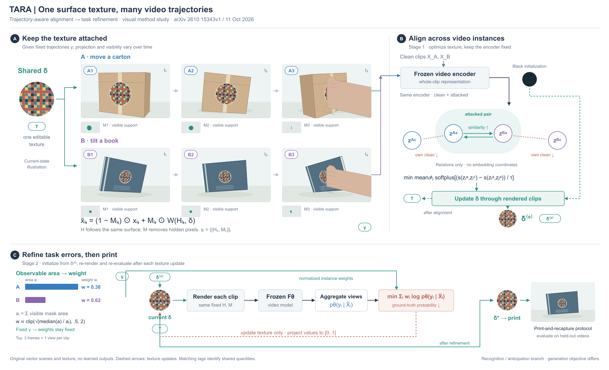
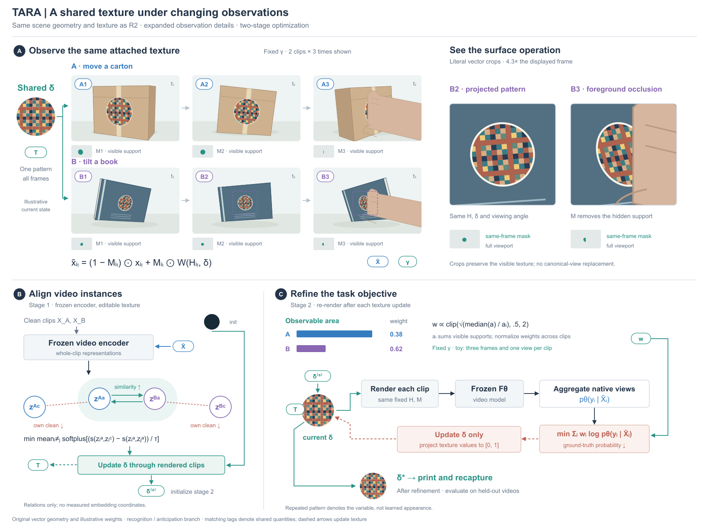

# TARA：分开观察时间与优化时间

[2026-10-11 原论文](https://arxiv.org/html/2610.15343v1)，v1 预印本，PDF 标 Under review。读 §2–3、Eq.1/3–5、附录 A.1/A.6/A.7；实际看 p4 / Figure4。没有运行模型或纹理优化。

## 由视觉入口到新图

比较原图式的连续三阶段与“观察主体 + 对齐关系 + 下方优化回路”，选择后者。借 NORP 的表面承载数据，让同一纹理在固定附着坐标上随箱体/书本姿态变化；借 SmuDPatch 的对象内操作，将纹理连回渲染和评价。没有借人体造型、镜头或球面。此前入口只做人工选型推演，本例实际生成了图稿，但没有用户反馈或质量提升证据。

六个矢量场景由同一物体平面参数化产生。圆形纹理用同一图案定义透视映射，第三帧的遮挡实际裁掉相应支持；缩略 mask 与面积使用同一多边形。完整识别/预判优化在给定轨迹后展开：阶段一对齐，阶段二重新渲染、视频推理与视图聚合、带权任务损失、更新纹理，最后打印/复拍。轨迹标注流水线与生成任务目标留在说明中，不能称为展开全部任务。

特征节点图只表达目标中的相似度关系，非测量散点；其位置不表示余弦值。三帧单视图的原创支持面积算出 A/B 权重约 .383/.617，面积条与权重数字分别编码。重复彩色纹理只标识变量身份，不伪造学习后的外观。黑初始化单独标明，两个阶段都冻结模型。

## 修订与可迁移部分

实际看 R1/R2：第二行标题挤近 mask，阶段交接长线穿说明，面积与权重易混。R2 下移第二行、用 δ⁽⁰⁾ 同名端口交接、分别命名面积和权重；保留同尺寸/同几何。权重线随后移出端口区。下方回路仍长，书本纹理在缩图中较小，匹配标签也有查找成本。

可借用的不是六帧布局，而是两个时间尺度分工：观察轴上的 δ 相同，H/M 改变；优化轴上更新 δ，轨迹固定。空间表示负责附着和遮挡，二维关系负责目标，正视条形负责面积与权重。单次试画不能证明它对所有论文更好。

## R4：细节已有，但总览看不清

比较扩大整个场景与保留总览另开局部，选择后者。六个原场景继续使用同一函数、相机、图案与遮挡定义，显示宽度从270降到250；B2/B3从原场景直接裁切，倍率为总览4.32倍。框出总览中的范围，放大窗口保留斜视、前景遮挡和邻近书本表面，不把canonical纹理拿来充当观察的放大。两个mask仍是同帧完整视口，避免让裁图范围冒充计算范围。面积与权重不变。

阶段一、二改为下方并列；阶段二的前向向右、损失及更新折返，发布从当前纹理旁引出。原来的独立复拍小书本省去，出口仍标打印/复拍及留出视频评价。页宽1840→1640、高1120→1220；总览变小、局部变大，整体更适合近方形页面，但不能说所有信息都获得更大面积。

实际看R3/R4：修第一行标题与副标题挤压、第二行标签与mask距离、发布线穿过current δ标签的问题；初始化改实线，与虚线更新区分。新版更容易看见图案及遮挡，仍有同名端口查找与较长的阶段一初始化线。没有新模型结果、用户审美确认或导出检查。

适合迁移的是“已经有正确细节时，先调整可见尺度”，而不是总要追加两个放大框。若关键差异发生在不同观察之间，局部应保留各自相机；改变视角后就属于另一个解释视图。
