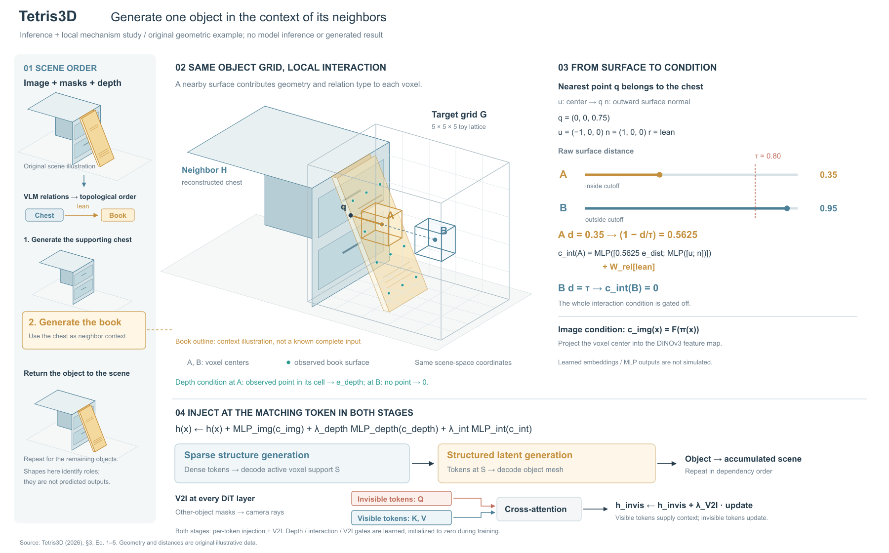
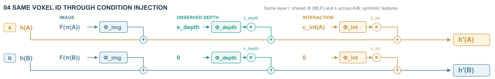

# Tetris3D：让空间条件成为主视觉

## 来源与范围

[Tetris3D v1](https://arxiv.org/html/2610.10539v1)，2026-10-07；已看PDF p3/Fig.2，读§3.2–3.5及Eq.1–5。本图覆盖推理顺序和单对象条件构造，训练数据构造/实验结果不在展开范围。源码 `build_tetris3d.py`，R2为当前稿；数据为 `tetris3d-toy.json`。没有运行模型。

## 构图比较与选择

两种可行组织：A把稀疏结构与结构化潜变量生成各占一半，便于看阶段差异，但会重复条件来源；B用窄总览定位正在生成的对象，大幅场景承担最近表面关系，右侧读距离，下方共享注入规则再接两阶段。采用B，以同一书本、柜体、体素A/B承担解释，不把普通DiT层逐层铺开。

这是上轮原图研究提示的一次实际试用，不是独立盲测或用户认可。主场景确实从完整推理总览中选出一处操作，细节可以按A/B对回空间；右侧与底部仍有较多公式文字，尚不能声称整体视觉质量已达到用户期望。

## 机制和原创算例

柜体坐标范围x=[−1.4,0]，y=[−.85,.85]，z=[0,1.3]；书形薄板从地面斜靠柜顶。R2前侧满足x=.585−.45z，后侧x=.65−.45z，y=±.42，z=[0,1.3]。这是原创示意几何，并非作者对象或模型生成结果。

目标网格为[−.1,1.4]×[−.75,.75]×[0,1.5]，5³格，步长.3。A=(.35,0,.75)、B=(.95,0,.75)，都以柜面q=(0,0,.75)为最近点。原距离.35/.95，截断τ=.8后为.35/.8；方向u=(−1,0,0)，法向n=(1,0,0)，关系lean。A邻近系数.5625；B整项c_int为0，关系embedding也不再相加。不同于只把距离项清零而保留关系项。

人为在书面z=.15/.45/.75/1.05、y=−.3/0/.3取12点，按实际坐标归格。A格(1,2,2)包含点，B格(3,2,2)不含点，因此示意depth条件分别为e_depth与0。完整半透明书轮廓仅帮助识别；它不是已知完整输入，绿色点才表示这组给定部分观测。透明度只用于显示层次，不代表置信度。图中的网格不是实际模型分辨率。

图像条件只给F(π(x))定义，未计算特征或投影掩码；MLP和embedding保留符号。注入规则把图像、depth和interaction分别投影、门控后加到对应token；SS使用dense tokens，SLAT只使用active support。两阶段各自按空间位置对应，不声称分辨率相同。

V2I把其他物体mask射线定义的invisible tokens作Q，visible tokens作K/V，残差更新只作用于invisible。图中以关系图保留此分支，没有运行该场景的可见性划分。三个额外门初始化为0属于训练初始设置，不表示训练后推理时仍为0。

## 实际看图与修订

R1主场景下沿与图例太近，页脚两行相互挤压；书形虽在图注交代，图内仍容易被误读为已知完整输入。R2把主场景上移75单位、完整轮廓降透明并就近标明用途，V2I从两行文字改为Q/K/V短连接，页脚分开。R1的书形底面略悬空、顶部离柜面有隙，R2同时修正接触位置并重新生成表面点；A/B距离不变。这不是纯排版对照。

仍有不足：下方生成过程仍以阶段框收拢，未展示真正去噪或生成状态；右侧空间方向依赖文字坐标，色彩和形体较克制。用完整物体辅助识别存在解释负担，后续可比较只保留部分面片的表达，但不能将未知完整形状作为条件输入。

## 可借的提示

> 空间条件来自邻居时，选同一对象的少量代表位置，在主场景标出位置和最近点，在旁边按同ID读出截断、门控和条件。总览保留该对象的位置与返回出口，重复条件只展开一次，再分别接各消费阶段。辅助完整轮廓与真实观测要可分辨；透视、透明度和物体身份不能替代条件计算。

## R3/R4：同ID条件注入展开

R2的条件注入只是一行完整公式。比较把MLP输出画成数值色带与保留符号、按A/B展开值流，选择后者：没有模型结果，色带会增加无依据的特征值。读取R2 SVG上半部与现有JSON；书形、柜体、网格、点、距离、画布1800×1120全部保持，没有重算数据。

下半部两行是同层的两个体素位置，三列为image/depth/interaction。各自输入经投影及对应标量门，接回同一token的残差加法。图像分支没有额外标量门。同层A/B共享对应MLP与门；不同层可以不同。B的两个条件输入为0，仍进入投影，不能根据c=0推断带偏置的MLP输出为0。特征和更新值均保持符号，不表现收敛或前后大小。

V2I移至右侧下部独立小图，保留Q来自不可见、K/V来自可见及更新目标。两阶段缩成底部流程：dense tokens→decode S→SLAT at S→mesh→scene。两行规则按阶段实际token集合应用，未断言A/B都被S选中。F(π(x))取图像特征的含义移入图注。

实际查看R3/R4，R4放大加号节点，并明确同层共享Φ/λ。两行更容易追踪相加关系，但比公式版占据更多面积，阶段说明被压缩；远处场景与两行仍靠ID对应。颜色分别承担行身份和列类型，需要结合表头读。无新增实验或用户审美反馈。

可迁移：当学习输出未知但运算关系确定，用符号输入、变换、门控和汇合画清值流，不必为了“丰富”填入任意彩色特征条。把置零/选择发生的位置画准确，后续变换不能凭直觉省略。此例改善局部可追踪性，不能据此证明整图已经更美观。
