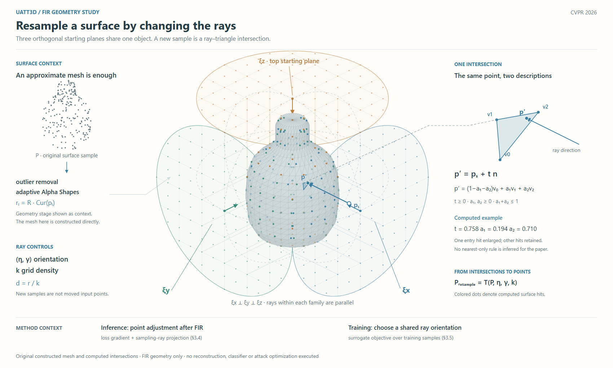
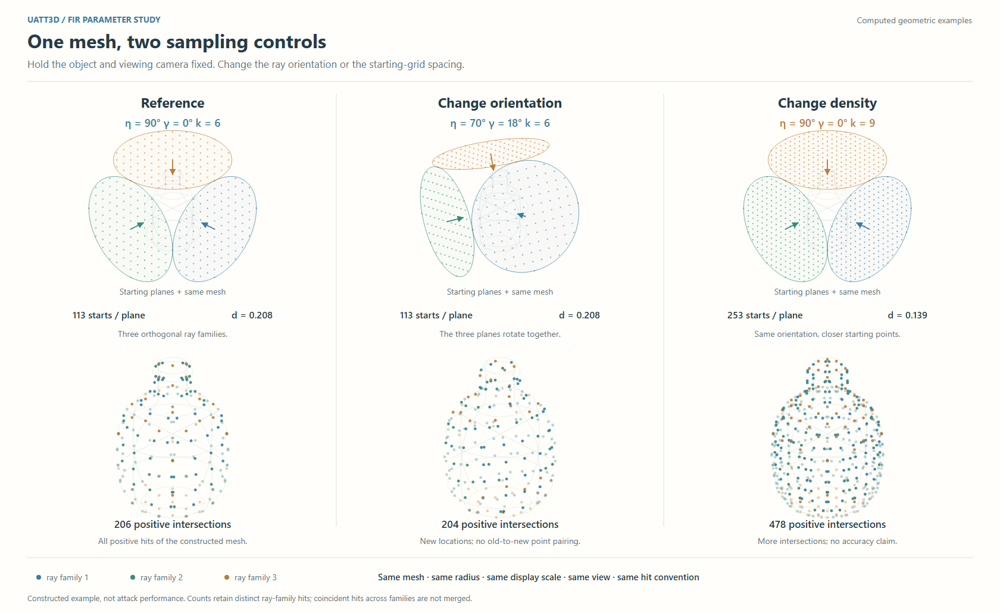

# UAtt3D：让取样几何决定构图

[CVPR2026论文](https://openaccess.thecvf.com/content/CVPR2026/papers/Fan_Good_Can_Sometimes_be_Bad_A_Unified_Attack_against_3D_CVPR_2026_paper.pdf)。实际查看PDF第4页Fig.2–3，阅读§3.1–3.5与Eq.4–11。

## 决定画什么

只展开§3.3 FIR射线取样几何，不把它称为完整攻击总览。左侧保留表面近似的来源，中央三个物理平面围绕同一瓶形网格，右侧放大一个实际相交三角形；底部只定位两种下游用途。与线性流水图相比，正交、相切与平行关系获得主要面积。

原图Fig.2的空间对象值得借鉴，但球、切平面和物体表面必须分清。颜色区分三个射线族，而不是算法阶段或攻击强弱。表面用低对比细网格，构造球用虚线，起点平面用低透明填色与离散点。主射线有箭头，放大引线无箭头。

## 原创实例与边界

构造瓶形网格含1584个三角面；外接球r=1.25，三个轴向切平面，每面圆域内113个均匀起点。实际计算得到206个正向交点，非实验点数。选定一条射线的入射交点满足t≈0.758、a1≈0.194、a2≈0.710，主图与放大图使用同一三角面及投影方向。

这不是网格重建实验：Alpha Shapes与离群点移除只作上下文，网格直接构造；交点计算才是执行过的部分。同一射线的多个交点在此例中全部保留，并合并重合边上的重复，不将绘图约定当成论文通用交点规则。输入点云为同一表面的随机采样，重采样不是把每个旧点移动到新位置。

## 实际看图与修订

R1输入标签太贴散点，放大线终点落空。R2上移输入示意，放大线从主图三角面的v1连到放大图同一v1，避免把p′错误对应到另一个顶点。已查看两稿。

## 可借用的决定

当机制本身就是取样、投影或相交，可让实际几何约束决定构图。一个共享对象配合局部几何解释，常比重复几份对象、用箭头排队更直接。空间复杂度用于关系，普通来源和用途压到外围。

代价是显示投影仍有遮挡，三族射线不能全部同样醒目；本图只强调一条入射线，其余降低对比。R2的角度变化仍只有参数标签；下方参数图补充这一关系。该稿是新的空间构图证据，不等于已经满足用户审美，也不是独立会话迁移评估。

## 参数对照：固定对象与观察，分别改变两个控制项

三列同尺度、同观察相机：参考(η=90°,γ=0°,k=6)，只改朝向(70°,18°,6)，只改密度(90°,0°,9)。起点平面与结果点云上下对齐，颜色始终对应射线族，不画旧点到新点的虚构配对。它补充R2的几何主图，不替代交点公式解释。

实际求交得到206、204、478条正向交点记录；每面起点113、113、253。记录数未跨射线族去重，不能称为去重后的点数或质量指标。旋转时三个面按同一正交标架一起旋转，完整标架的构造是绘图约定，不假定论文未指定的绕法向自由度。

首稿参数文字被平面压住，(60°,40°)让两个平面几乎侧视；修订选(70°,18°)并统一缩小三列的上部示意，使平面方向可辨。观察相机仍相同，没有为了让结果更好而分别旋转点云。已查看修订稿。

可迁移区别：构图比较固定内容以比较读法；参数比较固定输入、其余设置与显示条件，计算或忠实展示变化后的结果。两者不能混称。结果改变时保留真正不变的身份（这里是物体与射线族），不强行保持新采样点的逐点对应。

取舍：并列重复对象适合受控比较，中央共享对象适合解释几何约束。不能将“不用三列”或“只画一个物体”写成审美规则。此图没有实测性能、攻击优化或用户审美确认。
