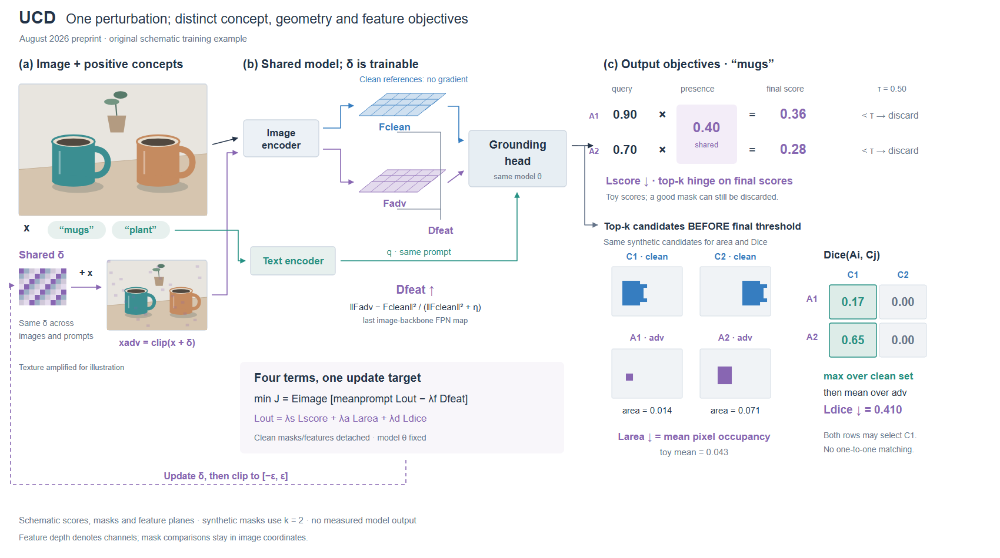
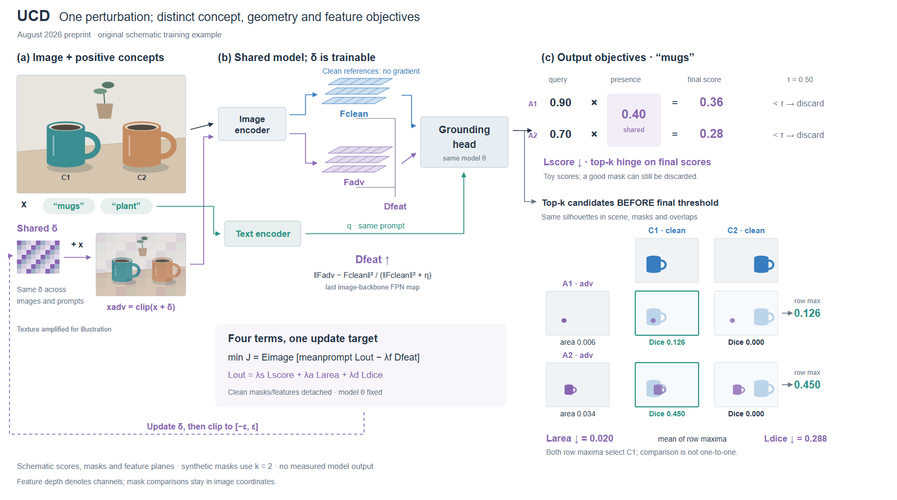

# UCD：多种目标采用不同的可见对象

[论文 v1](https://arxiv.org/html/2608.05983v1)，2026-08 预印本。实际查看 Fig.1 / PDF p3；依据 Methodology Eq.1–12。

## 从原图提取什么

原图以总体架构连接局部失效状态，特征、候选分数与掩码各有表示。新图保留这种分工，改用原创桌面实例、浅层特征片、广播分数表与二维掩码比较矩阵。没有复制原图人物、照片或构图。

## 两个需要实际展开的决定

**不同选择发生在不同位置。** 用两个低于最终阈值的候选演示：它们仍可处于损失的 top-k 集合。因此把 head 的候选分支接到几何计算，不能从最终“保留的 mask”框再接回这些目标。

**集合比较不等于配对。** 原创 Dice 例中，两行的最佳 clean 参照均为 C1。逐行高亮最大值，随后取均值，让读者看见多对一可能性。一个 A1↔C1、A2↔C2 的漂亮匹配图反而会画错。

这一点可迁移到检索、集合监督、最近邻和匹配损失：依据实际的 max/min、索引或分配约束选择连线与矩阵。不要只因输入输出各有两个对象就自动一一对应。

## R1/R2 的实际试画与边界

R1 的局部加号容易被读为 δ 与已修改图相加，R2 改为带 +x 的变换边，并移动穿过文字的更新回线。特征深度仅表示通道，掩码保留正视图像坐标。

分数与二值掩码均为合成示意；面积和 Dice 数值由同一数组计算。示例 top-k=2、η=0，区别于论文软 mask 和设置。桌面图不是模型输入实验，mask 不是该图的精确轮廓，未显示攻击成功。

本图包含四项目标，密度比之前更高，但符号引用较多。下一步应改进同一对象的几何对应或分配视觉重点；不要直接据此宣称复杂图更美。

## R3/R4：同一轮廓同时用于场景、掩码与比较

之前小 mask 只有大致的杯子概念，读者难以沿形状追踪。新变体用同一参数化轮廓定义杯身、杯柄和内孔；场景再加表面颜色、咖啡和阴影。clean 示意掩码复用轮廓，比较格也复用它。阴影与表面装饰不进入物体轮廓。

矩阵列头直接放 clean mask、行头放 adv mask，每格在相同完整图像坐标中叠两者，数值置于格下。读者可以就地看见为什么某格是零、哪一列是最大值。没有将每个对象单独居中或放大，否则会改变位置重叠的含义。

本次更换了合成几何，数值随之重算：在120×84网格中心采样，Dice约为[[0.126,0],[0.450,0]]，均值0.288；区域均值0.020。不能把这次变化当作论文性能变化或与R2同数据的纯版式实验。

R3 汇总值缺少目标名称，R4补回 Ldice；浅层片改用统一投影并增大层间距，让几层可分辨。几何复用减少了跨表示差异，仍有图形较小、四项损失分散的问题。

这个例子只使用理想化的合成 clean 参照，方法并不接收 ground truth，也不假设 clean 预测完美。真实输出应按实际形状绘制；共享坐标和对象 ID，不把预测改成理想轮廓。
