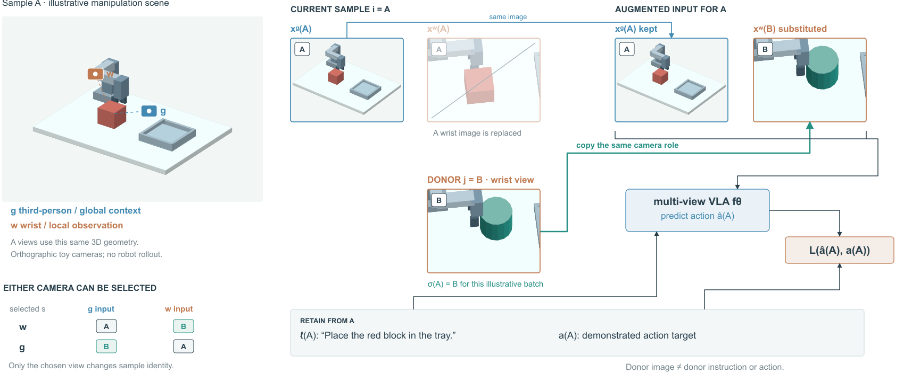
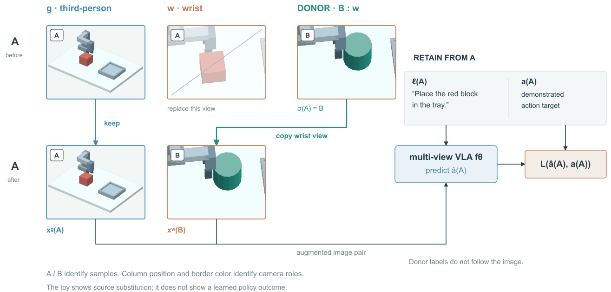

# View Swap：相机角色与样本身份分开

## 依据与展开范围

[Does Adversarial Training Improve Generalization in Multi-View VLAs? Revealing and Mitigating View Collapse](https://arxiv.org/html/2609.33707v1)，2026-09-27。读§3、§5.1/Eq5、Appendix A/G，实际看PDF p6/Fig2和p21/Fig6。Fig2将同一种表面鲁棒性拆成三种解释；Fig6把像素扰动与跨样本错配分开，图像保持相机列，替换后保留另一列。

本图只展开View Swap，底部保留它在组合训练中的位置。随机选择g或w，按批内置换取同角色视图；另一视图、当前语言和动作目标保留。主设置从3,750步SFT出发，后续75%步做AT、25%做Swap；不能画成同一步的连续处理。完整AT优化和泛化结果未展开，不宣称本图证明消除视角依赖。

## 构图选择

读者通过**A/B身份变化、g/w角色保留及独立监督路径**看懂操作。比较两种成立的组织：

- 行列矩阵：样本为行，相机为列，在矩阵上标出置换。便于一般化，但具体图像变化会小。
- 同尺度前后视图，加供体来源：直接看到复制后内容相同、另一视图不变；代价是重复图像和较长的保留路径。

选第二种。空间场景提供相机语境；视图、替换、输入组合和监督采用二维。左下小表补充选择g的另一分支，不把展开w的一例误读成w专用方法。按角色给相机边框着色，A/B字母独立标记样本身份，绿色仅表示复制。

## 原创实例与几何

`build_view_swap.py`用同一组桌面、托盘、机械臂和物体的矢量面生成正交视图。A为红块，B为青色柱体；相机参数保存在`view-swap-toy.json`。A的g视图前后直接重用，供体B的w视图与替换后视图同源，均非论文图像、真实机器人观测或训练输出。

总览相机图标和虚线用于示意观察角色，未校准为图中投影相机外参；不把两根虚线称为视锥或光线追踪。真正生成g/w视图的参数见JSON。示意指令只属于A；动作目标保留符号，避免编造策略结果。

## 看图与修订

R1实际看图发现：供体复制线贴住模型底边；语言输入线穿过说明；大桌面按全局面平均深度排序，错误覆盖红块顶面和部分夹爪。

R2把复制边放在输入与模型之间，输入组合从外侧接模型，移动说明。桌面先绘制、再绘制物体并剔除背面，修复遮挡。保持几何、相机、图幅、视图大小和语义；画面变化含渲染错误修复，不称纯排版对照。

再看R2：来源可追踪，模型接口与复制线分开；但视图组到模型的路线仍长，左侧场景和说明占比偏大。下一次可比较按相机列组织的矩阵，保留全部身份与监督，不急于加更多立体元素。未运行模型、导出检查或审美评分，效果待用户反馈。

## 写回skill的可迁移经验

复制或替换对象时，先拆开**来源身份、接口角色、监督归属**。把改变的属性标在对象上，把保持的约束接到实际输入/损失。只出现一条“swap”箭头不足以说明允许替换什么；供体的标签不能跟随图像自动迁移。

## R4：角色列固定，来源在列内改变

R2的相机角色虽有颜色，但前后两组左右排列，保留g的路径绕过被替换的w，供体复制又绕回输出组。继续比较两种组织：将输入组靠近模型并用同名端口接线；或把相机角色设为固定列、前后状态设为行，供体邻接被替换列。选择后者，位置直接承载g/w的稳定关系，A/B标签承载改变的来源。

`build_view_swap_columns.py`直接读取R2 SVG的原始视图组，复用相同矢量元素，没有重新生成几何或相机。五张视图保持212×158、原色、原裁切，原w(A)保持淡化和划线；场景区从490×350等比缩为400×285.7，画布1800×1100缩为1800×1000。监督移到各自使用者上方：语言接模型、动作目标接损失。底部训练步分支、另一合法选择g、全部来源约束保留。不是只裁掉说明来获得紧凑。

看R3发现汇总括线擦到视图标签，模型输入线穿过“供体标签不跟随图像”的说明；R4把汇总端点放到两个图像底边中部、说明移到路线下方，供体标题补w角色。再看R4，两条局部复制关系与输入汇总可分开追踪。

收益：g保留边变为一条竖线，w复制不经过模型附近，监督分别邻接模型/损失。代价：场景细节缩小；读者要按行读前后状态，再向右读模型，输入汇总仍有一段长水平线。没有用户阅读实验或审美认可，不能由画布减高推断阅读更快。

迁移提示：当角色/接口保持而内容来源变化时，可用固定行列承载稳定属性，把变化放到另一个轴。供体保留自身角色标识，标签与目标是否随之变化仍按方法单独表达。布局轴不是数据维度，不能据此杜撰模型的矩阵运算。
