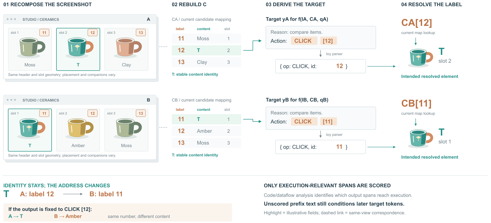
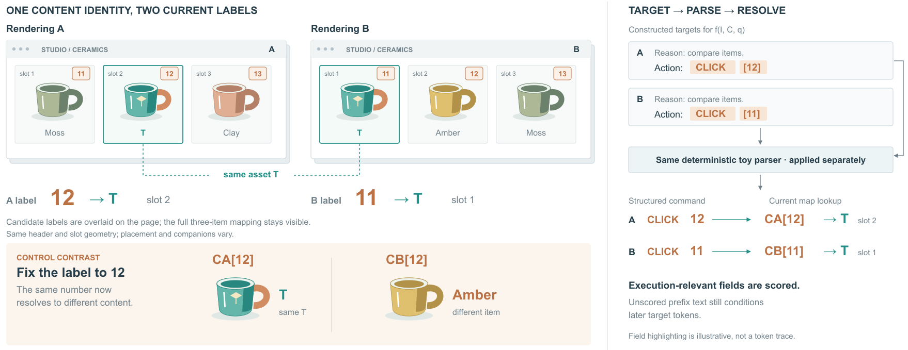

# WebMirage：对象身份与当前地址

## 依据与范围

[Adversarial Images Hijack Web Agents from Visual Grounding to Browser Execution](https://arxiv.org/html/2610.09240v1)，arXiv 2610.09240v1，2026-10-07。读取§2.1、§3、§4.1–4.4、Eq1–11；实际看PDF p5/Fig3和p7/Fig4。图稿展开页面重组—候选映射—动作目标—解析与解析后的元素对应，整体优化/部署仅保留上方定位条。

Fig3用相同商品在不同兼容槽位的页面对比解释变化；Fig4展开原始文本到执行字段的程序链。借它们的具体对象与实际字段，重新组合成两条可追踪实例。没有复制原站界面或作者商品图片。

## 画前选择

阅读任务：读者通过同一杯子的不同位置、当前候选表和动作字段，理解为什么固定内容需要变化的输出编号。参考入口选“同源关系追踪”；不是仅借场景做气氛，也不是独立几何解释例。

两种成立组织：①完整训练架构作为主视觉，页面缩略图放在重组模块内；能覆盖更多算法，但编号变化容易被缩小。②两行对应同一对象在不同页面的状态，各行展开当前映射与解析；选择②，牺牲完整优化细节，突出该局部机制。

2D承担候选表、字段与对应；杯子的曲面、椭圆杯口和侧面提供可识别的具体内容。页面浅边只表示图像载体，不代表特征维度、物理材料或优化阶段。没有为增加立体比例画无依据的网络立方体。

## 原创算例

A: Moss / T / Clay，对应11 / 12 / 13。B: T / Amber / Moss，对应11 / 12 / 13。目标T复用同一个SVG定义；其他物体也按身份复用。示意中编号按槽位给出，这不是对真实智能体编号策略的假定。

由当前表找T的编号，构造目标字符串，再用本地确定性简化解析器提取CLICK和id，再查询当前候选表。A得到12→T，B得到11→T；固定12则B得到Amber。数据写在webmirage-toy.json；不是VLM预测、优化得到的扰动或真实浏览器操作。

候选json保存示意bbox，图面为阅读而保留slot列。bbox与物体身份不同；候选表是当前页面观测的一部分，不能一概认为由截图单独生成。

## 必须保留的区别

- 内容身份T、功能槽位、当前候选label是三个概念。role-slot定义在渲染区域及功能兼容性上，不等于候选ID。
- 重组时对应的候选、输入提示和目标都重建；共享扰动跨页面优化，部署时固定，不按新页面现场重优化。图中扰动只作符号说明。
- 模型原始文字需要后处理，动作编号还需要用当前映射解析。模型输出改变并不等于实际动作成功。
- 论文用静态数据流分析确定执行相关输出范围。图中高亮是原创字段示意，没有运行CodeQL，也不是BPE token位置。分析保守性不在此图展开。
- 只对选择的输出token位置计算损失，不意味着从自回归条件前缀删除其他token。图内单独说明这一点。

## 看图与修改

R1实际观看：对象、表、目标和解析后的杯子能够按行对应；但页面到候选表的箭头容易暗示所有候选由截图提取，且B行绿色连接从表的中部出发，靠近Amber而非选中T。

R2保留数据与排版，把页面—候选表改为虚线对应；目标构造连接准确从T所在行出发，再折到目标字段。局部更准确，折线也增加了少量连线复杂度。看图后没有发现新的遮挡。

剩余限制：这仍是规则的双行对照图，立体感主要来自物体造型；未证明审美或跨领域泛化提升。当前图刻意突出局部，不替代完整优化架构。没有用户审美确认。

## 写回技能

将“保持跨视图ID”改为“保持对象身份和符号；随视图变化的编号或地址根据当前映射重算”。关系追踪必须先确定哪些量应保持、哪些量应变化，不能仅让同色对象使用相同数字。已在本例实际应用，而不是再添加一种固定布局模板。

## R4：页面承担映射，反例形成对比

沿用R2的webmirage-toy.json和SVG物体定义，页面卡片、编号、目标、解析字段与查询结果均保留。两种成立组织：继续保留独立候选表，但把T行集中成中间桥；或用页面已有的编号、名称、槽位承载整个三项映射，去掉独立表，扩大固定编号反例。选择后者，将主视觉放在并排页面与内容差异上。

页面实际尺寸仍为542×230，杯子仍用同一.82比例；不是通过放大页面取得变化。画布由1800×1040缩至1800×950，去掉的是重复表和两套解析器外框。两次解析输入/输出按A、B保留，共用一个操作框表示同一规则分别应用。固定12的反例增加原始T、Amber资产的物体视图，故不是所有显示对象都完全不变的纯排版对照。

看R3发现A输入未明确接入共用解析器；身份虚线穿过页面说明。R4补A独立侧路，确保没有经B输入；两页共同说明移出页内，虚线从T卡片到下部不再压字。大号编号加A/B label提示，区别于C的函数查表表达。实际看R4后把A箭头端点移到框外，避免箭头被框遮住。

本例支持的提示：一个对象视图已经完整承载身份与地址时，可让它兼任映射表，省下重复表示；共用操作框仍保留各输入的独立身份、路径和输出。代价：读者不能再直接按竖直表列扫描，需要在页面卡片中读取三项映射。固定编号反例更直观，但右侧流程字仍多，未得到用户审美或阅读反馈。
